<p align="center">
  
</p>

<h1 align="center">AETHER OS · 以太 OS</h1>

<p align="center">
  <b>三壳终端 · 全场景套件 · Android / iPhone 双端可安装</b><br>
  一个运行在浏览器 / PWA 中的未来科技风概念系统，并可选接入手机内的真实 Linux。
</p>

<p align="center">
  版本 1.1.0 · 构建 2026.11.19 · 纯前端 + Python 标准库桥接 · 无构建步骤 · 无后端依赖
</p>

---

> **一句话认识它**
>
> AETHER OS 不是手机固件，也不是可以刷入手机的自研内核。它是一套可以「安装到主屏幕」的未来科技风 PWA 界面，包含终端、电话、短信、微信、QQ、支付宝、浏览器、文件、办公、代码工作室、地图、备忘录、媒体、相册、相机与设置等 **16 个应用**；在 Android 的 Termux 或 iPhone 的 iSH 中启动本地桥接后，终端既能在 Linux 用户空间中执行命令，也能切换到 **Termux / iSH 主机**直接运行 `pkg`、`termux-*`、`apk` 等命令；代码工作室可以编译、运行并调试 **13 种语言（含 Kotlin / Swift）**。
>
> 电话与短信通过 `tel:` / `sms:` 交给手机系统 App；微信、QQ、支付宝通过官方 URL Scheme 唤起，并可调用系统分享。AETHER 不读取系统短信、通话记录或聊天内容。Wi-Fi / 数据开关仍为**交互模拟**；Android / iOS 的内核、引导链、基带与 App Store / Google Play 生态**不会被修改，也无法被本项目管理**。所有能力边界在本文与[完整说明书](docs/MANUAL.md)中逐项写清。

---

## 目录

- [1. 这个项目解决了什么](#1-这个项目解决了什么)
- [2. 三个必须先讲清的事实](#2-三个必须先讲清的事实)
- [3. 功能总览](#3-功能总览)
- [4. 界面与截图](#4-界面与截图)
- [5. 系统架构](#5-系统架构)
- [6. 真实 / 模拟 / 不可能](#6-真实--模拟--不可能)
- [7. 快速开始](#7-快速开始)
  - [7.1 电脑上静态预览](#71-电脑上静态预览)
  - [7.2 Android：Termux + proot-distro](#72-androidtermux--proot-distro)
  - [7.3 iPhone / iPad：iSH](#73-iphone--ipadish)
  - [7.4 安装为 PWA 应用](#74-安装为-pwa-应用)
- [8. 真 Linux 桥接](#8-真-linux-桥接)
- [9. 终端使用手册](#9-终端使用手册)
- [10. 逐个应用说明](#10-逐个应用说明)
- [11. 项目结构](#11-项目结构)
- [12. 安全设计](#12-安全设计)
- [13. 已知限制与常见问题](#13-已知限制与常见问题)
- [14. 开发与二次开发](#14-开发与二次开发)
- [15. 测试记录](#15-测试记录)
- [16. 版本与更新日志](#16-版本与更新日志)
- [17. 致谢与第三方组件](#17-致谢与第三方组件)
- [18. 许可](#18-许可)

---

## 1. 这个项目解决了什么

很多「手机装 Linux / 双系统 / 三内核」的设想，会在真正落地时撞上签名引导链、驱动、基带与封闭生态。AETHER OS 走的是另一条可验证、可体验、可发布的路线：

1. **把「未来科技风移动系统」做出来**：启动动画、锁屏、桌面、状态栏、应用窗口、转场、主题色与壁纸，全部是真实可交互的界面，不是视频或静态图。
2. **把「Linux 终端」做真**：在 Android 上用 Termux + proot-distro 安装 Ubuntu / Kali；在 iPhone 上用 iSH 运行 Alpine。网页里的终端通过本地 token 鉴权的桥接执行真实命令，而不是只打印假输出。
3. **把「日用套件」做全**：电话、短信、微信、QQ、支付宝、浏览器、文件、办公、代码工作室、地图、备忘录、媒体、相册、相机、设置，共 16 个应用，尽量可用、可演示、可扩展。
4. **把「能力边界」说透**：哪些是真的、哪些是模拟的、哪些技术上不可能，逐项列出，避免用「三内核合并」「全平台兼容」这类无法兑现的承诺误导使用者。

它适合：

- 想体验未来科技风移动 UI 与完整应用生态的概念设计者；
- 想在手机浏览器里拥有一个可安装的「桌面环境 / 仪表盘」的极客；
- 想在 Android / iOS 上快速获得一个带 token 鉴权的本地 Linux Web 终端的安全研究者；
- 想学习「PWA + 本地桥接 + 命令执行安全」完整实现的前端 / 全栈开发者。

---

## 2. 三个必须先讲清的事实

### 2.1 Ubuntu、Kali、deepin 不是三个内核

Linux 内核只有一个。Ubuntu、Kali、deepin 都是在 Linux 内核之上构建的**用户态发行版**（不同软件包、桌面、工具集）。所谓「把 Ubuntu + Kali + deepin 合并成三内核」在技术上不存在对应物。

AETHER OS 的做法是：

- Android：Termux 提供终端与 proot-distro，在本机内核上运行 Ubuntu / Kali 的**用户空间**；如能获得兼容的 deepin rootfs，也可按 proot-distro 自定义 rootfs 的方式导入。
- iPhone / iPad：iSH 在 App 沙盒内模拟 x86 用户态，运行 Alpine Linux；**无法运行 Kali、Ubuntu 的完整 rootfs**，更无法接管 iOS 内核。
- 无论哪种方式，**设备内核、引导链、基带、射频与系统分区都不会被修改**。

### 2.2 无法在零售 Android / iPhone 上启动自研系统

- Android：Boot ROM → XBL → ABL 的安全启动链会校验签名；零售机不允许刷入自编译内核或第三方完整固件。USB 大容量存储启动也不在手机 Boot ROM 的支持范围内。
- iPhone：SecureROM → iBoot 的签名链由 Apple 控制，无法加载自研内核或第三方系统。
- 因此，「把系统装进 U 盘再让手机启动」「给 iPhone 装自研系统」这类目标不是本项目的能力范围，也不在任何第三方应用的能力范围内。

### 2.3 不能复刻 App Store / Google Play 兼容

- AETHER OS 不包含、也不能模拟 Android Runtime、iOS 运行时、Google 服务框架或 App Store 签名与分发体系。
- 它不内置微信 / QQ / 支付宝客户端，也不代理腾讯或支付宝服务；这些页面只负责唤起已安装的官方 App 或调用系统分享。
- 电话、短信页面通过系统 URL Scheme 交接，网页本身不能读取系统通话记录、短信收件箱，也不能确认你是否真正拨出或发送。
- 「从网上下载所有安卓软件并运行」在本项目内不成立。你可以把 AETHER OS 安装到主屏幕，但它的本质是 PWA 应用，不是 Android 系统。
- APK 与 Android 原生游戏同样无法在 AETHER 界面内安装或运行。Android 上最多只能通过系统 Intent 打开一个已安装的 App / 游戏，界面会离开浏览器，且无法枚举全部已安装应用；iOS 不允许这种跳转。

> 这些说明不是功能退让，而是工程诚实。把不可行的部分讲清楚，才能把可行的部分做扎实。

---

## 3. 功能总览

### 3.1 16 个内置应用

| # | 应用 | 能力 | 性质 |
|---|---|---|---|
| 1 | **终端** | Linux / CMD / PowerShell 模拟三壳；真机可切换 Linux 用户空间与 Termux / iSH 主机命令 | 模拟 + 真实（需桥接） |
| 2 | **电话** | 拨号盘、通讯录选择（支持的浏览器）、`tel:` 调起系统电话 | 系统交接（网页不承载通话） |
| 3 | **短信** | 号码 / 正文预填、`sms:` 调起系统短信、复制正文 | 系统交接（不读取收件箱） |
| 4 | **微信** | 唤起官方微信、系统分享、复制草稿 | 原生 App 唤起 |
| 5 | **QQ** | 唤起官方 QQ、系统分享、复制草稿 | 原生 App 唤起 |
| 6 | **支付宝** | 唤起官方支付宝、实验性扫一扫入口、官网回退 | 原生 App 唤起 |
| 7 | **浏览器** | 地址栏、快捷书签、iframe 网页视图、外部打开 | 真实（受站点 CSP / X-Frame-Options 限制） |
| 8 | **文件** | 本机目录授权、手机存储桥接、AETHER 私有空间；上传、新建、查看、重命名/移动、删除、下载 | 真实（系统授权 / 桥接 / OPFS） |
| 9 | **办公** | PDF 查看与页面/文字层编辑；DOCX 预览与逐段编辑；XLSX/XLS/CSV/ODS 表格编辑；PPTX 文字编辑；另存副本 | 真实（本地，PDF-lib / SheetJS / mammoth / JSZip） |
| 10 | **代码工作室** | **13 种语言**：JS、Python、HTML、CSS、C、C++、Java、Kotlin、Swift、Rust、Go、PHP、汇编；逐行 DEBUG、断点与精确行列错误定位 | 浏览器沙盒 + 桥接真实编译 |
| 11 | **地图** | Esri 暗色瓦片、Photon / OSM 搜索、真实 GPS 定位、直线距离 | 真实（需网络与定位权限） |
| 12 | **备忘录** | 新建、编辑、搜索、删除、自动保存 | 真实（本地 localStorage） |
| 13 | **媒体** | 三段 WebAudio 合成音乐、本地音频 / 视频导入播放 | 真实（本地） |
| 14 | **相册** | 系统照片选择器导入并保存副本、桥接扫描手机相册目录、按来源筛选与下载原图 | 真实（系统选择器 / Termux 授权 / iSH 可见目录） |
| 15 | **相机** | 系统相机原始文件通道；取景器连续自动对焦、点按对焦、双指/滑杆变焦 | 真实（系统相机 / MediaDevices） |
| 16 | **设置** | 主题与壁纸、网络概念开关、桥接配置、真实省电模式、安装说明、存储清理 | 混合（省电策略为真实渲染控制） |

> **关于代码工作室的 13 种语言**：JavaScript、Python、HTML、CSS 在浏览器内运行或预览；C、C++、Java、Kotlin、Swift、Rust、Go、PHP、汇编需要本机桥接提供的真实工具链。Kotlin 只编译 JVM 命令行程序，不构建 Android APK；Swift 只编译命令行程序，不构建 iOS App；本系统不包含 Android SDK / Gradle / Xcode。HTML 与 CSS 使用隔离子沙盒预览，不读取令牌；「检查」对标签/括号做基础配对校验，不做完整 W3C 校验。详情见 [10.8](#108-代码工作室)。

### 3.2 系统级能力

- **PWA 安装**：Android Chrome / iOS Safari「添加到主屏幕」，独立窗口运行。
- **离线应用壳**：Service Worker 预缓存界面、字体与图标；断网仍能打开界面与本地应用。
- **双平台更新检查**：启动、回到前台、联网与每 6 小时自动读取 GitHub / GitCode 仓库中的 `version.json`；发现新版本时弹出提示，可自行选择 GitHub 或 GitCode 来源并刷新生效，不需要重新安装 PWA。
- **未来科技风格**：启动动画、锁屏、六边形 X 徽标、粒子、扫描线、霓虹渐变、四套主题色、四套壁纸。
- **状态栏**：信号、Wi-Fi、真实电量（Battery Status API）、时钟；蜂窝代际跟随浏览器 `Network Information API` 报告的真实类型（4G / 5G；不支持时显示「蜂窝」），不再是手动假切换。
- **真实省电模式**：自动 / 开启 / 关闭三档策略，低电量自动触发；开启时暂停粒子、背景动画、模糊与大部分过渡，并停止不必要的渲染循环。
- **流畅度控制**：粒子在打开应用时自动暂停；时钟与网络状态按分钟 / 事件更新，不再每秒重排 DOM；画布 DPR 与粒子数量限制在移动端合理范围。
- **深链接**：`?skip=1&app=terminal|map|notes|files|office|...` 直接打开指定应用，可用于快捷方式与自动化。
- **本地数据**：备忘录、设置、桥接令牌保存在当前浏览器 localStorage；AETHER 空间使用 OPFS；不上传服务器。

---

## 4. 界面与截图

<table>
  <tr>
    <td width="50%">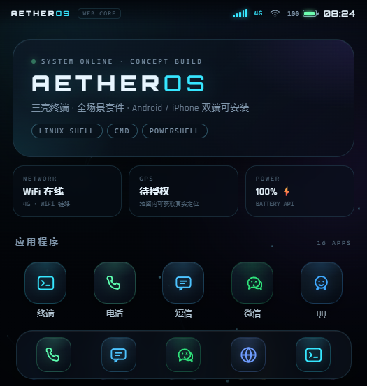<br><sub>桌面：16 个应用、系统卡片与真实状态栏</sub></td>
    <td width="50%">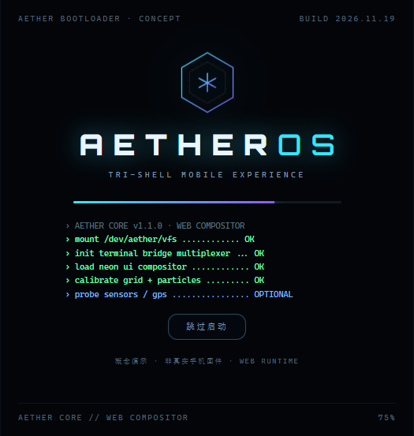<br><sub>启动：引导日志、进度与 X 徽标</sub></td>
  </tr>
  <tr>
    <td>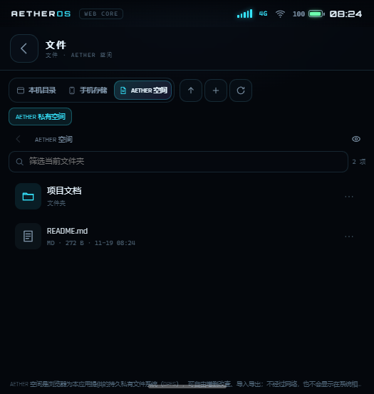<br><sub>文件：本机目录 / 手机存储 / AETHER 空间</sub></td>
    <td>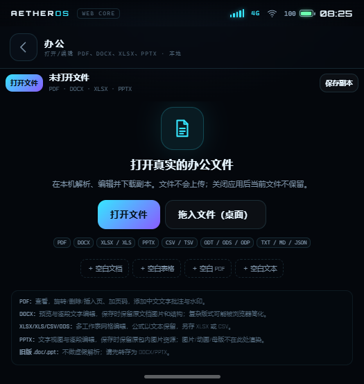<br><sub>办公：PDF / DOCX / XLSX / PPTX 本地打开与编辑</sub></td>
  </tr>
  <tr>
    <td>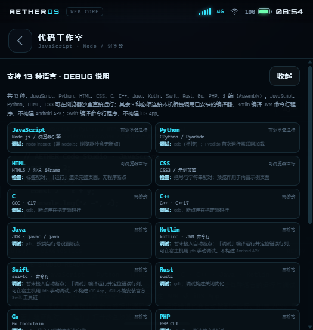<br><sub>代码工作室：13 种语言与 DEBUG 说明</sub></td>
    <td>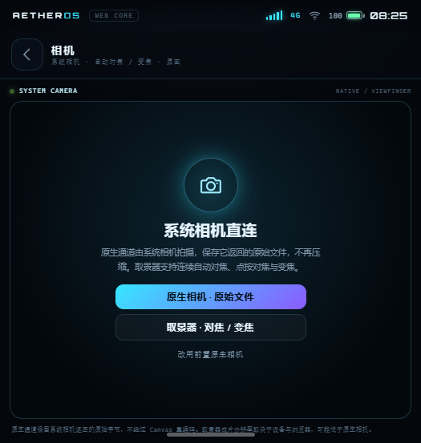<br><sub>相机：系统相机原始文件、自动对焦与变焦</sub></td>
  </tr>
  <tr>
    <td>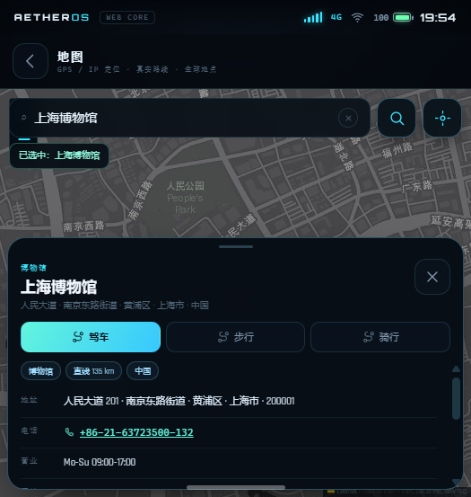<br><sub>地图：真实瓦片、搜索与定位标记</sub></td>
    <td>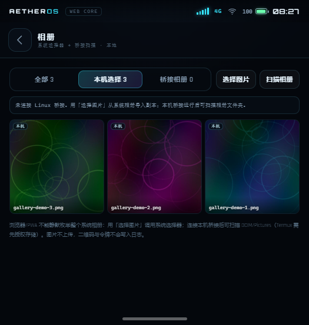<br><sub>相册：系统选择器导入与桥接扫描</sub></td>
  </tr>
  <tr>
    <td><br><sub>终端：三壳模式与欢迎信息</sub></td>
    <td>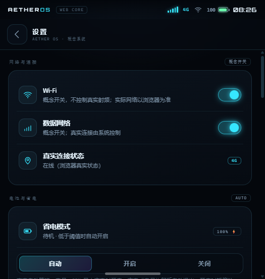<br><sub>设置：真实省电策略与系统信息</sub></td>
  </tr>
</table>

更多截图：[启动与锁屏](docs/shot-lock.png)、[终端帮助](docs/shot-terminal-help.png)、[CMD](docs/shot-terminal-cmd.png)、[PowerShell](docs/shot-terminal-ps.png)、[桥接配置](docs/shot-bridge-setup.png)、[电话](docs/shot-phone.png)、[短信](docs/shot-messages.png)、[微信](docs/shot-wechat.png)、[QQ](docs/shot-qq.png)、[支付宝](docs/shot-alipay.png)、[浏览器](docs/shot-browser.png)、[表格](docs/shot-office-sheet.png)、[备忘录](docs/shot-notes.png)、[媒体](docs/shot-media.png)。

---

## 5. 系统架构

<p align="center">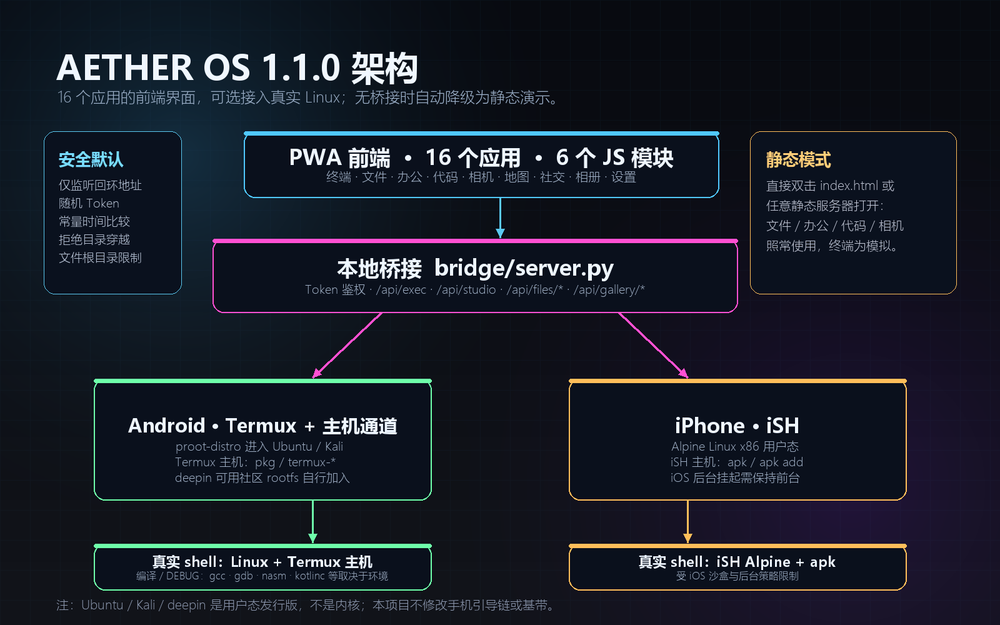</p>

### 5.1 三层结构

1. **界面层（PWA）**
   - `index.html` + `css/` + 6 个原生 JS 文件（`core`、`terminal`、`apps-social`、`apps-tools`、`files`、`office`），无打包器、无 npm 依赖。
   - 应用通过 `Aether.registerApp({ id, name, icon, render })` 注册。
   - Service Worker 缓存应用壳；离线可用，API 与跨域请求不拦截。

2. **桥接层（可选）**
   - `bridge/server.py`：Python 标准库实现，默认监听 `127.0.0.1:8787`。
   - 同一个进程既提供静态界面，也提供受保护的 `/api/exec`、`/api/studio`、`/api/files/*`、`/api/gallery/*`。
   - 仅接受带 `x-aether-token` 的请求；令牌首次启动随机生成，保存在 `bridge/.aether_token`（权限 600，已 gitignore）。

3. **Linux 用户空间层**
   - Android：Termux → `proot-distro login <distro> -- bash -lc <cmd>`，支持已安装的 Ubuntu / Kali，以及通过自定义 rootfs 导入的发行版。
   - Android 主机通道：Termux → `bash -lc <cmd>`，直接执行 `pkg`、`termux-*`、`am` 等 Termux 命令；`termux-*` 需要 Termux:API App 与 `termux-api` 包。
   - iPhone / iPad：iSH → `/bin/sh -lc <cmd>`，运行 Alpine 用户态；iSH 通道同时就是主机通道，可直接使用 `apk` 等命令。
   - 终端顶部 `LINUX` / `TERMUX` / `ISH` 按钮切换执行位置，两个通道分别维护工作目录。
   - 桥接只执行用户主动输入的命令与文件操作；默认只监听回环地址，文件接口受令牌、Host 校验与授权根目录约束。

### 5.2 关键设计

- **同源部署**：桥接同时托管 UI，避免 CORS；也可以把 UI 部署在任意静态站点，只把桥接地址填为 `http://127.0.0.1:8787`。
- **静态降级**：如果当前服务运行在非 Termux / iSH 平台（例如 Windows / macOS 预览），健康检查返回 `mode: "static"`，终端自动停留在模拟模式，不会伪装执行真命令。
- **环境探测**：终端连接面板调用公开的 `/api/health` 获取当前模式与已安装发行版，再要求用户粘贴令牌完成鉴权；令牌错误会在「连接并测试」阶段被拒绝。

---

## 6. 真实 / 模拟 / 不可能

<p align="center">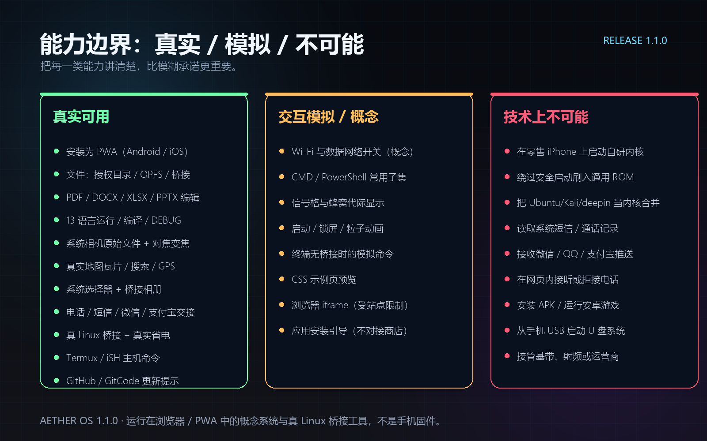</p>

### 6.1 真实可用

- 安装为 PWA（Android Chrome / iOS Safari）。
- JavaScript 与 Python（Pyodide，首次运行需联网加载约十几 MB 运行时）；HTML / CSS 沙盒预览；连接桥接后 C、C++、Java、Kotlin、Swift、Rust、Go、PHP、汇编可真实编译、运行与错误定位（Kotlin / Swift 为命令行程序，暂未接入自动交互断点）。
- 真实地图瓦片、Photon / OpenStreetMap 搜索、GPS 定位（需 HTTPS 或 localhost 与用户授权）。
- 本地音乐合成、本地音视频播放、本地图片查看。
- 备忘录、设置、桥接配置保存在当前浏览器；AETHER 空间使用 OPFS 持久化。
- 文件管理器：系统目录授权（File System Access API）、手机存储桥接、AETHER 空间均可增删改查；桥接单文件上限 64 MB。
- 办公：PDF 页面与叠加文字层编辑、DOCX 逐段编辑、XLSX/XLS/CSV/ODS 表格编辑、PPTX 文字编辑，均另存真实文件。
- 相机：可调用系统拍照界面并保存其返回的原始文件字节；取景器支持真实设备能力范围内的连续/点按对焦与变焦。
- 相册：系统照片选择器导入副本；Termux 授权或 iSH 可见目录下可扫描真实相册文件夹。
- 接入 Termux / iSH 后执行真实 Linux 命令；Android 可切到 Termux 主机运行 `pkg` / `termux-*`，iPhone/iPad 可直接运行 iSH Alpine 命令。主机通道拥有对应 App 用户空间权限，需自行确认命令安全。
- 导出文件到系统下载目录（浏览器下载行为）。
- 真实省电策略：手动三档 + Battery Status API 低电量自动触发，真实暂停动画、模糊与渲染循环。
- 通过 `tel:` / `sms:` 调起系统电话 / 短信 App；通过 `weixin://` / `mqq://` / `alipays://` 唤起已安装的官方 App；通过 Web Share API 调用系统分享。
- 双平台更新检查：并行读取 GitHub 与 GitCode 的公开 `version.json`，发现更高版本时自动提示，可自行选择来源并刷新应用，不需要重装 PWA。

### 6.2 系统交接与浏览器能力

电话、短信、微信、QQ、支付宝页面不是网页内聊天室或支付客户端，也不保存任何演示会话。实际行为如下：

- **电话**：输入号码或从通讯录选择（仅部分 Chrome Android 支持 Contact Picker API），点击绿色按钮交给系统电话 App。
- **短信**：填写号码与可选正文，交给系统短信 App；正文是否预填取决于短信 App 对 `sms:` 参数的实现。
- **微信 / QQ**：只负责唤起官方 App，或把文字交给系统分享面板；网页不能登录账号、读取聊天、选择具体聊天或代发消息。
- **支付宝**：通过 `alipays://` 唤起官方 App；「扫一扫」为实验性 `alipayqr://` 入口，可能随版本失效。网页不能登录、读取余额 / 账单 / 订单、发起支付或代付。
- **不读取系统数据**：浏览器无法读取通话记录、短信收件箱、送达回执、微信 / QQ 聊天内容或支付宝账户数据。
- **不能接收或接听**：PWA 没有来电、短信收件箱、微信 / QQ / 支付宝消息的读取 API，因此无法在 AETHER 内显示新短信、接收聊天消息、接听或拒接来电。Android 原生 App 可通过默认拨号器 / 通知监听做到部分能力，但那需要单独的原生应用与系统权限；iOS 不允许第三方读取这些数据。本项目不放置伪造的「接收消息 / 接听电话」界面。
- **桌面浏览器**：可能打开操作系统的电话 / 短信处理器，也可能没有注册处理器；此时页面会给出提示，可复制号码或正文。
- **平台限制**：iOS Safari 不支持 Contact Picker API；自定义 Scheme 是否跳转取决于官方 App 是否安装及系统策略。

### 6.3 交互模拟

- Wi-Fi / 数据网络开关及其状态栏指示灯。
- 信号格数、启动日志、扫描线、粒子和部分系统提示。
- 电量：支持 Battery Status API 的浏览器读取真实电量与充电状态；不支持的浏览器（如 iOS Safari）显示 `--`，不伪造百分比。省电模式本身是真实的渲染控制，但网页无权调整屏幕亮度、CPU 频率或系统级省电设置。

### 6.4 技术上不可能（本项目不做承诺）

- 在零售 iPhone 上启动自研内核或第三方完整系统。
- 绕过 Android / iOS 安全启动刷入通用 ROM。
- 把 Ubuntu / Kali / deepin 当作三个内核合并。
- 复刻 Google Play / App Store 的运行时、签名与分发体系。
- 在 PWA 内安装 APK、运行 Android 原生应用或游戏；Android 只能交给系统 Intent 打开已安装应用。
- 让浏览器把一个平台的远端文件直接替换进另一个已安装 PWA 的包；更新只能刷新当前安装地址，或由用户重新安装另一来源。
- 在 PWA 内运行真实微信 / QQ / 支付宝原生客户端，或读取其账户、聊天、余额与订单。
- 从手机 USB 启动 U 盘中的系统。
- 接管基带、射频、运营商配置或真实 Wi-Fi / 数据开关。

---

## 7. 快速开始

### 7.1 电脑上静态预览

要求：Python 3.9+（或任意静态服务器）。

```bash
# 进入项目目录
cd aether-os

# 方式 A：直接运行桥接（推荐，Windows / macOS / Linux 均可）
python3 bridge/server.py

# 方式 B：只启动静态服务器（终端为模拟模式）
python3 -m http.server 8787
```

浏览器打开 `http://127.0.0.1:8787`。

- 在电脑上，桥接会以 `static` 模式运行：界面、地图、办公、媒体、备忘录全部可用，终端保持模拟命令。
- 地图定位需要 `localhost` 或 HTTPS；直接双击 `file://` 打开时，Service Worker、定位与安装提示都会受限，建议使用上述服务器。
- 可通过 `http://127.0.0.1:8787/index.html?skip=1` 跳过启动动画，或用 `?skip=1&app=map` 直接打开地图。

### 7.2 Android：Termux + proot-distro

前置条件：

- 从 **F-Droid** 或 Termux GitHub Releases 安装 Termux（Google Play 版本已长期停更，可能缺少 `proot-distro`）。
- 建议预留 2–4 GB 存储空间；Ubuntu + Kali 首次安装需要下载数百 MB。
- Android 7.0 及以上。

步骤：

1. 下载 Release 中的 `aether-os-1.1.0.zip`，解压到用户目录，或直接 `git clone` 本项目。
2. 在 Termux 中准备基础环境：

   ```bash
   pkg update -y
   pkg install -y python unzip
   termux-setup-storage
   ```

3. 进入项目目录并执行准备脚本：

   ```bash
   cd ~/aether-os-1.1.0       # 按实际解压路径调整
   bash bridge/setup-termux.sh
   ```

   脚本会安装 `python`、`proot-distro`，并在缺失时安装 **Ubuntu** 与 **Kali** 用户空间；同时尝试获取 wake lock。

4. 启动桥接：

   ```bash
   python3 bridge/server.py
   ```

   终端会打印：

   - 访问地址：`http://127.0.0.1:8787`
   - 运行模式：`termux`
   - 已安装发行版列表
   - 访问令牌（同时保存在 `bridge/.aether_token`）

5. 在手机浏览器打开 `http://127.0.0.1:8787`，进入「终端」，点右上角「真 Linux」，粘贴令牌，选择发行版，点「连接并测试」。
6. 浏览器菜单选择「添加到主屏幕」，之后可以像普通 App 一样全屏打开。
7. 保持 Termux 存活：下拉通知栏确认 wake lock 已启用；在系统电池设置中把 Termux 设为「不限制 / 允许后台活动」。部分厂商系统仍可能冻结后台进程，此时重新打开 Termux 执行 `python3 bridge/server.py` 即可。

> **可选：deepin**
>
> proot-distro 官方列表不含 deepin。若你自行获得与设备架构兼容的 deepin rootfs，可按 proot-distro 的自定义 rootfs 方式导入，桥接会自动把它列入「已安装」列表供终端选择。本项目不附带 deepin rootfs，也不保证第三方 rootfs 的完整性与合法性。
>
> **可选：更多发行版**
>
> `proot-distro install debian`、`proot-distro install archlinux` 等安装后，重新连接终端即可在发行版下拉框中看到。

### 7.3 iPhone / iPad：iSH

前置条件：

- 从 App Store 安装 **iSH**（x86 用户态模拟器）。
- iSH 运行的是 Alpine Linux，不是 iOS 越狱环境；无法安装 Kali / Ubuntu 的完整 rootfs。
- 建议 iPad 分屏或保持 iSH 前台，避免后台被系统挂起。

步骤：

1. 把项目放入「文件」App，例如 `我的 iPhone/AETHER/aether-os-1.1.0`。
2. 打开 iSH，挂载并进入项目目录（iSH 默认可以访问「文件」中的 iSH 文件夹，也可用 `mount -t ios . /mnt` 挂载其他位置）：

   ```sh
   cd /mnt/aether-os-1.1.0
   ```

3. 准备 Alpine 环境：

   ```sh
   sh bridge/setup-ios-ish.sh
   ```

   脚本会检查 `/etc/alpine-release`、执行 `apk update` 并安装 `python3`。

4. 启动桥接：

   ```sh
   python3 bridge/server.py
   ```

5. 打开 Safari，访问 `http://127.0.0.1:8787`，在终端中连接；或直接在 iSH 中用 `python3 -m http.server` 预览静态界面。
6. 在 Safari 分享菜单选择「添加到主屏幕」。
7. iOS 后台限制：iSH 被切到后台后可能暂停，桥接会随之中断。需要时保持 iSH 前台，或用 iPad 分屏同时显示 iSH 与 Safari。

> iOS 上 `Network Information API` 通常不可用，状态栏会显示「蜂窝」而不是具体 4G/5G；这是浏览器的能力限制，不是系统伪造。

### 7.4 安装为 PWA 应用

**Android Chrome**

1. 用 Chrome 打开 `http://127.0.0.1:8787`。
2. 菜单 →「安装应用」/「添加到主屏幕」。
3. 从主屏幕启动，界面以独立窗口运行。

**iOS Safari**

1. 用 Safari 打开同一地址（必须是 Safari，第三方浏览器不能安装 PWA）。
2. 分享 →「添加到主屏幕」。
3. 从主屏幕启动。

安装后，应用壳与字体在首次加载后被缓存；断网仍可打开桌面、终端（模拟）、备忘录、相册与办公等本地功能。地图瓦片、Photon 搜索、Pyodide 运行时与真实 Linux 命令需要网络或本地桥接。

---

## 8. 真 Linux 桥接

### 8.1 启动与停止

```bash
python3 bridge/server.py
```

- 默认地址：`127.0.0.1:8787`。
- 停止：在运行窗口按 `Ctrl+C`。
- 更换端口：设置环境变量 `AETHER_PORT=9000` 后启动。
- 允许局域网访问（默认关闭，风险自负）：`AETHER_ALLOW_LAN=1 python3 bridge/server.py`。启用后同一 Wi-Fi 下的设备可以访问，务必配合防火墙与可信网络，不要暴露到公网。

### 8.2 令牌

- 首次启动自动生成 32 字符左右的随机令牌（`secrets.token_urlsafe(24)`）。
- 保存在 `bridge/.aether_token`，权限 `0600`；已加入 `.gitignore`，不会随仓库或 Release 分发。
- 如需更换令牌：停止服务，删除 `.aether_token`，重新启动。
- 也可用环境变量 `AETHER_TOKEN` 指定固定令牌（不建议写入脚本或公开位置）。

### 8.3 API

**健康检查（公开，用于探测模式）**

```http
GET /api/health
```

返回示例：

```json
{
  "ok": true,
  "bridge": "aether",
  "version": "1.1.0",
  "mode": "termux",
  "platform": "Linux",
  "installed": ["ubuntu", "kali"],
  "home": "/root",
  "python": "3.12.x",
  "auth": false
}
```

当请求头携带正确令牌时，`auth` 为 `true`；`mode` 可能为 `termux`、`ish` 或 `static`。

**执行命令（需要令牌）**

```http
POST /api/exec
Content-Type: application/json
x-aether-token: <启动时打印的令牌>

{ "cmd": "uname -a", "cwd": "/root", "distro": "ubuntu" }
```

用浏览器控制台或任意脚本调用（示例为 JavaScript，避免依赖 curl）：

```js
const res = await fetch('http://127.0.0.1:8787/api/exec', {
  method: 'POST',
  headers: {
    'content-type': 'application/json',
    'x-aether-token': '<从 bridge/.aether_token 读取的令牌>'
  },
  body: JSON.stringify({ cmd: 'uname -a', cwd: '/root', distro: 'ubuntu' })
});
console.log(await res.json());
```

返回包含 `ok`、`out`（合并后的 stdout + stderr）、`code`、`cwd`（执行后的工作目录）、`ms`、`distro`、`truncated`、`timed_out` 等字段。具体字段以服务实现为准。

其余需要令牌的接口（细节与字段以 `bridge/` 源码为准）：

| 接口 | 用途 |
|---|---|
| `POST /api/studio` | 代码工作室的健康探测、编译、运行与 DEBUG；只允许白名单语言。 |
| `GET /api/files/roots` | 列出桥接可见的存储根目录。 |
| `GET /api/files/list` | 列出目录内容。 |
| `GET /api/files/read` | 读取文件（64 MB 上限）。 |
| `POST /api/files/write` | 写入文件（原子写入，路径限定在已配置根内）。 |
| `POST /api/files/mkdir` / `rename` / `delete` | 新建目录、重命名/移动、删除。 |
| `GET /api/gallery/list` | 扫描相册目录（Termux / iSH 可见范围内）。 |
| `GET /api/gallery/file` | 读取相册中的指定图片。 |

### 8.4 安全护栏

- 仅绑定 `127.0.0.1`（除非显式开启局域网）。
- 请求体大小上限、命令超时 25 秒、输出头尾截断（防止大输出拖垮浏览器）。
- 最多 2 个并发命令。
- 校验 Host 头，阻止 DNS rebinding 类型的跨站访问。
- 静态文件服务拒绝 `..` 与点文件，避免读取 `.aether_token`。
- 令牌使用常量时间比较，减少时序侧信道。
- 桥接不会主动访问互联网、不会上传命令输出。

这些措施降低风险，但**不是完整沙盒**：终端执行的是你本人手机用户空间内的命令，拥有该用户空间的权限。不要粘贴来源不明的命令，不要在启用局域网时使用弱令牌。

---

## 9. 终端使用手册

### 9.1 三种 Shell 模式

终端顶部可切换：

- **Linux / bash**：模拟模式提供 `ls`、`cd`、`cat`、`grep`、`echo`、`calc`、`whoami`、`uname -a`、`neofetch`、`ping`、`nmap` 等命令；连接真 Linux 后执行真实命令。
- **CMD**：模拟 `dir`、`cd`、`cls`、`type`、`echo`、`ver`、`ipconfig`、`systeminfo`、`tasklist` 等。
- **PowerShell**：模拟 `Get-ChildItem`、`Get-Location`、`Set-Location`、`Get-Content`、`Get-Date`、`Get-Process`、`Get-Command`、`Write-Output`、`Clear-Host` 等。

连接真机桥接后，顶部切换组会变成两个通道：

- **LINUX**：Ubuntu / Kali / Alpine 用户空间，使用 `apt`、`apk` 或发行版自带工具；
- **TERMUX / ISH**：Android 直接执行 Termux 主机命令（`pkg install`、`termux-battery-status`、`termux-toast`、`am start` 等）；iPhone / iPad 直接执行 iSH 的 Alpine 命令（`apk update`、`apk add` 等）。`termux-*` 需要安装 Termux:API App 与 `termux-api` 包。

> Windows 命令是交互模拟，不是真实 Windows 二进制。需要运行真实 Windows 程序时，请使用 Windows 电脑或远程桌面；桥接执行的是 Linux 用户空间命令。

### 9.2 常用操作

| 操作 | 说明 |
|---|---|
| 输入 `help` | 查看当前 Shell 可用命令 |
| `open map` / `open terminal` | 从终端启动应用 |
| `shell bash` / `shell cmd` / `shell pwsh` | 切换 Shell 模式 |
| `clear` / `cls` | 清屏 |
| `history` | 查看历史命令 |
| 点击「真 Linux」 | 配置桥接地址、令牌和发行版 |
| 点击「返回模拟」 | 断开真实模式，回到模拟命令 |

### 9.3 在真 Linux 中执行

连接成功后，提示符会变成 `aether@ubuntu:~$`（或对应发行版），直接输入命令即可：

```bash
uname -a
cat /etc/os-release
ls -la
python3 --version
gcc --version
```

点顶部 **TERMUX**（Android）后，提示符变为 `termux@termux:~$`，命令直接在 Termux 主机执行：

```bash
pkg update
pkg install termux-api
termux-battery-status
termux-toast "hello from AETHER"
termux-open --content-type image /sdcard/DCIM/photo.jpg
```

`termux-*` 命令需要安装 Termux:API App；访问共享存储前先运行 `termux-setup-storage`。

iPhone / iPad 点 **ISH** 后，提示符变为 `ish@alpine:~$`，命令直接在 iSH 的 Alpine 中执行：

```bash
apk update
apk add curl git python3
uname -a
```

能执行哪些命令，取决于对应 rootfs / Termux / iSH 中安装的软件包。需要编译器时，在 Termux 的 proot 环境中安装：

```bash
proot-distro login ubuntu
apt update && apt install -y build-essential gdb python3
```

汇编、C/C++ 的编译与调试依赖所安装的 `gcc` / `gdb` / `nasm` 等工具；AETHER OS 本身不内置这些工具链。

---

## 10. 逐个应用说明

### 10.1 终端
见第 9 节。支持模拟三壳与真实 Linux；连接状态、发行版与 cwd 会保留在本地存储中。

### 10.2 电话
- 输入号码，或点击「从通讯录选择」调用 Contact Picker（Chrome Android 等支持的浏览器；其他浏览器会提示不支持）。
- 点击绿色按钮后用 `tel:` 链接交给系统电话 App；AETHER 不承载通话，也没有模拟通话覆盖层。
- 可复制号码，方便没有注册 `tel:` 处理器的桌面浏览器。
- 不读取系统通话记录、SIM 卡或运营商信息；通话、录音、双卡与挂断均由系统 App 管理。

### 10.3 短信
- 输入或从通讯录选择号码，填写可选正文，点击「打开系统短信并预填」。
- 通过 `sms:` 链接交给系统短信 App。iOS 与 Android 的正文参数写法不同，部分短信 App 可能只预填号码。
- 可复制正文，在系统短信 App 中手动粘贴。
- 不读取系统收件箱、发送记录或送达回执；不保存任何会话到 localStorage。

### 10.4 微信 / QQ
- 微信使用 `weixin://`、QQ 使用 `mqq://` 唤起已安装的官方 App；未安装时提供官网入口。
- 可以在输入框写下文字，调用系统分享面板交给微信 / QQ，或复制草稿。
- 网页无法登录、读取聊天记录、选择具体聊天或代发消息；不包含朋友圈、支付、语音 / 视频通话等平台能力。
- AETHER 不是微信 / QQ 客户端，也不连接腾讯服务。旧版中的演示会话与自动回复已全部移除。

### 10.5 支付宝
- 通过 `alipays://` 唤起已安装的官方支付宝 App；未安装时提供 [官网](https://www.alipay.com/) 入口。
- 「尝试打开扫一扫」使用 `alipayqr://platformapi/startapp?saId=10000007`，属于实验性快捷入口，可能随支付宝版本失效。
- 打开后可使用扫一扫、付款码、收款码、转账、账单与出行；这些操作全部由支付宝 App 完成。
- 网页不能登录支付宝，不能读取余额、账单、订单或支付结果，不能发起支付、代付或确认支付状态。
- AETHER 不是支付宝客户端，也不连接支付宝或蚂蚁集团服务。

### 10.6 浏览器
- 输入网址或关键词，Bing 搜索兜底。
- iframe 视图受目标站点 `X-Frame-Options` / CSP 限制，空白属于正常现象。
- 右上角「在系统浏览器中打开」可跳出 iframe 限制。
- 不提供广告拦截、密码管理或下载管理器。

### 10.7 办公
- **PDF**：浏览器内置查看器预览；可旋转页面、删除 / 插入空白页、加页码、添加中文文字批注与水印。PDF 正文的原生文字排版不可在浏览器内重排；这是格式限制，不做假编辑。
- **DOCX**：读取 OOXML，预览正文；逐段修改文字后另存 `.docx`，保存时保留原包中的图片与未修改结构；复杂版式可能被简化。
- **XLSX / XLS / CSV / TSV / ODS**：多工作表网格编辑，公式以文本保留；可另存 `.xlsx` 或 `.csv`。
- **PPTX**：文字视图与逐段编辑，另存 `.pptx`，保留包内图片资源；图片、动画与母版不在本应用内渲染。
- **TXT / MD / JSON / XML / HTML / CSS / JS / 日志**：纯文本查看与编辑。
- 支持从文件管理器把文件交给办公打开，也支持拖放（桌面浏览器）。
- 旧版 `.doc` / `.ppt` 不做虚假解析，会提示先转存为 DOCX / PPTX。
- 本地编辑，不上传；保存通过浏览器下载生成副本，不覆盖系统原文件。

### 10.8 代码工作室

**13 种语言，两种运行位置：**

| 语言 | 浏览器内 | 本机桥接 | 调试方式 |
|---|---|---|---|
| JavaScript | 沙盒执行 | Node 执行 | 桥接 + Node inspect |
| Python | Pyodide（首次联网约十几 MB） | CPython | 桥接 + pdb |
| HTML | 沙盒 iframe 预览 | — | 「检查」：标签/括号基础配对 |
| CSS | 内置示例页预览 | — | 「检查」：括号/字符串基础语法 |
| C | — | GCC（C17） | 桥接 + gdb |
| C++ | — | G++（C++17） | 桥接 + gdb |
| Java | — | javac / java | 桥接 + jdb |
| Kotlin | — | kotlinc + JVM | 编译运行与错误定位；交互断点需手动 jdb，不构建 APK |
| Swift | — | swiftc | 编译运行与错误定位；交互断点需手动 lldb，不构建 iOS App |
| Rust | — | rustc | 桥接 + gdb |
| Go | — | Go toolchain | 桥接 + gdb |
| PHP | — | PHP CLI | 桥接 + phpdbg |
| Assembly | — | NASM x86-64 或 GNU as/ld | 桥接 + gdb（受目标文件行信息限制） |

**DEBUG 用来做什么：**

1. 在左侧行号栏设定断点行，再点「调试」；程序会在真实 debugger 中启动并停在断点处（Python `pdb`、JS `node inspect`、Java `jdb`、PHP `phpdbg`、C/C++/Rust/Go/汇编 `gdb`）。
2. 编译错误、运行时错误、异常栈会被桥接解析成统一的 `{line, column, severity, message, file}` 诊断；面板显示「第 N 行 第 M 列」并标红对应行，点击诊断即可跳到源码位置，而不是只给一段模糊堆栈。
3. 若某个语言/平台缺少对应 debugger，界面会说明改成了直接运行或仅解析编译器输出，不会假装已经断点暂停。
4. HTML/CSS 没有可执行断点，按钮会变为「检查」：只做标签闭合、括号与字符串的基础校验，并给出精确行列；不冒充完整 W3C 校验器。预览运行在 `sandbox="allow-scripts"` 的隔离 iframe 中，不读取桥接令牌。

原生语言必须在设置/终端中连接本机桥接；桥接会按白名单调用系统工具链，并把编译诊断和工作目录限制在临时目录内。工具链本身需要你在 Termux / iSH / Windows 上预先安装，详见 `bridge/studio.py` 的 `TOOL_HINTS`。Kotlin 需要 `kotlinc` 与 JDK，Swift 需要官方 `swiftc`；iSH 不能安装官方 Swift 工具链，Android 上也没有 Android SDK / Gradle，因此这里不能生成 APK 或 iOS App。

### 10.9 地图
- 瓦片：Esri Dark Gray Canvas（无需 API Key；遵循 Esri 使用条款）。
- 搜索：Photon 优先，Nominatim 兜底，12 秒超时。
- 定位：调用浏览器 Geolocation API；需要授权与安全上下文（HTTPS / localhost）。
- 选中结果后放置标记；若已定位，绘制到目标的**直线**并显示距离，**不是**转向级导航。
- 需要网络加载瓦片与搜索；离线时只显示已缓存瓦片。

### 10.10 备忘录
- 新建、编辑、搜索、删除。
- 输入后 400 ms 自动保存到 localStorage，关闭应用后仍保留。
- 清除浏览器数据会删除全部备忘录；设置页提供「清除本地数据」按钮。

### 10.11 媒体
- 三段由 WebAudio 实时合成的氛围音乐（不是真实曲目）。
- 导入本地音频（mp3 / m4a / wav / ogg）真实播放；文件不会上传。
- 导入本地视频（mp4 / webm / mov），能否播放取决于浏览器与系统的解码能力。
- 移动端 Safari 对部分容器 / 编码支持有限。

### 10.12 相册
- 浏览器 / PWA 不能静默枚举整个系统相册，这是平台安全边界。
- 「选择图片」调用系统照片选择器，把用户主动选择的图片复制到浏览器 IndexedDB；不上传。
- 连接本机桥接后可扫描 `DCIM` / `Pictures` 等相册目录：Termux 需要先执行 `termux-setup-storage` 并把照片目录授权给 Termux；iSH 只能扫描它可见的挂载目录。
- 缩略图按需生成，滚动到可见区域才读取原图；大相册使用分页加载。
- 支持按「本机选择 / 桥接相册」筛选、全屏查看与下载原图。
- 相册不会写入系统相册，也不会删除你的原始照片。

### 10.13 设置
- 主题色：青 / 洋红 / 青柠 / 琥珀。
- 壁纸：极光、星云、网格、深空。
- Wi-Fi / 数据网络：概念开关，只影响界面状态，不控制真实射频。
- 真实连接状态：读取浏览器 `navigator.onLine` 与 `Network Information API`。
- **真实省电模式**：自动 / 开启 / 关闭。自动策略读取 Battery Status API：电量 ≤20% 且未充电时开启，充电或电量恢复后退出；手动策略立即生效。开启时暂停粒子、背景动画、模糊与过渡，并停止不必要的渲染循环。浏览器无权调整屏幕亮度或 CPU 频率，界面不会冒充系统级省电。
- 桥接配置：入口在终端「真 Linux」面板；设置页提供说明、检测与部署提示。
- 存储与数据：显示 localStorage 用量，一键清除。
- 能力边界：内置透明说明。

### 10.14 文件
- **本机目录**：使用 File System Access API 打开系统目录选择器，用户授权后可增删改查真实文件；目录句柄保存在 IndexedDB，下次需重新确认权限。
- **手机存储**：通过 Termux / iSH 桥接读写共享存储或用户目录；Android 需 `termux-setup-storage`，iOS 受 iSH 沙盒可见范围限制。
- **AETHER 空间**：浏览器私有 OPFS，持久保存，可导入导出、新建文件夹/文本、重命名、移动、删除。
- 支持上传、下载、重命名 / 移动、删除、文本编辑、图片预览、PDF 预览和交给办公打开。
- 安全限制：拒绝目录穿越与受保护文件名，桥接写入使用原子替换；桥接单文件上限 64 MB；网页无法绕过系统授权访问任意路径。
- 不支持解压压缩包、批量同步或后台文件监控。

### 10.15 相机
- **原生相机通道**：通过系统图片捕获入口 `capture="environment"` / `capture="user"` 调起手机原生相机，用户拍完后直接保存相机返回的原始文件字节，不再二次压缩或转码。最终分辨率、HDR、夜景算法与画质由手机系统相机决定，网页无法强制等同系统相机 App 的完整处理流程。
- **取景器模式**：`getUserMedia` 实时取景；设备支持时启用连续自动对焦与点按对焦；支持双指捏合和滑杆变焦，变焦范围来自设备 `MediaTrackCapabilities`，不支持时明确显示「变焦不可用」。
- 取景器拍照走 Canvas 编码，属于浏览器重编码路径；追求原始画质请使用「原生相机 · 原始文件」。
- 相机画面与照片仅在本机处理，不上传；权限被拒绝时会显示明确提示。

---

## 11. 项目结构

```text
aether-os/
├─ index.html                 # 入口、启动屏、锁屏、状态栏、桌面容器
├─ manifest.webmanifest       # PWA 清单（名称、图标、快捷方式）
├─ version.json               # 双平台更新清单（版本、构建、说明、发布页）
├─ sw.js                      # Service Worker：应用壳缓存与离线回退
├─ css/
│  ├─ fonts.css               # 本地字体 @font-face
│  ├─ style.css               # 系统界面、代码工作室、相机、省电模式
│  ├─ files.css               # 文件管理器
│  └─ office.css              # 办公套件
├─ js/
│  ├─ core.js                 # 系统内核：注册、窗口、桌面、主题、网络、电池、省电、更新检查
│  ├─ terminal.js             # 三壳终端 + 真 Linux 桥接客户端
│  ├─ apps-social.js          # 电话、短信、微信、QQ、支付宝
│  ├─ apps-tools.js           # 代码、地图、媒体、相册、相机、备忘录、浏览器、设置
│  ├─ files.js                # 文件管理器：本机目录 / 桥接 / OPFS
│  └─ office.js               # PDF / DOCX / XLSX / PPTX / CSV / 文本
├─ bridge/
│  ├─ server.py               # Python 标准库桥接 / 静态服务器
│  ├─ studio.py               # 代码工作室：13 语言编译、运行、DEBUG
│  ├─ files.py                # 文件 API 与路径安全
│  ├─ gallery.py              # 相册扫描与图片读取
│  ├─ setup-termux.sh         # Android Termux 一键准备
│  ├─ setup-ios-ish.sh        # iOS iSH 准备
│  └─ .aether_token           # 运行时生成，已 gitignore，不随项目分发
├─ vendor/                    # 本地办公库：pdf-lib / SheetJS / mammoth / JSZip
├─ fonts/                     # Orbitron / Rajdhani（SIL OFL 1.1）与许可证
├─ icons/                     # X 徽标：SVG + 192/512/1024 PNG + maskable
├─ docs/                      # 说明书、截图、架构图、发布说明
├─ release/                   # 发布压缩包与 SHA256SUMS（不进入 git）
├─ tools/
│  └─ make_intro_images.py    # 生成 docs/intro-*.png 的脚本
├─ LICENSE                    # MIT
└─ README.md
```

---

## 12. 安全设计

1. **默认回环**：桥接只监听 `127.0.0.1`。手机上的其他设备无法访问；除非显式设置 `AETHER_ALLOW_LAN=1`。
2. **随机令牌**：首次启动生成，不硬编码；支持环境变量覆盖；文件权限 600。
3. **常量时间比较**：`hmac.compare_digest` 验证令牌。
4. **Host 校验**：拒绝非 localhost / 非配置主机的请求，降低 DNS rebinding 风险。
5. **路径保护**：文件 API 拒绝目录穿越、受保护文件名和越界路径，检查符号链接；静态文件服务拒绝 `..` 和点文件，避免泄露令牌与源码配置。
6. **资源上限**：请求体大小限制、命令超时、输出头尾截断、最多 2 个并发命令；文件读写上限 64 MB。
7. **代码工具链**：`/api/studio` 只接受白名单语言与操作，编译运行在临时目录；不执行用户提供的任意 shell 字符串。
8. **不做的事**：不监听公网、不主动连接远程服务器、不收集遥测、不读取短信 / 通话记录 / 第三方聊天数据。
9. **用户责任**：真 Linux 模式下你拥有 Termux / iSH 用户空间的权限；不要执行来源不明的脚本；文件桥接会真实写入你授权的目录，删除操作不可撤销；不要在公共 Wi-Fi 下开启局域网访问。

PWA 前端没有后端账号体系，所有数据在浏览器本地。清除站点数据会删除备忘录、设置与桥接令牌。

---

## 13. 已知限制与常见问题

### Q1：为什么不直接做一个可安装的 Android ROM / iOS 系统？
因为签名引导链、驱动、基带与硬件抽象层由厂商控制，第三方无法在零售设备上安装自编译内核。能做的是 PWA、Termux / iSH 用户空间与本地桥接。

### Q2：能运行真实的微信、QQ、抖音、原神吗？
不能。它们是原生应用，依赖 Android / iOS 运行时与平台服务。AETHER OS 的微信 / QQ 页面只会唤起已安装的官方 App，或调用系统分享；不包含聊天客户端。

### Q3：能从 Google Play / App Store 下载应用，或安装安卓游戏吗？
不能。AETHER OS 没有应用商店兼容层，也不会绕过平台签名与分发体系。PWA 无法安装 APK 或运行 Android 原生游戏；Android 上最多由系统 Intent 打开已安装应用，iOS 不允许此类跳转。

### Q4：能打电话、发短信、开关 Wi-Fi / 数据吗？
电话与短信可以**交给系统 App**：AETHER 使用 `tel:` / `sms:` 发起跳转，实际拨号与发送由手机系统完成。网页不能读取通话记录或短信收件箱，也无法确认是否真正拨出 / 发送。Wi-Fi / 数据开关仍是界面模拟，真实射频由系统控制。

### Q4.1：能接收短信、微信 / QQ / 支付宝消息，或接听来电吗？
不能。浏览器 / PWA 没有读取系统短信收件箱、来电状态、微信 / QQ / 支付宝聊天数据的 API，也不能接听或拒接电话。Android 需要默认拨号器或通知监听等原生权限，iOS 则不允许第三方读取这些数据。本项目不提供伪造的「新消息」或「来电接听」界面；唯一真实的路径是已实现的系统 App 交接。

### Q5：地图为什么有时没有结果？
搜索依赖 Photon / Nominatim 第三方服务，可能受网络、地区或服务限流影响。已做 12 秒超时与 Nominatim 兜底；失败时会显示提示。瓦片来自 Esri，需要网络。

### Q6：Python 第一次运行很久 / 失败？
Pyodide 首次运行需要从 CDN 下载十几 MB 运行时。网络受限时会较慢或失败；可以稍后重试，或改用真 Linux 中的 Python。加载成功后浏览器会缓存运行时。

### Q7：iOS 上为什么状态栏显示「蜂窝」而不是 5G？
iOS Safari 不提供 `Network Information API`，无法读取真实蜂窝代际。Android Chrome 支持时显示 4G / 5G。AETHER OS 不会伪造。

### Q8：真 Linux 连接失败怎么办？
1）确认 Termux / iSH 中的 `python3 bridge/server.py` 仍在运行；2）确认地址是 `http://127.0.0.1:8787`；3）确认令牌从启动输出或 `bridge/.aether_token` 复制完整；4）确认已安装至少一个发行版（设置面板会探测）；5）iOS 检查 iSH 是否被后台挂起。

### Q9：为什么网页里的浏览器打不开某些网站？
目标站点通过 `X-Frame-Options` / CSP 禁止被嵌入，这是浏览器安全策略，不是本项目可以绕过的。可点右上角用系统浏览器打开。

### Q10：如何更新？
设置页「系统更新」会自动检查 GitHub / GitCode 的 `version.json`，也可手动检查；选择来源后点「刷新到新版本」即可，不需要重装 PWA。更新会清空旧缓存并重新加载当前安装地址：若应用部署在对应平台的 Pages，就直接取得该平台的新版本；若通过本地桥接运行，仍需先把新文件放进本地项目目录，刷新只负责应用新文件与缓存。

维护者发布新版本时，除了提升界面版本、`sw.js` 的 `VERSION`，还要在两平台的 `version.json` 写入更高的 `version` 与发布说明。Release 提供完整 zip 与 SHA256 校验值。浏览器不能把一个平台的远端文件直接替换到另一个已安装 PWA 的包内，这是平台边界。

### Q11：会不会上传我的数据？
不会。项目没有遥测、账号或上传接口。地图搜索会将关键词发送给 Photon / Nominatim；瓦片请求发送给 Esri；Pyodide 从 CDN 加载；此外没有外部请求。

### Q12：为什么叫「三壳」而不是「三内核」？
「三壳」指 Linux / CMD / PowerShell 三种 Shell 交互模式。项目明确不宣称三内核，因为 Ubuntu / Kali / deepin 是用户态发行版，不是三个内核。

---

## 14. 开发与二次开发

### 14.1 无构建步骤

所有 JS 为原生 ES2019+，直接由浏览器执行：

```bash
python3 bridge/server.py     # 或 python3 -m http.server 8787
```

修改文件后刷新即可。若 Service Worker 缓存了旧文件，提升 `sw.js` 的 `VERSION`，或注销 SW 后刷新。

### 14.2 添加一个应用

在 `js/apps-tools.js`（或新文件，记得在 `index.html` 中 defer 引入）注册：

```js
Aether.registerApp({
  id: 'hello',
  name: '你好',
  sub: 'HELLO WORLD',
  icon: 'spark',          // 使用内置图标名
  accent: '#36e6ff',
  order: 200,
  render(root, api) {
    root.innerHTML = '<div class="card">Hello, AETHER.</div>';
    api.setSub('本地演示应用');
    api.onClose(() => { /* 清理音频、定时器等 */ });
  }
});
```

`api` 提供 `setSub`、`toast`、`onClose`、`addAction` 等方法；图标集合见 `js/core.js` 的 `ICONS`。

### 14.3 修改主题

- 主题色：`css/style.css` 中的 CSS 变量与 `body[data-accent]`。
- 壁纸：`body[data-wall]` 与 `.wall-*` 规则。
- 字体：`css/fonts.css` 与 `fonts/`。

### 14.4 修改桥接

`bridge/server.py` 仅依赖 Python 标准库。改动后运行：

```bash
python3 -m py_compile bridge/server.py bridge/studio.py bridge/files.py bridge/gallery.py
node --check js/core.js
node --check js/terminal.js
node --check js/apps-social.js
node --check js/apps-tools.js
node --check js/files.js
node --check js/office.js
```

### 14.5 文档图片

```bash
python tools/make_intro_images.py
```

需要 Pillow 与 Windows 微软雅黑字体；生成 `docs/intro-*.png`。截图使用浏览器 525×553 视口拍摄，可自行替换。

---

## 15. 测试记录

本项目在发布前完成了以下手工验证（Chromium 移动视口 + 本地桥接）：

- 启动、锁屏、桌面渲染；桌面显示 **16 个应用**，状态栏电量来自 Battery Status API。
- 终端：`help`、`neofetch`、CMD `dir`、PowerShell `Get-ChildItem`；桥接健康检查与静态降级。
- 电话、短信、微信、QQ、支付宝的原生 Scheme 交接与复制回退；旧演示数据清理。
- 代码工作室：13 种语言下拉与说明面板（含 Kotlin / Swift）；HTML 样例在 `sandbox` iframe 中渲染；CSS 未闭合括号显示「第 1 行 第 6 列」并以 `CHECK FAILED` 阻止预览；桥接 `/api/studio` 的语言探测、编译、运行与 DEBUG 路由。
- 文件：桥接文件 API 的根目录、列目录、读写、新建、重命名、删除、越界与符号链接拒绝共 15 项测试通过；浏览器内对 AETHER 空间与本机目录完成增删改查、文本保存和查看器刷新。
- 办公：DOCX 应用修改后另存为有效 OOXML；PDF 旋转、页码、中文批注后另存为有效 PDF；PPTX 逐段修改后保留 7 个包内条目；TXT 保存 UTF-8 内容一致。
- 相机：原生捕获入口、取景器约束、连续/点按对焦与设备变焦能力的代码路径验证；桌面环境无法验证真实手机镜头画质与对焦速度，需在真机复测。
- 地图：Esri 瓦片、Photon 搜索、标记与定位。
- 备忘录、媒体、相册缩略图、浏览器 iframe。
- 省电：手动「开启」立即添加 `power-saver` 并暂停粒子/动画/模糊/过渡；自动策略在模拟 15% 未充电时开启，充电后退出；无 Battery API 时显示不可用提示。
- 流畅度：包装 `requestAnimationFrame` 实测；打开应用后的 0.6 秒内背景粒子绘制帧数为 **0**，返回桌面后恢复。
- PWA：manifest 解析、Service Worker 激活、离线壳缓存与新版本缓存清理。
- 桌面环境无法覆盖：真实手机相机画质、iOS Safari 安装/相册授权、Termux 真实短信与通知权限（本项目不读取这些数据）。

---

## 16. 版本与更新日志

当前版本：**1.1.0**（构建 2026.11.19）

完整更新日志见 [docs/RELEASE_NOTES.md](docs/RELEASE_NOTES.md)。

主要里程碑：

- 1.1.0：新增**文件管理器**（本机目录 / 手机存储桥接 / AETHER 空间，增删改查）；办公套件支持真实 **PDF / DOCX / XLSX / PPTX** 打开与修改；新增**相机**（系统相机原始文件、自动对焦、变焦）；相册接入系统选择器与桥接扫描。
- 代码工作室扩展到 **13 种语言**（新增 HTML、CSS、Kotlin、Swift），内置 13 语言与 DEBUG 作用说明；编译错误与运行时错误定位到精确行列；HTML/CSS 使用隔离沙盒预览。
- 新增**真实省电模式**（自动 / 开启 / 关闭，Battery Status API 阈值触发）与全局流畅度优化。
- 1.0.1：电话 / 短信交接系统 App，微信 / QQ / 支付宝唤起官方 App 与系统分享；删除全部演示会话与测试数据。
- 1.0.0：完整的未来科技风 PWA 外壳、三壳终端、Termux / iSH 真 Linux 桥接与安全模型、本地字体、PWA 离线缓存、X 徽标全套图标。

---

## 17. 致谢与第三方组件

- **Leaflet 1.9.4** — BSD-2-Clause，地图交互库（首次打开地图时从 unpkg 加载）。
- **Esri Dark Gray Canvas** — 地图瓦片与标注，遵循 Esri 使用条款。
- **Photon（komoot）** — 地点搜索 API。
- **OpenStreetMap / Nominatim** — 地理数据与兜底搜索；© OpenStreetMap contributors。
- **Pyodide 0.26.4** — MPL-2.0，浏览器中的 Python 运行时（首次运行从 jsDelivr 加载）。
- **pdf-lib** — MIT，PDF 页面与文字层编辑；本地 `vendor/pdf-lib.min.js`。
- **SheetJS Community Edition** — Apache-2.0，XLSX / XLS / ODS / CSV 解析与导出；本地 `vendor/xlsx.full.min.js`。
- **mammoth.js** — BSD-2-Clause，DOCX 转 HTML 预览；本地 `vendor/mammoth.browser.min.js`。
- **JSZip** — MIT，DOCX / PPTX 包内 XML 读写；本地 `vendor/jszip.min.js`。
- 各库许可证全文见 `vendor/LICENSE-*`。
- **Orbitron / Rajdhani** — SIL Open Font License 1.1，字体许可证见 `fonts/OFL-*.txt`。
- **Termux / proot-distro** — Android 上的终端与用户空间工具。
- **iSH** — iOS 上的 x86 用户态 Linux 模拟器。

AETHER OS 的界面、应用层与桥接代码为本项目原创；第三方组件与数据源遵循各自许可证。

---

## 18. 许可

本项目代码采用 **MIT License**，详见 [LICENSE](LICENSE)。第三方组件、字体、地图瓦片与地理数据遵循各自许可证与使用条款。地图与搜索服务的使用需遵守 Esri / Photon / OpenStreetMap 的相关政策。

---

<p align="center"><sub>AETHER OS · 概念系统 · 不修改固件 · 不替代手机系统 · 不承诺应用商店兼容</sub></p>
