# AETHER OS 完整说明书

> 适用版本：**1.0.0**（构建 2026.11.18）  
> 文档类型：安装、使用、部署、开发与安全说明  
> 适用平台：Android（Chrome / Termux）、iPhone / iPad（Safari / iSH）、桌面浏览器（预览）  
> 项目性质：PWA 概念系统 + 可选的本地 Linux 桥接，**不是手机固件**

---

## 目录

1. [阅读之前：项目定位与需求对照](#1-阅读之前项目定位与需求对照)
2. [术语与运行环境](#2-术语与运行环境)
3. [获取、校验与安装](#3-获取校验与安装)
4. [首次启动](#4-首次启动)
5. [系统界面与交互](#5-系统界面与交互)
6. [终端与真 Linux 桥接](#6-终端与真-linux-桥接)
7. [应用详细说明](#7-应用详细说明)
8. [PWA、离线与更新](#8-pwa离线与更新)
9. [数据、隐私与安全](#9-数据隐私与安全)
10. [故障排查](#10-故障排查)
11. [常见问题 FAQ](#11-常见问题-faq)
12. [开发与二次开发](#12-开发与二次开发)
13. [测试与验收记录](#13-测试与验收记录)
14. [法律、合规与第三方条款](#14-法律合规与第三方条款)
15. [附录](#15-附录)

---

## 1. 阅读之前：项目定位与需求对照

### 1.1 AETHER OS 是什么

AETHER OS 是一个运行在浏览器中的「移动系统概念壳」：

- 具备完整的启动 / 锁屏 / 桌面 / 状态栏 / 应用窗口 / 过渡动画；
- 内置 13 个应用，覆盖终端、通讯、社交、办公、代码、地图、笔记、媒体、相册与设置；
- 可以作为 PWA 安装到 Android 与 iPhone 的主屏幕；
- 可选连接手机内的 Termux（Android）或 iSH（iOS），让终端执行**真实 Linux 命令**；
- 全部前端代码无构建步骤，桥接仅依赖 Python 标准库。

### 1.2 AETHER OS 不是什么

- **不是**可以在手机上刷入的固件或 ROM；
- **不是**自研内核，也不修改引导链、基带、系统分区；
- **不是** Android / iOS 模拟器，不能运行原生 APK / IPA；
- **不是**微信、QQ 的第三方客户端，不连接腾讯服务器；
- **不是**应用商店兼容层，不提供 Google Play / App Store 下载或签名绕过；
- **不是**可以控制手机射频、Wi-Fi、蜂窝数据、通话与短信的系统级应用。

### 1.3 原始需求与实现对照

| 原始需求 | 本项目实现 | 说明 |
|---|---|---|
| 生成 Android 与 Apple 两个可安装系统 | 同一套 PWA 可安装到两端主屏幕 | 不生成、也无法生成可刷入的系统镜像 |
| Ubuntu + Kali + deepin 三内核合并 | 不实现「三内核」；Android 可跑 Ubuntu / Kali 用户空间，deepin 可选自定义 rootfs；iOS 跑 Alpine | 三者是用户态发行版，不是内核；内核由手机系统提供 |
| 命令行 + 图形界面 | 三壳终端 + 完整 GUI | Linux 模式可接真环境；CMD / PowerShell 为模拟 |
| 打电话、发短信、微信、QQ、办公 | 电话 / 短信 / 微信 / QQ 交互模拟；办公为真实本地应用 | 浏览器无通话、短信、腾讯客户端权限 |
| Linux 与 Windows 全部命令 | Linux 命令可真可模拟；CMD / PowerShell 为常用子集模拟 | 「全部命令」不现实；真 Windows 需 Windows 设备 |
| 所有语言编译器、汇编、调试 | 浏览器内 JS / Python；真 Linux 中可安装 gcc / gdb / nasm 等 | 工具链不内置，取决于 rootfs 安装的软件包 |
| 全球地图定位与导航 | 真实瓦片、搜索、GPS 定位、直线距离 | 不提供转向级导航与实时路况 |
| 未来科技风 UI 与启动界面 | 完整实现 | 启动、锁屏、桌面、应用、主题、壁纸 |
| 视频 / 音乐播放器、图片查看器 | 本地文件真实播放 / 查看；合成音乐 | 解码能力取决于浏览器 |
| 备忘录、浏览器 | localStorage 备忘录；iframe 浏览器 | 浏览器受站点嵌入策略限制 |
| Wi-Fi、数据网络开关 | 概念开关 + 真实在线状态 | 不能控制真实射频 |
| 下载并运行所有 Android 软件，兼容商店 | 不实现 | 需要 Android 运行时与平台签名体系，技术上不可行 |

> 这张表是本项目的「诚实契约」。任何与它冲突的宣传都不代表本项目。

### 1.4 为什么不做「三内核」

Linux 内核只有一个。Ubuntu、Kali、deepin 是在内核之上构建的用户态发行版。把三者「合并成内核」既没有对应的内核源码形态，也无法在零售手机上替换厂商内核：

- Android 的安全启动链验证引导与系统签名；
- iOS 的 SecureROM / iBoot 由 Apple 控制；
- 基带、射频、摄像头、电源管理等依赖厂商闭源驱动与 HAL。

因此本项目选择「用户态 Linux + 本地桥接」这条可行路线，并在 UI 中明确标注能力边界。

---

## 2. 术语与运行环境

### 2.1 术语

| 术语 | 含义 |
|---|---|
| PWA | Progressive Web App，可安装到主屏幕、带离线缓存的网页应用 |
| 桥接 / Bridge | `bridge/server.py`，在手机本地提供静态界面与受保护的命令执行 API |
| 三壳 | 终端的三种 Shell 模式：Linux（bash）、CMD、PowerShell |
| proot-distro | Termux 中用于安装、登录 Linux 发行版用户空间的工具 |
| iSH | iOS 上的 x86 用户态模拟器，运行 Alpine Linux |
| 真 Linux 模式 | 终端通过桥接执行 Termux / iSH 中真实命令的模式 |
| 模拟模式 | 终端在浏览器内解释并打印预设结果的模式 |
| 应用壳 | index.html、CSS、JS、字体与图标等离线缓存资源 |

### 2.2 浏览器兼容性

| 平台 | 推荐浏览器 | 说明 |
|---|---|---|
| Android | Chrome / Edge / 三星浏览器 | 支持 PWA 安装、Service Worker、Geolocation、WebAudio |
| iPhone / iPad | Safari | 必须使用 Safari 才能「添加到主屏幕」；不支持 Network Information API |
| Windows / macOS / Linux | Chrome / Edge / Firefox | 桌面预览；Geolocation 需要 localhost 或 HTTPS |

不支持：IE、旧版 Android WebView、禁用了 JavaScript 或 Service Worker 的浏览器。

### 2.3 硬件与系统建议

- Android 7.0+；Termux 需要约 2–4 GB 可用存储（Ubuntu + Kali）。
- iPhone / iPad：iOS 15+ 建议；iSH 为 x86 模拟，性能有限。
- 屏幕：360 px 宽以上体验最佳；已针对 510×546 视口与窄屏做布局适配。
- 网络：地图瓦片、搜索、Pyodide 首次加载、桥接部署需要网络。

### 2.4 权限

| 权限 | 用途 | 何时请求 |
|---|---|---|
| 定位 | 地图显示当前位置、计算直线距离 | 首次点击「定位」 |
| 存储 / 文件选择 | 导入音视频、图片；导出办公文件 | 点击导入 / 导出时由浏览器选择器处理 |
| 通知 | 本项目不请求通知权限 | — |

Termux / iSH 的存储与后台权限由各自 App 和手机系统管理。

---

## 3. 获取、校验与安装

### 3.1 发布包内容

Release 附件：

- `aether-os-1.0.0.zip`：完整项目（界面、桥接、字体、图标、文档、截图）；
- `SHA256SUMS.txt`：zip 的 SHA-256 校验值。

zip 解压后目录为 `aether-os-1.0.0/`，包含：

```text
index.html
manifest.webmanifest
sw.js
css/  js/  icons/  fonts/  bridge/  docs/  tools/
README.md  LICENSE
```

`bridge/.aether_token` **不在发布包中**，首次启动时生成。

### 3.2 校验下载

Windows PowerShell：

```powershell
Get-FileHash .\aether-os-1.0.0.zip -Algorithm SHA256
```

macOS / Linux：

```bash
sha256sum aether-os-1.0.0.zip
```

将输出与 `SHA256SUMS.txt` 对比。若不一致，请重新下载，不要继续安装。

### 3.3 Android：Termux 安装全流程

#### 3.3.1 安装 Termux

1. 从 **F-Droid** 搜索并安装 Termux；或从 Termux 的 GitHub Releases 下载 APK。
2. 不建议使用 Google Play 版本：它已停止更新，可能无法安装 `proot-distro`。
3. 安装后打开 Termux，等待初始化完成。

#### 3.3.2 把项目放到手机

任选一种：

- **浏览器下载**：在手机浏览器下载 `aether-os-1.0.0.zip`，保存到「下载」。
- **电脑传输**：用数据线或局域网传到手机。
- **Git**（如已安装）：

  ```bash
  pkg install git
  git clone <仓库地址> aether-os
  ```

在 Termux 中：

```bash
termux-setup-storage     # 允许访问共享存储
pkg update -y
pkg install -y python unzip
cd ~/storage/downloads
unzip aether-os-1.0.0.zip -d ~
cd ~/aether-os-1.0.0
```

如使用 git 克隆，目录名可能是 `aether-os`，后续命令按实际路径调整。

#### 3.3.3 一键准备

```bash
bash bridge/setup-termux.sh
```

脚本行为：

1. 检查是否在 Termux（`pkg` 是否存在）。
2. `pkg update`，安装 `python` 与 `proot-distro`。
3. 若 Ubuntu 未安装，执行 `proot-distro install ubuntu`（约 200–500 MB）。
4. 若 Kali 未安装，执行 `proot-distro install kali`（体积也不小）。
5. 尝试 `termux-wake-lock`，降低后台被冻结概率。

中途可以 `Ctrl+C` 停止；再次运行会跳过已安装的发行版。

#### 3.3.4 启动桥接

```bash
python3 bridge/server.py
```

启动输出示例：

```text
  █ AETHER OS · LOCAL BRIDGE 1.0.0
  ────────────────────────────────────────────
  UI      http://127.0.0.1:8787
  Mode    TERMUX
  Home    /data/data/com.termux/files/home
  Distros ubuntu, kali
  Token   <随机令牌>
  ────────────────────────────────────────────
  令牌已保存在 bridge/.aether_token；在 AETHER 终端「真 Linux」里粘贴。
  保持本终端运行；按 Ctrl+C 停止。
```

#### 3.3.5 打开界面并连接

1. 手机浏览器访问 `http://127.0.0.1:8787`。
2. 打开「终端」→ 右上角「真 Linux」。
3. 地址保持 `http://127.0.0.1:8787`；粘贴令牌；选择 `ubuntu` 或 `kali`。
4. 点击「连接并测试」。面板会显示「在线 · Termux / proot · 已安装：…」。
5. 连接后提示符变为 `aether@ubuntu:~$`，输入 `uname -a` 验证。

#### 3.3.6 添加到主屏幕

Chrome 菜单 →「安装应用」或「添加到主屏幕」。图标为 X 徽标，名称 AETHER OS。

#### 3.3.7 保持后台运行

Android 会回收后台进程：

- 下拉通知栏，确认 Termux 的 wake lock 通知存在；
- 设置 → 应用 → Termux → 电池 →「不限制 / 允许后台活动」；
- 部分厂商（MIUI、ColorOS、EMUI 等）需要额外允许自启动；
- 若桥接断开，重新打开 Termux，执行 `python3 bridge/server.py`，终端会保留令牌配置，重新点「连接并测试」即可。

长期运行可用 tmux：

```bash
pkg install tmux
tmux new -s aether
python3 bridge/server.py
# Ctrl+B 然后 D 脱离；tmux attach -t aether 返回
```

#### 3.3.8 安装其他发行版

```bash
proot-distro list                  # 查看可用发行版
proot-distro install debian
proot-distro install archlinux
```

安装后回到终端「真 Linux」面板重新连接，下拉框会刷新为已安装列表。

**deepin**：官方 proot-distro 列表不含 deepin。若你有兼容的 rootfs，可按 proot-distro 文档的自定义 rootfs 方式导入；本项目不提供该 rootfs，也不对其合法性、完整性与可用性作保证。

### 3.4 iPhone / iPad：iSH 安装全流程

#### 3.4.1 安装 iSH

从 App Store 免费安装 **iSH**。它是 x86 用户态模拟器，运行 Alpine Linux，不需要越狱，但受 iOS 沙盒与后台策略限制。

#### 3.4.2 导入项目

推荐：

1. 在「文件」App 中新建文件夹，例如「AETHER」，把 `aether-os-1.0.0` 文件夹放入。
2. 打开 iSH，执行：

```sh
mount -t ios . /mnt
```

系统会弹出文件选择器；选择「AETHER」文件夹后，`/mnt` 即为该目录。

3. 进入项目：

```sh
cd /mnt/aether-os-1.0.0
```

也可以只使用 iSH 自己的文件空间（在「文件」App 的「iSH」位置），把项目复制进去后从 `~` 进入。

#### 3.4.3 准备 Alpine

```sh
sh bridge/setup-ios-ish.sh
```

脚本检查 `/etc/alpine-release`，执行 `apk update` 并安装 `python3`。

> iSH 使用 `apk`，不是 `apt`。Alpine 使用 musl libc，部分 Linux 二进制不可直接运行。

#### 3.4.4 启动与连接

```sh
python3 bridge/server.py
```

在 Safari 打开 `http://127.0.0.1:8787`。终端「真 Linux」面板中：

- 地址：`http://127.0.0.1:8787`
- 令牌：启动输出中复制
- 发行版：`alpine`（面板会自动探测为 iSH）

#### 3.4.5 后台与稳定性

- iOS 切到其他 App 后，iSH 通常很快被挂起，桥接随之中断。
- 最稳的方式：iPad 分屏，把 iSH 与 Safari 并排；或保持 iSH 前台。
- 在已添加到主屏幕的 AETHER 中也可以连接 `127.0.0.1:8787`（同一设备本地回环）。
- 重新打开 iSH 后，如进程被终止，需要再次执行 `python3 bridge/server.py`。

### 3.5 桌面预览

```bash
cd aether-os-1.0.0
python3 bridge/server.py
```

打开 `http://127.0.0.1:8787`。桌面桥接为 `static` 模式：

- 界面、地图、办公、媒体、备忘录全部可用；
- 终端保持模拟模式，点击「连接并测试」会提示无法执行真命令；
- 可使用 `http://127.0.0.1:8787/?skip=1` 跳过启动动画。

只启动静态服务器：

```bash
python3 -m http.server 8787
```

此时没有 `/api/health` 与 `/api/exec`，终端连接面板会提示未检测到桥接。

### 3.6 更新与卸载

**更新（保留数据）**

1. 下载新版本 zip，解压到新目录（例如 `aether-os-1.0.1`）。
2. 停止旧桥接；从新目录启动。
3. 浏览器打开新地址并刷新两次；若仍显示旧界面，提升 `sw.js` 的 `VERSION` 或注销 Service Worker。

**更新（Termux 内直接替换）**

```bash
cd ~
unzip -o aether-os-1.0.1.zip -d ~
cd ~/aether-os-1.0.1
bash bridge/setup-termux.sh
python3 bridge/server.py
```

**卸载**

- 删除项目目录；
- 在浏览器站点设置中「清除存储 / 网站数据」，删除 PWA 与 localStorage；
- 可选：从主屏幕移除图标；
- Termux 中的 Ubuntu / Kali：`proot-distro remove ubuntu`、`proot-distro remove kali`。

---

## 4. 首次启动

### 4.1 启动动画

<p align="center"></p>

- 顶部显示 `AETHER BOOTLOADER · CONCEPT` 与构建号。
- 中央为六边形 X 徽标与 `AETHER OS` 字标。
- 下方依次打印挂载、终端多路复用、合成器、网格与粒子校准日志。
- 进度条与百分比推进；底部 `AETHER CORE // WEB COMPOSITOR`。
- 右下角「跳过启动」可立即进入锁屏。

这段动画是纯前端演示，不会加载真实内核或修改设备。

### 4.2 锁屏

<p align="center"></p>

- 大号时钟、日期、`AETHER OS · CONCEPT SHELL`。
- 顶部左侧显示链路状态，右侧显示电量。
- 点击任意位置或上滑解锁；进入桌面。

### 4.3 桌面

<p align="center"></p>

- 顶部状态栏：品牌、`WEB CORE` 标签、信号、蜂窝代际、Wi-Fi、电量、时钟。
- Hero 卡片：`SYSTEM ONLINE · CONCEPT BUILD`、AETHEROS 字标、三种 Shell 标签。
- 系统卡片：NETWORK（在线状态 / 链路）、GPS（授权状态）、POWER（电量）。
- 应用网格：13 个应用，带分类点缀与 `order` 排序。
- 底部 Dock：电话、短信、微信、浏览器、终端。

### 4.4 深链接

| URL | 效果 |
|---|---|
| `/?skip=1` | 跳过启动与锁屏，直接桌面 |
| `/?skip=1&app=terminal` | 直接打开终端 |
| `/?skip=1&app=map` | 直接打开地图 |
| `/?skip=1&app=notes` | 直接打开备忘录 |
| `/?skip=1&app=...` | 任意已注册应用 ID |

PWA 快捷方式（长按图标）提供终端、地图、备忘录入口。

---

## 5. 系统界面与交互

### 5.1 应用窗口

- 点击图标打开应用；窗口从下方滑入并淡入。
- 左上角返回箭头关闭窗口；部分应用右上角有动作按钮（下载、外部打开等）。
- 底部中央胶囊按钮「回到桌面」关闭当前应用。
- 应用关闭时会清理定时器、音频上下文与对象 URL（由各应用 `onClose` 实现）。

### 5.2 状态栏

- **信号格**：5 格；网络概念开关关闭或离线时降为 1 格。
- **蜂窝代际**：由 `Network Information API` 的 `effectiveType` 映射为 2G / 3G / 4G / 5G；不支持该 API 时显示「蜂窝」。这不是手动假切换。
- **Wi-Fi 图标**：概念开关关闭或离线时变暗。
- **电量**：优先使用 Battery API；不支持时显示演示值。
- **时钟**：本地时间，每分钟更新。

### 5.3 主题与壁纸

设置 → 外观与主题：

- 主题色：青（cyan）、洋红（magenta）、青柠（lime）、琥珀（amber）。
- 壁纸：极光（aurora）、星云（nebula）、网格（grid）、深空（void）。

选择立即生效，并保存到 `aether.settings`。

### 5.4 网络概念开关

设置 → 网络与连接：

- Wi-Fi / 数据网络为**概念开关**，只影响状态栏与网络卡片的显示。
- 「真实连接状态」读取 `navigator.onLine` 与 `effectiveType`。
- 不能控制手机真实 Wi-Fi / 蜂窝数据 / 飞行模式。

### 5.5 电池

- 使用 Battery API 时显示真实百分比与充电状态（如浏览器支持）。
- 不支持时使用演示百分比。
- 电量图标颜色随水平变化。

### 5.6 手势与键盘

- 锁屏点击 / 上滑解锁。
- 应用内滚动区域独立滚动；地图支持拖拽、双指 / 滚轮缩放。
- 终端输入框支持回车执行、上下方向键浏览历史（模拟模式）。

---

## 6. 终端与真 Linux 桥接

### 6.1 终端界面

<p align="center">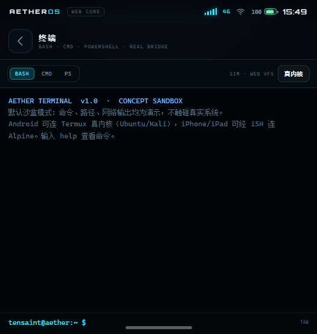</p>

- 顶部：返回、标题「终端」、Shell 切换、动作按钮。
- 终端主体：等宽字体、命令历史、输出着色。
- 底部：提示符 + 输入框 + 快捷操作（清屏、键盘、真 Linux）。

右上角「真 Linux」打开连接面板：

<p align="center"></p>

面板字段：

| 字段 | 说明 |
|---|---|
| 桥接地址 | 默认当前页面 origin；真机通常为 `http://127.0.0.1:8787` |
| 访问令牌 | 桥接启动时打印，保存在 `bridge/.aether_token` |
| 发行版 | 自动探测已安装列表；iSH 固定为 alpine |
| 连接并测试 | 校验令牌、模式与发行版 |
| 返回模拟 | 断开真 Linux，回到模拟命令 |

连接成功后终端会打印类似：

```text
已连接：proot · ubuntu · Linux
直接输入 Linux 命令，例如 uname -a、ls、cat /etc/os-release。
```

### 6.2 模拟 Linux 命令

<p align="center">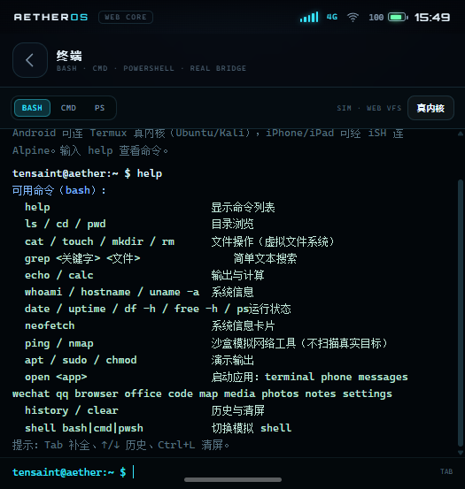</p>

在模拟模式中，命令由前端解析并返回预设结果。支持的命令包括：

- 文件：`ls`、`cd`、`pwd`、`cat`、`touch`、`mkdir`、`rm`、`grep`
- 计算：`echo`、`calc`
- 系统信息：`whoami`、`hostname`、`uname -a`、`date`、`uptime`、`df -h`、`free -h`、`ps`
- 展示：`neofetch`
- 网络演示：`ping`、`nmap`（**不会扫描真实目标**）
- 演示：`apt`、`sudo`、`chmod`
- 应用：`open terminal`、`open map` 等
- 其他：`history`、`clear`、`shell bash|cmd|pwsh`

虚拟文件系统与输出都保存在页面内存中；刷新后重置。

### 6.3 CMD 模式

<p align="center">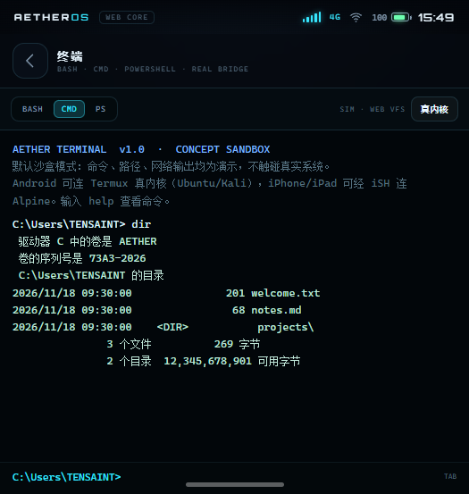</p>

命令：`dir`、`cd`、`cls`、`type`、`echo`、`ver`、`ipconfig`、`systeminfo`、`tasklist`、`whoami`、`hostname`、`date`、`time`、`ping`、`shell`。

提示符为 `C:\Users\TENSAINT>`。这些是交互模拟，不执行真实 Windows 二进制。

### 6.4 PowerShell 模式

<p align="center"></p>

支持：

| cmdlet / 别名 | 作用 |
|---|---|
| `Get-ChildItem`、`gci`、`ls` | 列目录 |
| `Get-Location`、`pwd` | 当前目录 |
| `Set-Location`、`cd` | 切换目录 |
| `Get-Content` | 查看文件 |
| `Get-Date` | 当前时间 |
| `Get-Process` | 进程列表（模拟） |
| `Get-Command` | 可用命令 |
| `Write-Output` | 输出 |
| `Clear-Host`、`cls` | 清屏 |
| `Get-Help`、`help` | 帮助 |
| `shell` | 切换 Shell |

### 6.5 真 Linux 模式

点击「连接并测试」后，终端进入真实执行模式：

- 输入的命令通过 `POST /api/exec` 发送到本地桥接；
- Android 上执行 `proot-distro login <distro> -- bash -lc <cmd>`；
- iSH 上执行 `/bin/sh -lc <cmd>`；
- 返回合并输出、退出码、执行后的工作目录与耗时；
- 支持 `cd` 持久化：桥接通过哨兵标记返回 `$PWD`，前端更新 `realCwd`。

执行示例：

```bash
uname -a
cat /etc/os-release
ls -la /root
apt update
```

在 proot 中安装工具：

```bash
proot-distro login ubuntu
apt update
apt install -y build-essential gdb nasm python3 nodejs
exit
```

之后即可编译 / 调试：

```bash
gcc -g hello.c -o hello
gdb ./hello
nasm -f elf64 hello.asm
```

工具是否存在取决于你安装的软件包；AETHER OS 不内置编译器。

### 6.6 桥接部署细节

```bash
python3 bridge/server.py
```

环境变量：

| 变量 | 默认 | 说明 |
|---|---|---|
| `AETHER_HOST` | `127.0.0.1` | 监听地址；改为 `0.0.0.0` 时需自行承担风险 |
| `AETHER_PORT` | `8787` | 监听端口 |
| `AETHER_ALLOW_LAN` | `0` | 设为 `1` 允许非回环 Host，用于局域网访问 |
| `AETHER_TOKEN` | 自动生成 | 固定令牌；不建议公开 |
| `AETHER_SKIP_BOOT` | 未设置 | 启动时在打印的 UI 地址追加 `?skip=1` |

示例：

```bash
AETHER_PORT=9000 python3 bridge/server.py
AETHER_ALLOW_LAN=1 AETHER_HOST=0.0.0.0 python3 bridge/server.py
```

> 局域网模式下，HTTP 明文会传输令牌；仅限可信网络。不要把端口映射到公网。

### 6.7 令牌与故障

- 令牌文件：`bridge/.aether_token`，权限 600。
- 更换：停止服务 → 删除文件 → 重启；或在环境变量中指定新值。
- 令牌错误：连接面板显示「访问令牌无效」，执行接口返回 401。
- 令牌丢失：查看 Termux / iSH 中的启动输出，或 `cat bridge/.aether_token`。

### 6.8 桥接 API 参考

**GET /api/health**

- 公开；用于探测。
- 带正确令牌时 `auth: true`。
- 字段：`ok`、`bridge`、`version`、`mode`、`platform`、`proot`、`installed`、`home`、`python`、`auth`。

**POST /api/exec**

请求头：

```http
Content-Type: application/json
x-aether-token: <令牌>
```

请求体：

```json
{ "cmd": "uname -a", "cwd": "/root", "distro": "ubuntu" }
```

响应（成功）：

```json
{
  "ok": true,
  "out": "Linux ...",
  "cwd": "/root",
  "code": 0,
  "ms": 120,
  "distro": "ubuntu",
  "truncated": false,
  "timed_out": false
}
```

错误：

| 状态码 | 含义 |
|---|---|
| 400 | 请求体为空 / 过大 / JSON 错误 / 命令为空 / 命令过长 / 发行版未安装 |
| 401 | 令牌无效或缺失 |
| 403 | Host 非本机且未开启 LAN |
| 429 | 并发超过 2 |
| 501 | 静态模式（非 Termux / iSH） |
| 504 | 命令超过 25 秒 |

输出超过 128 KB 时保留头尾并标记 `truncated`。

---

## 7. 应用详细说明

### 7.1 终端

见第 6 节。补充：

- 真 Linux 连接配置保存在 `aether.bridge`，刷新后仍保留。
- 断线重连时若发行版被删除，连接面板会报错并列出可用发行版。
- 模拟模式的历史仅保存在内存。

### 7.2 电话

<p align="center"> 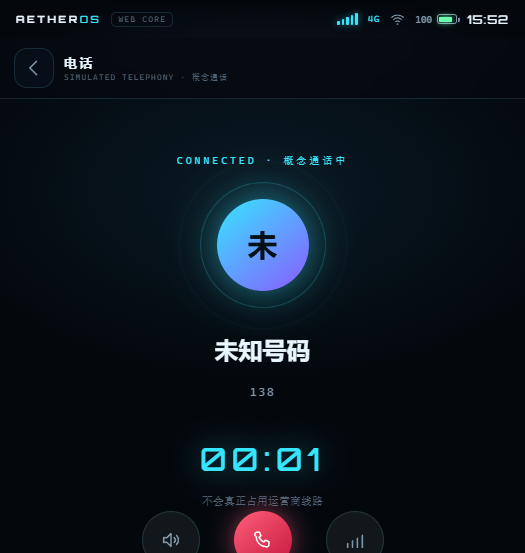</p>

**入口**：桌面图标 / Dock / 终端 `open phone`。

**界面**：

- 顶部标题「电话」与副标题。
- 号码显示区与退格键。
- 3×4 拨号盘（1–9、*、0、#）。
- 绿色拨号按钮、联系人 / 最近通话入口。

**操作**：

1. 输入号码（或点击联系人）。
2. 点击绿色按钮进入通话界面，显示呼叫状态与计时。
3. 点击红色挂断结束，返回拨号盘。
4. 最近通话保存在 `aether.phone.calls`。

**限制**：不申请通话权限，不拨出真实电话，不读取 SIM / 通讯录。

### 7.3 短信

<p align="center"> </p>

**操作**：

- 会话列表按时间排序，显示联系人与摘要。
- 进入会话后输入消息并发送。
- 自动回复在短暂延时后出现，用于演示。

**数据**：`aether.messages.threads`；刷新不丢失，清除数据后恢复示例。

**限制**：不发送真实短信，不访问短信数据库。

### 7.4 微信

<p align="center">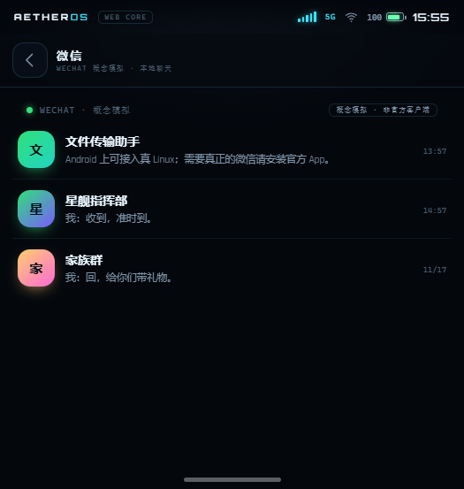 </p>

- 会话列表、头像、最后一条消息。
- 聊天窗口支持发送文本，消息进入本地数组并保存到 `aether.wechat.threads`。
- 不连接腾讯服务器、不提供登录、支付、语音 / 视频、朋友圈。

### 7.5 QQ

<p align="center"></p>

- 与微信类似的本地会话演示，保存在 `aether.qq.threads`。
- 不连接 QQ 服务，不提供真实账号能力。

### 7.6 浏览器

<p align="center">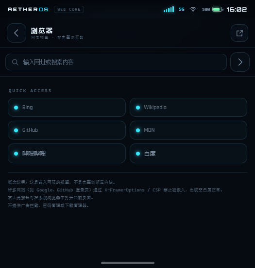</p>

- 地址栏：输入完整 URL 或关键词；关键词使用 Bing 搜索。
- 快捷书签：Bing、Wikipedia、GitHub、MDN、哔哩哔哩、百度。
- iframe 视图带 sandbox 与 no-referrer；部分站点拒绝嵌入。
- 右上角动作按钮在系统浏览器打开当前 URL。

**限制**：不是完整浏览器内核，不提供标签页、下载管理、广告拦截、密码管理、扩展。

### 7.7 办公

<p align="center">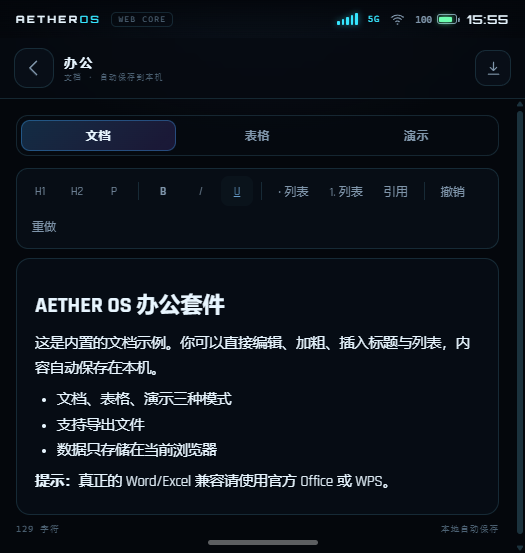 </p>

**三种模式**（顶部切换）：

- **文档**：contenteditable 富文本；支持标题、加粗、列表；自动保存 `aether.office.doc`；导出 `aether-doc.html`。
- **表格**：可编辑单元格；数值列自动合计；保存 `aether.office.sheet`；导出 `aether-sheet.csv`。
- **幻灯片**：多页标题 + 条目；缩略图预览；保存 `aether.office.slides`；导出 `aether-slides.json`。

<p align="center">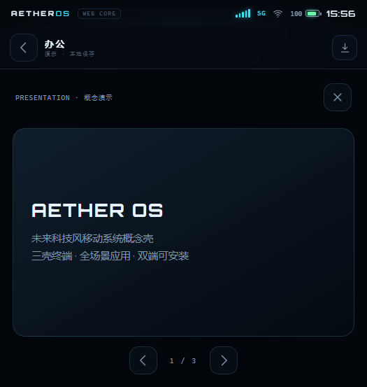</p>

**限制**：自有数据模型，不兼容 `.docx` / `.xlsx` / `.pptx`。需要 Office 兼容请使用 Microsoft Office / WPS / LibreOffice。

### 7.8 代码工作室

<p align="center"></p>

- 语言切换：JavaScript / Python。
- JavaScript：`Function` / 沙盒执行，捕获异常并显示堆栈；输出到下方 OUTPUT。
- Python：首次点击运行加载 Pyodide（CDN）；状态依次为「正在加载 Pyodide…」→「Pyodide 就绪」→ 输出。
- 代码按语言保存在 `aether.code.js` / `aether.code.py`；语言保存在 `aether.code.lang`。
- 不支持文件系统、系统调用、原生扩展；完整能力需真 Linux。

### 7.9 地图

<p align="center">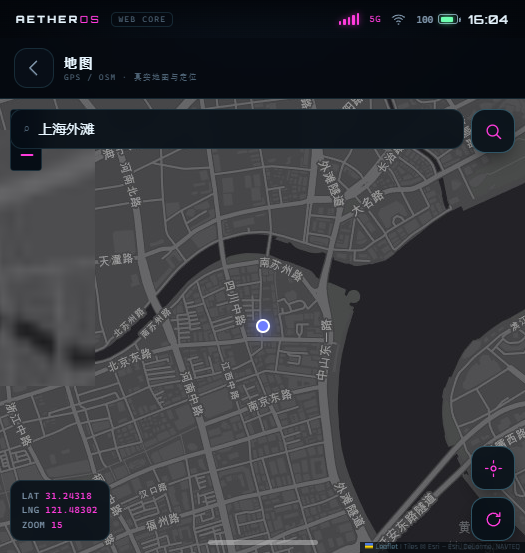 </p>

**瓦片**：Esri Dark Gray Canvas Base + Reference；无需 API Key，遵循 Esri 条款。

**搜索**：

1. 输入地点，点击放大镜或回车。
2. Photon API 优先；失败时 Nominatim 兜底；总超时 12 秒。
3. 结果列表点击后放置标记；若已有定位，绘制虚线直线并显示公里数。

**定位**：点击「定位」，浏览器请求权限；成功后地图飞至当前位置。定位精度取决于设备与网络。

**限制**：

- 不提供转向级导航、实时路况、离线地图包。
- 地图视图保存在 `aether.map.view`。
- 第三方搜索可能限流或不可用。

### 7.10 备忘录

<p align="center">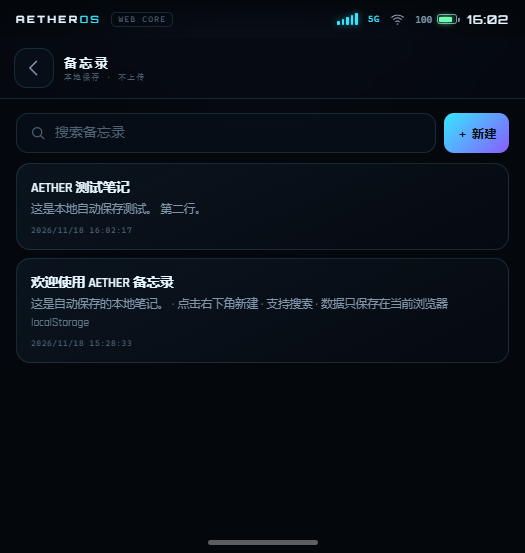</p>

- 搜索框实时过滤标题与正文。
- 「＋ 新建」创建并进入编辑器。
- 标题 / 正文输入后 400 ms 自动保存；状态显示「已保存 · 时间」。
- 返回按钮关闭编辑器；删除按钮带确认。
- 数据保存 `aether.notes.items`；清除站点数据会删除全部笔记。

### 7.11 媒体

<p align="center">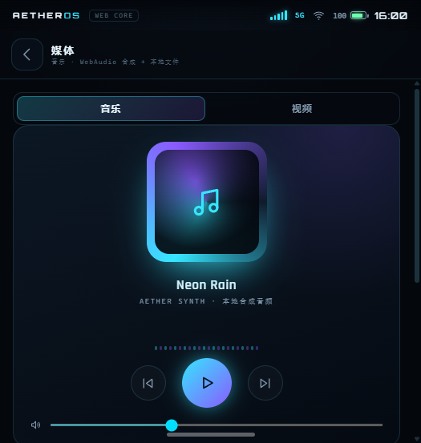</p>

**音乐**：

- 三段 WebAudio 合成曲目：Neon Rain、Deep Orbit、Grid Runner。
- 专辑封面旋转、可视化条、播放 / 暂停、上一首 / 下一首、音量滑杆。
- 导入本地音频后使用原生 `<audio controls>` 播放；文件不上传。

**视频**：

- 导入本地视频到 `<video controls playsinline>`。
- 支持格式取决于浏览器；iOS Safari 对容器 / 编码有限制。

**限制**：合成音乐不是真实曲目；页面关闭后停止播放；导入文件不持久化。

### 7.12 相册

<p align="center">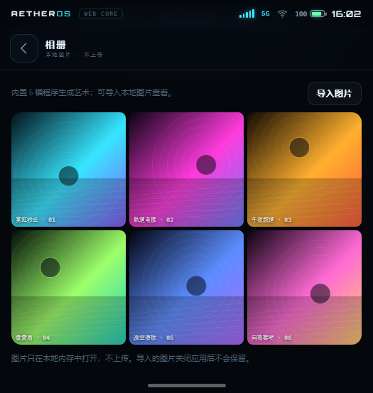</p>

- 内置 6 幅 Canvas 程序生成艺术（青霞幻弦、绯红电路、午夜轨迹、翡翠窗、深空信标、向晚紫苏）。
- 「导入图片」使用文件选择器，只在当前页面显示。
- 不上传、不写入服务器。

### 7.13 设置

<p align="center">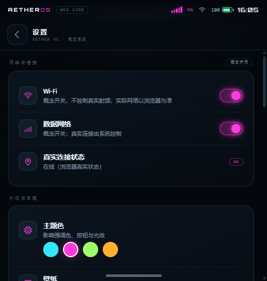</p>

分区：

1. **网络与连接**：Wi-Fi / 数据概念开关、真实连接状态（在线状态 + 有效网络类型）。
2. **外观与主题**：主题色、壁纸。
3. **真 Linux 接入**：桥接步骤说明与入口提示。
4. **安装应用**：Android / iOS 安装说明。
5. **系统信息**：版本、构建、运行环境 UA、显示与设备信息。
6. **存储与数据**：localStorage 用量、清除按钮。
7. **能力边界**：真实 / 模拟 / 不存在的清晰声明。

---

## 8. PWA、离线与更新

### 8.1 安装机制

- `manifest.webmanifest`：名称、短名称、主题色、背景色、`display: standalone`、图标、快捷方式。
- iOS 还使用 `apple-mobile-web-app-*` meta 与 `apple-touch-icon`。
- 安装后以独立窗口运行，状态栏颜色与主题一致。

### 8.2 离线缓存

`sw.js` 预缓存：

- `index.html`、manifest、`css/fonts.css`、`css/style.css`；
- 4 个 JS 文件；
- SVG / 192 / 512 图标；
- Orbitron / Rajdhani 字体文件。

策略：

- **导航请求**：网络优先，失败回退缓存的 `index.html`。
- **同源 GET**：缓存优先，同时后台更新（stale-while-revalidate）。
- **API 与跨域**：不拦截。

### 8.3 离线能力边界

离线可用：桌面、终端（模拟）、备忘录、办公、相册（内置图）、设置、已缓存的地图瓦片。

离线不可用：真实地图新瓦片 / 搜索、Pyodide 首次加载、真实 Linux 命令、微信 / QQ 模拟的在线感（本质本地，仍可用）。

### 8.4 更新缓存

修改静态资源后：

1. 修改 `sw.js` 中 `VERSION`（例如 `aether-v1.0.1`）。
2. 刷新页面两次：第一次安装新 SW，第二次由新 SW 接管。
3. 或在开发者工具 → Application → Service Workers 中 Unregister，并清除 Cache Storage。

---

## 9. 数据、隐私与安全

### 9.1 本地存储键

| 键 | 内容 |
|---|---|
| `aether.settings` | 主题、壁纸、网络概念开关 |
| `aether.notes.items` | 备忘录 |
| `aether.phone.calls` | 最近通话 |
| `aether.messages.threads` | 短信会话 |
| `aether.wechat.threads` | 微信演示会话 |
| `aether.qq.threads` | QQ 演示会话 |
| `aether.office.doc` | 文档 HTML |
| `aether.office.sheet` | 表格数据 |
| `aether.office.slides` | 幻灯片 |
| `aether.office.tab` | 办公当前模式 |
| `aether.code.js` / `aether.code.py` / `aether.code.lang` | 代码工作室 |
| `aether.map.view` | 地图中心与缩放 |
| `aether.bridge` | 桥接地址、令牌、发行版、模式 |

### 9.2 外部请求

| 目标 | 目的 | 数据传输 |
|---|---|---|
| Esri 瓦片 | 地图底图 | 瓦片坐标、IP、UA |
| Photon / Nominatim | 地点搜索 | 搜索关键词、IP、UA |
| Pyodide CDN | Python 运行时 | IP、UA |
| 本地桥接 | 命令执行 | 命令、cwd、distro（仅回环） |

无遥测、无账号、无广告、无第三方分析脚本。字体已本地化，不再请求 Google Fonts。

### 9.3 桥接威胁模型

防御目标：

- 其他网页通过 DNS rebinding / 跨站请求调用本地桥接；
- 局域网内未授权设备访问；
- 静态文件路径穿越读取令牌；
- 超大请求 / 输出导致资源耗尽；
- 时序侧信道猜测令牌。

措施：

- Host 白名单（默认仅回环）；
- 随机令牌 + 常量时间比较；
- 请求体 16 KB 上限、命令 4000 字符上限；
- 25 秒超时、128 KB 输出截断、并发 2；
- 静态路径拒绝 `..` 与点文件；
- 不提供 CORS 头，跨源 JS 无法读取响应。

不在防御范围：

- 能直接操作你手机的用户；
- 已获得 Termux / iSH 权限的恶意软件；
- 你主动执行的危险命令；
- 开启 `AETHER_ALLOW_LAN=1` 后在不可信网络中的明文传输。

### 9.4 令牌处理建议

- 不要把令牌截图发布到公开网络；
- 不要在共享设备上保存桥接配置；
- 定期更换令牌；
- 公共电脑预览时不要连接真机桥接。

---

## 10. 故障排查

| 现象 | 可能原因 | 处理 |
|---|---|---|
| 桌面 0 APPS / 空白 | 旧缓存或 JS 加载失败 | 刷新两次，清除 SW 与缓存；检查控制台错误 |
| 终端点击无反应 / 应用缺失 | 旧缓存了有语法错误的脚本 | 注销 SW、清除 Cache Storage、刷新 |
| 启动后一直停在锁屏 | 点击 / 上滑未触发 | 点击屏幕中央；检查是否被其他覆盖层拦截 |
| 地图空白 / 灰块 | 无网络或瓦片服务不可达 | 检查网络；等待瓦片加载；重试搜索 |
| 地图搜索「没有结果」 | 关键词无匹配或第三方限流 | 换关键词；稍后重试；Photon 已作为主搜索 |
| 地图一直「搜索中…」 | 网络阻塞（12 秒超时） | 等待超时后重试；检查网络 |
| 定位失败 | 非安全上下文 / 拒绝授权 | 使用 localhost 或 HTTPS；在浏览器设置允许定位 |
| Python 一直加载 / 失败 | CDN 不可达、首次体积大 | 稍后重试；检查网络；或使用真 Linux 的 Python |
| 桥接面板「未检测到桥接」 | 服务未启动 / 地址错误 | 确认 `python3 bridge/server.py` 正在运行；地址为 `http://127.0.0.1:8787` |
| 连接提示「访问令牌无效」 | 令牌复制不完整 / 已更换 | 从启动输出或 `.aether_token` 重新复制 |
| 连接提示「尚未安装发行版」 | proot-distro 无 rootfs | 运行 `bash bridge/setup-termux.sh` |
| 连接提示「该服务运行在非 Termux/iSH」 | 在桌面启动，模式为 static | 正常现象；真命令需在手机 Termux / iSH 中运行 |
| 真命令超时 | 命令超过 25 秒 | 拆分命令；使用后台任务；调整脚本 |
| 真命令无输出 | 命令写文件 / 无 stdout / 被截断 | 检查返回码；查看 `out` 与 `truncated` |
| Termux 后台被冻结 | 系统省电策略 | 启用 wake lock、关闭电池优化、厂商白名单 |
| iOS 连接很快断开 | iSH 被挂起 | 保持 iSH 前台；iPad 分屏；重新启动服务 |
| 浏览器无法打开某些站点 | 站点禁止 iframe 嵌入 | 使用右上角「在系统浏览器中打开」 |
| 视频无声 / 无法播放 | 编码不受支持 | 转为 H.264 + AAC 的 mp4；在系统播放器验证 |
| 微信 / QQ 刷新后消息丢失 | 无痕模式、清除了站点数据或存储被限制 | 使用普通窗口；会话默认保存在 localStorage |
| 清除站点数据后笔记消失 | localStorage 被清除 | 无法恢复；重要内容请导出 / 备份 |
| PWA 图标未更新 | 系统缓存旧图标 | 卸载 PWA 后重新安装；清除站点数据 |

---

## 11. 常见问题 FAQ

**Q：这能在真机上取代 Android / iOS 吗？**  
不能。它是 PWA 界面与 Linux 用户空间工具，不接管系统。

**Q：安装后我的手机变慢 / 发热吗？**  
PWA 本身很轻。Termux 中安装 Ubuntu + Kali、运行 proot 与编译任务会占用 CPU / 存储，模拟器（iSH）更明显。不用时停止桥接。

**Q：能玩 Android 游戏吗？**  
不能。PWA 没有 Android 运行时。

**Q：能运行真正的微信吗？**  
不能。内置微信是演示。

**Q：地图能导航吗？**  
能查看位置、搜索地点、计算直线距离；没有转向级导航。

**Q：终端能执行所有 Linux 命令吗？**  
在真 Linux 模式下，能执行 rootfs 中已安装程序支持的任意命令；不存在的程序会报 command not found。模拟模式只支持内置命令。

**Q：能用汇编和调试器吗？**  
在 Termux 的 Ubuntu / Kali 中安装 `binutils`、`nasm`、`gdb` 后即可；浏览器端不内置汇编器。

**Q：为什么 iPhone 不能装 Kali / Ubuntu？**  
iSH 是 Alpine 用户态模拟，不是完整虚拟化；且 iOS 不允许加载第三方内核或完整系统镜像。

**Q：为什么 Android 上不能直接运行 APK？**  
PWA 不是 Android 应用运行时，无法加载 APK 的 DEX / 原生库，也无法获得系统签名权限。

**Q：能把 AETHER OS 部署到公网吗？**  
静态界面可以部署到任意静态托管；但**不要**把桥接暴露到公网。桥接设计为本地工具，公网暴露会带来命令执行风险。

**Q：项目会收集我的命令或笔记吗？**  
不会。桥接只在本机回环，前端无遥测。

**Q：如何贡献 / 二次开发？**  
见第 12 节。代码为原生 JS + Python 标准库，无构建步骤，便于修改。

---

## 12. 开发与二次开发

### 12.1 本地开发

```bash
python3 bridge/server.py
# 打开 http://127.0.0.1:8787/?skip=1
```

修改文件后刷新；若被 SW 缓存，提升 `sw.js` 的 `VERSION`。

语法检查：

```bash
node --check js/core.js
node --check js/terminal.js
node --check js/apps-social.js
node --check js/apps-tools.js
python3 -m py_compile bridge/server.py
```

### 12.2 应用注册 API

```js
Aether.registerApp({
  id: 'example',            // 唯一 ID，用于深链接
  name: '示例',
  sub: 'EXAMPLE',
  icon: 'spark',            // ICONS 中的键
  accent: '#36e6ff',
  order: 300,
  flush: false,             // true 时应用主体无默认内边距
  render(root, api) {
    root.innerHTML = '<div class="card">内容</div>';
    api.setSub('副标题');
    api.toast('提示', 'ok');
    api.addAction('download', '导出', () => {});
    api.onClose(() => {});
  }
});
```

可用 API：

| 方法 | 作用 |
|---|---|
| `api.setSub(text)` | 设置标题栏副标题 |
| `api.toast(text, type)` | 轻提示（`ok` / `err` / 默认） |
| `api.addAction(id, label, fn)` | 注册右上角动作按钮 |
| `api.onClose(fn)` | 应用关闭时清理资源 |

系统 API：

| 方法 | 作用 |
|---|---|
| `Aether.openApp(id)` | 打开应用 |
| `Aether.closeApp()` | 关闭当前应用 |
| `Aether.store.get/set/del` | localStorage 封装（自动加 `aether.` 前缀） |
| `Aether.download(filename, content, mime)` | 触发浏览器下载 |
| `Aether.fmtBytes(n)` | 格式化字节 |
| `Aether.fmtTime(ts)` | 格式化时间 |
| `Aether.icon(name)` | 返回 SVG 字符串 |

### 12.3 添加图标

在 `js/core.js` 的 `ICONS` 中添加 SVG path：

```js
ICONS.spark = '<path d="..."/>';
```

图标统一 24×24 viewBox、`stroke="currentColor"`、`fill="none"`。

### 12.4 修改桥接

- 命令执行：`run_command()`；
- 健康检查：`do_GET` 中的 `/api/health`；
- 执行接口：`do_POST` 中的 `/api/exec`；
- 安全：`_host_is_local()`、`_token_ok()`、`_safe_static_path()`；
- 静态 MIME：`MIME` 字典。

修改后重启桥接，浏览器无需刷新（前端调用新接口时）。

### 12.5 文档图片

```bash
python tools/make_intro_images.py
```

依赖 Pillow 与 Windows 字体（微软雅黑）。如需在 macOS / Linux 生成，请修改字体路径。截图建议 510×546 或 390×844 视口。

### 12.6 发布检查清单

- [ ] `node --check` 全部通过
- [ ] `python3 -m py_compile bridge/server.py`
- [ ] PWA 注销旧 SW 后，manifest / SW 正常
- [ ] 终端模拟三壳命令
- [ ] 桥接令牌正确 / 错误两种路径
- [ ] 地图搜索与定位
- [ ] 13 个应用可打开、可关闭
- [ ] 截图与文档同步更新
- [ ] 更新 `README`、`MANUAL`、`RELEASE_NOTES`
- [ ] 生成 zip 与 SHA256SUMS
- [ ] 双平台 Release 附件与介绍核验

---

## 13. 测试与验收记录

测试环境：Chromium 移动视口 510×546，Windows 静态桥接（`mode: static`）；真机逻辑通过代码路径与接口验证。

| # | 项目 | 结果 | 备注 |
|---|---|---|---|
| 1 | 启动动画 | 通过 | 进度、日志、跳过按钮 |
| 2 | 锁屏点击解锁 | 通过 | 进入桌面 |
| 3 | 桌面 13 应用 | 通过 | 网格与 Dock |
| 4 | 终端 help / neofetch | 通过 | 模拟模式 |
| 5 | CMD dir | 通过 | 模拟模式 |
| 6 | PowerShell Get-ChildItem | 通过 | 模拟模式 |
| 7 | 桥接探测 | 通过 | 静态模式提示正确 |
| 8 | 错误令牌拦截 | 通过 | `data.auth !== true` 拒绝 |
| 9 | 电话拨号 / 通话 | 通过 | 覆盖层与挂断 |
| 10 | 短信发送 / 自动回复 | 通过 | 线程回显 |
| 11 | 微信 / QQ 列表 | 通过 | 会话与聊天 |
| 12 | 办公文档 | 通过 | 自动保存 |
| 13 | 表格合计 | 通过 | 611 / 742 / 728 / 912 |
| 14 | 幻灯片 | 通过 | 预览与导出逻辑 |
| 15 | JS 执行 | 通过 | 输出 / 错误 |
| 16 | Python（Pyodide） | 通过 | 输出 π 与平方 |
| 17 | 地图瓦片 | 通过 | Esri |
| 18 | 地图搜索 | 通过 | Photon「上海外滩」 |
| 19 | 地图标记 / 缩放 | 通过 | flyTo 15 |
| 20 | 备忘录 CRUD | 通过 | localStorage 回显 |
| 21 | 媒体播放 / 视频切换 | 通过 | 合成音频与标签 |
| 22 | 相册渲染 | 通过 | 6 幅 Canvas 艺术 |
| 23 | 浏览器书签 / iframe | 通过 | 快捷入口 |
| 24 | 设置主题 / 网络 | 通过 | 状态栏跟随 effectiveType |
| 25 | PWA SW / 缓存 | 通过 | activated，包含字体 |
| 26 | 离线壳 | 通过（静态资源） | 地图 / Pyodide 需网络 |

---

## 14. 法律、合规与第三方条款

- 本项目为**概念演示与个人工具**，不提供电信服务、应用分发、系统刷机或商店兼容。
- 不得将本项目用于绕过设备安全机制、侵犯他人系统、未授权访问或发送垃圾信息。
- 电话 / 短信 / 微信 / QQ 界面仅为模拟，不代表任何真实平台；相关商标归各自权利人所有。
- 地图瓦片、搜索与地理数据的使用需遵守 Esri、Photon、OpenStreetMap / Nominatim 的条款与署名要求。
- Orbitron、Rajdhani 字体遵循 SIL OFL 1.1，许可证见 `fonts/OFL-*.txt`。
- Leaflet 遵循 BSD-2-Clause；Pyodide 遵循 MPL-2.0。
- 本项目代码采用 MIT License；第三方组件保留各自许可证。

---

## 15. 附录

### 15.1 模拟命令速查（Linux）

```text
help  ls  cd  pwd  cat  touch  mkdir  rm  grep
echo  calc  whoami  hostname  uname -a  date  uptime
df -h  free -h  ps  neofetch  ping  nmap
apt  sudo  chmod  open <app>  history  clear
shell bash|cmd|pwsh
```

### 15.2 模拟命令速查（CMD）

```text
help  dir  cd  cls  type  echo  ver  ipconfig
systeminfo  tasklist  whoami  hostname  date  time
ping  shell
```

### 15.3 模拟命令速查（PowerShell）

```text
help  Get-Help  Get-ChildItem  gci  Get-Location  pwd
Set-Location  cd  Get-Content  Get-Date  Get-Process
Get-Command  Write-Output  Clear-Host  cls  shell
```

### 15.4 路径与端口

| 项 | 值 |
|---|---|
| 默认 UI / API | `http://127.0.0.1:8787` |
| 健康检查 | `GET /api/health` |
| 命令执行 | `POST /api/exec` |
| 令牌文件 | `bridge/.aether_token` |
| Service Worker 缓存 | `aether-v1.0.0` |
| PWA 主题色 | `#04070c` |

### 15.5 URL 参数

| 参数 | 值 | 说明 |
|---|---|---|
| `skip` | `1` | 跳过启动与锁屏 |
| `app` | 应用 ID | 打开指定应用 |

应用 ID：`terminal`、`phone`、`messages`、`wechat`、`qq`、`browser`、`office`、`code`、`map`、`notes`、`media`、`photos`、`settings`。

### 15.6 localStorage 键

见 9.1。所有键以 `aether.` 为前缀；设置页「清除」会删除全部前缀键。

### 15.7 环境变量

见 6.6。

### 15.8 发布校验

```text
SHA256SUMS.txt
  <sha256>  aether-os-1.0.0.zip
```

每次发布都应重新生成并核对；README、MANUAL、RELEASE_NOTES 与 zip 内容保持一致。

---

<p align="center"><sub>AETHER OS 1.0.0 · 概念系统 · 真 Linux 可选桥接 · 不修改固件</sub></p>
