# AETHER OS 完整说明书

> 适用版本：**1.2.0**（构建 2026.11.19）  
> 文档类型：安装、使用、部署、开发与安全说明  
> 适用平台：Android（Chrome / Termux）、iPhone / iPad（Safari / iSH）、桌面浏览器（预览）  
> 项目性质：PWA 概念系统 + 可选的本地 Linux 桥接，**不是手机固件**

---

## 目录

1. [阅读之前：项目定位与需求对照](#1-阅读之前项目定位与需求对照)
2. [术语与运行环境](#2-术语与运行环境)
3. [获取、校验与安装](#3-获取校验与安装)
4. [首次启动](#4-首次启动)
5. [系统界面与交互](#5-系统界面与交互)
6. [终端与真 Linux 桥接](#6-终端与真-linux-桥接)
7. [应用详细说明](#7-应用详细说明)
8. [PWA、离线与更新](#8-pwa离线与更新)
9. [数据、隐私与安全](#9-数据隐私与安全)
10. [故障排查](#10-故障排查)
11. [常见问题 FAQ](#11-常见问题-faq)
12. [开发与二次开发](#12-开发与二次开发)
13. [测试与验收记录](#13-测试与验收记录)
14. [法律、合规与第三方条款](#14-法律合规与第三方条款)
15. [附录](#15-附录)

---

## 1. 阅读之前：项目定位与需求对照

### 1.1 AETHER OS 是什么

AETHER OS 是一个运行在浏览器中的「移动系统概念壳」：

- 具备完整的启动 / 锁屏 / 桌面 / 状态栏 / 应用窗口 / 过渡动画；
- 内置 17 个应用，覆盖终端、通讯、社交、文件、办公、代码、地图、黄页、笔记、媒体、相册、相机与设置；
- 文件管理器可连接系统目录、手机存储桥接与浏览器私有文件系统；
- 办公套件可打开并修改 PDF / DOCX / XLSX / PPTX 等真实文件；
- 代码工作室支持 13 种语言（含 Kotlin / Swift），连接桥接后可真实编译、运行与错误定位；
- 真实省电模式与渲染循环优化；
- 可以作为 PWA 安装到 Android 与 iPhone 的主屏幕；
- 可选连接手机内的 Termux（Android）或 iSH（iOS），让终端执行**真实 Linux 命令**；
- 全部前端代码无构建步骤，桥接仅依赖 Python 标准库。

### 1.2 AETHER OS 不是什么

- **不是**可以在手机上刷入的固件或 ROM；
- **不是**自研内核，也不修改引导链、基带、系统分区；
- **不是** Android / iOS 模拟器，不能运行原生 APK / IPA，也不能安装或运行 Android 原生游戏；
- **不是**原生应用启动器：Android 上只能通过系统 Intent 打开已安装 App，界面会离开浏览器，且网页无法枚举全部已安装应用；iOS 不允许这种跳转；
- **不是**微信、QQ 的第三方客户端，不连接腾讯服务器；相关页面只负责唤起官方 App 或调用系统分享；
- **不是**应用商店兼容层，不提供 Google Play / App Store 下载或签名绕过；
- **不是**可以控制手机射频、Wi-Fi 或蜂窝数据的系统级应用；电话与短信只能通过系统 URL Scheme 交接给系统 App，网页不承载通话，也不能读取系统收件箱；
- **不能接收**系统短信、来电、微信 / QQ / 支付宝消息，也不能接听或拒接电话。浏览器没有对应 API；Android 需原生默认拨号器或通知监听，iOS 不允许第三方访问。本项目不提供伪造的接收界面。

### 1.3 原始需求与实现对照

| 原始需求 | 本项目实现 | 说明 |
|---|---|---|
| 生成 Android 与 Apple 两个可安装系统 | 同一套 PWA 可安装到两端主屏幕 | 不生成、也无法生成可刷入的系统镜像 |
| Ubuntu + Kali + deepin 三内核合并 | 不实现「三内核」；Android 可跑 Ubuntu / Kali 用户空间，deepin 可选自定义 rootfs；iOS 跑 Alpine | 三者是用户态发行版，不是内核；内核由手机系统提供 |
| 命令行 + 图形界面 | 三壳终端 + 完整 GUI | Linux 模式可接真环境；CMD / PowerShell 为模拟 |
| 打电话、发短信、微信、QQ、办公 | 电话 / 短信通过 `tel:` / `sms:` 交接系统 App；微信 / QQ 唤起官方 App + 系统分享；办公为真实本地应用 | 网页不能读系统短信 / 通话记录或腾讯聊天，也不能代发消息 |
| Linux 与 Windows 全部命令 | Linux 命令可真可模拟；CMD / PowerShell 为常用子集模拟 | 「全部命令」不现实；真 Windows 需 Windows 设备 |
| 所有语言编译器、汇编、调试 | 代码工作室列出 13 种语言；浏览器内运行 JS / Python、预览 HTML / CSS，桥接后真实编译 C / C++ / Java / Kotlin / Swift / Rust / Go / PHP / 汇编并定位错误行列 | 工具链不内置，取决于 rootfs 安装的软件包；Kotlin / Swift 为命令行程序，不构建 APK / iOS App，不是「所有语言」 |
| 全球地图定位与导航 | 真实瓦片、全球地点搜索、GPS / IP 定位、地点电话与营业信息、驾车 / 步行 / 骑行真实路线与中文分步指引 | 不提供实时路况、公交 / 地铁换乘与离线路径规划 |
| 全球电话黄页 | 212 个国家与地区的紧急电话 + 7 类常用服务热线 + 全球地点黄页 | 号码为本地静态数据，可能调整，不实时校验 |
| 未来科技风 UI 与启动界面 | 完整实现 | 启动、锁屏、桌面、应用、主题、壁纸 |
| 视频 / 音乐播放器、图片查看器 | 本地文件真实播放 / 查看；合成音乐 | 解码能力取决于浏览器 |
| 备忘录、浏览器 | localStorage 备忘录；iframe 浏览器 | 浏览器受站点嵌入策略限制 |
| Wi-Fi、数据网络开关 | 概念开关 + 真实在线状态 | 不能控制真实射频 |
| 下载并运行所有 Android 软件，兼容商店 | 不实现 | 需要 Android 运行时与平台签名体系，技术上不可行 |

> 这张表是本项目的「诚实契约」。任何与它冲突的宣传都不代表本项目。

### 1.4 为什么不做「三内核」

Linux 内核只有一个。Ubuntu、Kali、deepin 是在内核之上构建的用户态发行版。把三者「合并成内核」既没有对应的内核源码形态，也无法在零售手机上替换厂商内核：

- Android 的安全启动链验证引导与系统签名；
- iOS 的 SecureROM / iBoot 由 Apple 控制；
- 基带、射频、摄像头、电源管理等依赖厂商闭源驱动与 HAL。

因此本项目选择「用户态 Linux + 本地桥接」这条可行路线，并在 UI 中明确标注能力边界。

---

## 2. 术语与运行环境

### 2.1 术语

| 术语 | 含义 |
|---|---|
| PWA | Progressive Web App，可安装到主屏幕、带离线缓存的网页应用 |
| 桥接 / Bridge | `bridge/server.py`，在手机本地提供静态界面与受保护的命令执行 API |
| 三壳 | 终端的三种 Shell 模式：Linux（bash）、CMD、PowerShell |
| proot-distro | Termux 中用于安装、登录 Linux 发行版用户空间的工具 |
| iSH | iOS 上的 x86 用户态模拟器，运行 Alpine Linux |
| 真 Linux 模式 | 终端通过桥接执行真实命令的模式，可切换 LINUX 用户空间与 TERMUX / ISH 主机 |
| 主机通道 | Android 的 Termux 主机命令（pkg / termux-* / am）或 iPhone / iPad 的 iSH Alpine 命令（apk） |
| 模拟模式 | 终端在浏览器内解释并打印预设结果的模式 |
| 应用壳 | index.html、CSS、JS、字体与图标等离线缓存资源 |

### 2.2 浏览器兼容性

| 平台 | 推荐浏览器 | 说明 |
|---|---|---|
| Android | Chrome / Edge / 三星浏览器 | 支持 PWA 安装、Service Worker、Geolocation、WebAudio、相机、系统文件选择器；Chrome Android 支持 Contact Picker、系统分享与 File System Access（目录授权） |
| iPhone / iPad | Safari | 必须使用 Safari 才能「添加到主屏幕」；不支持 Network Information API、Contact Picker 与 File System Access 目录授权；系统相机与照片选择器可用 |
| Windows / macOS / Linux | Chrome / Edge / Firefox | 桌面预览；Geolocation 需要 localhost 或 HTTPS；`tel:` / `sms:` / 自定义 Scheme 是否有处理器取决于系统 |

不支持：IE、旧版 Android WebView、禁用了 JavaScript 或 Service Worker 的浏览器。

### 2.3 硬件与系统建议

- Android 7.0+；Termux 需要约 2–4 GB 可用存储（Ubuntu + Kali）。
- iPhone / iPad：iOS 15+ 建议；iSH 为 x86 模拟，性能有限。
- 屏幕：360 px 宽以上体验最佳；文档截图使用 525×553 移动视口。
- 网络：地图瓦片、搜索、地点详情与路线规划需要网络；Leaflet、黄页与办公文档库随项目本地提供。Pyodide 首次加载与桥接部署需要网络。
- 相机：原生通道需要系统相机与文件选择支持；取景器通道需要 `getUserMedia`（HTTPS 或 localhost）与相机权限。

### 2.4 权限

| 权限 | 用途 | 何时请求 |
|---|---|---|
| 定位 | 地图显示当前位置；被拒绝时回退到 IP 城市级粗略定位 | 首次点击「定位」或规划路线且尚无位置时 |
| 存储 / 文件选择 | 导入音视频、图片；打开 / 另存办公文件；文件管理器导入导出 | 点击相应按钮时由浏览器选择器处理 |
| 目录读写 | 文件管理器「本机目录」直接增删改查 | 首次添加目录时由 File System Access API 授权，可持久保存授权 |
| 相机 | 取景器预览与拍摄；原生通道调用系统相机 | 打开取景器或原生相机时由浏览器 / 系统请求 |
| 通知 | 本项目不请求通知权限，也不读取系统通知 | — |

Termux / iSH 的存储与后台权限由各自 App 和手机系统管理。系统短信、通话记录、微信 / QQ / 支付宝消息没有网页 API，本项目不会请求这些权限，也不会伪造接收界面。

---

## 3. 获取、校验与安装

### 3.1 发布包内容

Release 附件：

- `aether-os-1.2.0.zip`：完整项目（界面、桥接、字体、图标、文档、截图）；
- `SHA256SUMS.txt`：zip 的 SHA-256 校验值。

校验值以 Release 附件中的 `SHA256SUMS.txt` 为准；解压后再核对包内文件。

zip 解压后目录为 `aether-os-1.2.0/`，包含：

```text
index.html
manifest.webmanifest
version.json
sw.js
css/  js/  icons/  fonts/  bridge/  docs/  tools/  vendor/
README.md  LICENSE
```

`bridge/.aether_token` **不在发布包中**，首次启动时生成。

### 3.2 校验下载

Windows PowerShell：

```powershell
Get-FileHash .\aether-os-1.2.0.zip -Algorithm SHA256
```

macOS / Linux：

```bash
sha256sum aether-os-1.2.0.zip
```

将输出与 `SHA256SUMS.txt` 对比。若不一致，请重新下载，不要继续安装。

### 3.3 Android：Termux 安装全流程

#### 3.3.1 安装 Termux

1. 从 **F-Droid** 搜索并安装 Termux；或从 Termux 的 GitHub Releases 下载 APK。
2. 不建议使用 Google Play 版本：它已停止更新，可能无法安装 `proot-distro`。
3. 安装后打开 Termux，等待初始化完成。

#### 3.3.2 把项目放到手机

任选一种：

- **浏览器下载**：在手机浏览器下载 `aether-os-1.2.0.zip`，保存到「下载」。
- **电脑传输**：用数据线或局域网传到手机。
- **Git**（如已安装）：

  ```bash
  pkg install git
  git clone <仓库地址> aether-os
  ```

在 Termux 中：

```bash
termux-setup-storage     # 允许访问共享存储
pkg update -y
pkg install -y python unzip
cd ~/storage/downloads
unzip aether-os-1.2.0.zip -d ~
cd ~/aether-os-1.2.0
```

如使用 git 克隆，目录名可能是 `aether-os`，后续命令按实际路径调整。

#### 3.3.3 一键准备

```bash
bash bridge/setup-termux.sh
```

脚本行为：

1. 检查是否在 Termux（`pkg` 是否存在）。
2. `pkg update`，安装 `python` 与 `proot-distro`。
3. 若 Ubuntu 未安装，执行 `proot-distro install ubuntu`（约 200–500 MB）。
4. 若 Kali 未安装，执行 `proot-distro install kali`（体积也不小）。
5. 尝试 `termux-wake-lock`，降低后台被冻结概率。

中途可以 `Ctrl+C` 停止；再次运行会跳过已安装的发行版。

#### 3.3.4 启动桥接

```bash
python3 bridge/server.py
```

启动输出示例：

```text
  █ AETHER OS · LOCAL BRIDGE 1.2.0
  ────────────────────────────────────────────
  UI      http://127.0.0.1:8787
  Mode    TERMUX
  Home    /data/data/com.termux/files/home
  Distros ubuntu, kali
  Studio  gcc, g++, java, rustc, go, php, nasm
  Files   shared, downloads, documents, pictures
  Gallery DCIM, Pictures
  Token   <随机令牌>
  ────────────────────────────────────────────
  令牌已保存在 bridge/.aether_token；在 AETHER 终端「真 Linux」里粘贴。
  保持本终端运行；按 Ctrl+C 停止。
```

#### 3.3.5 打开界面并连接

1. 手机浏览器访问 `http://127.0.0.1:8787`。
2. 打开「终端」→ 右上角「真 Linux」。
3. 地址保持 `http://127.0.0.1:8787`；粘贴令牌；选择 `ubuntu` 或 `kali`。
4. 点击「连接并测试」。面板会显示「在线 · Termux / proot · 已安装：…」。
5. 连接后提示符变为 `aether@ubuntu:~$`，输入 `uname -a` 验证。

#### 3.3.6 添加到主屏幕

Chrome 菜单 →「安装应用」或「添加到主屏幕」。图标为 X 徽标，名称 AETHER OS。

#### 3.3.7 保持后台运行

Android 会回收后台进程：

- 下拉通知栏，确认 Termux 的 wake lock 通知存在；
- 设置 → 应用 → Termux → 电池 →「不限制 / 允许后台活动」；
- 部分厂商（MIUI、ColorOS、EMUI 等）需要额外允许自启动；
- 若桥接断开，重新打开 Termux，执行 `python3 bridge/server.py`，终端会保留令牌配置，重新点「连接并测试」即可。

长期运行可用 tmux：

```bash
pkg install tmux
tmux new -s aether
python3 bridge/server.py
# Ctrl+B 然后 D 脱离；tmux attach -t aether 返回
```

#### 3.3.8 安装其他发行版

```bash
proot-distro list                  # 查看可用发行版
proot-distro install debian
proot-distro install archlinux
```

安装后回到终端「真 Linux」面板重新连接，下拉框会刷新为已安装列表。

**deepin**：官方 proot-distro 列表不含 deepin。若你有兼容的 rootfs，可按 proot-distro 文档的自定义 rootfs 方式导入；本项目不提供该 rootfs，也不对其合法性、完整性与可用性作保证。

### 3.4 iPhone / iPad：iSH 安装全流程

#### 3.4.1 安装 iSH

从 App Store 免费安装 **iSH**。它是 x86 用户态模拟器，运行 Alpine Linux，不需要越狱，但受 iOS 沙盒与后台策略限制。

#### 3.4.2 导入项目

推荐：

1. 在「文件」App 中新建文件夹，例如「AETHER」，把 `aether-os-1.2.0` 文件夹放入。
2. 打开 iSH，执行：

```sh
mount -t ios . /mnt
```

系统会弹出文件选择器；选择「AETHER」文件夹后，`/mnt` 即为该目录。

3. 进入项目：

```sh
cd /mnt/aether-os-1.2.0
```

也可以只使用 iSH 自己的文件空间（在「文件」App 的「iSH」位置），把项目复制进去后从 `~` 进入。

#### 3.4.3 准备 Alpine

```sh
sh bridge/setup-ios-ish.sh
```

脚本检查 `/etc/alpine-release`，执行 `apk update` 并安装 `python3`。

> iSH 使用 `apk`，不是 `apt`。Alpine 使用 musl libc，部分 Linux 二进制不可直接运行。

#### 3.4.4 启动与连接

```sh
python3 bridge/server.py
```

在 Safari 打开 `http://127.0.0.1:8787`。终端「真 Linux」面板中：

- 地址：`http://127.0.0.1:8787`
- 令牌：启动输出中复制
- 发行版：`alpine`（面板会自动探测为 iSH）

#### 3.4.5 后台与稳定性

- iOS 切到其他 App 后，iSH 通常很快被挂起，桥接随之中断。
- 最稳的方式：iPad 分屏，把 iSH 与 Safari 并排；或保持 iSH 前台。
- 在已添加到主屏幕的 AETHER 中也可以连接 `127.0.0.1:8787`（同一设备本地回环）。
- 重新打开 iSH 后，如进程被终止，需要再次执行 `python3 bridge/server.py`。

### 3.5 桌面预览

```bash
cd aether-os-1.2.0
python3 bridge/server.py
```

打开 `http://127.0.0.1:8787`。桌面桥接为 `static` 模式：

- 界面、地图、办公、媒体、备忘录全部可用；
- 终端保持模拟模式，点击「连接并测试」会提示无法执行真命令；
- 可使用 `http://127.0.0.1:8787/?skip=1` 跳过启动动画。

只启动静态服务器：

```bash
python3 -m http.server 8787
```

此时没有 `/api/health` 与 `/api/exec`，终端连接面板会提示未检测到桥接。

### 3.6 更新与卸载

**更新（保留数据）**

1. 打开设置 →「系统更新」，先让应用检查 GitHub / GitCode，或点「检查」手动刷新。
2. 若发现新版本，选择 GitHub 或 GitCode 作为来源，点「刷新到新版本」。应用会清空旧缓存并重新加载当前安装地址，不需要重新安装 PWA。
3. 若应用通过本地桥接运行，先把新版本文件放到本地项目目录/启动新目录，再执行上面的刷新；浏览器不能把远端仓库文件直接写入本地磁盘。
4. 更新保留浏览器数据；AETHER 空间（OPFS）与目录授权随站点 origin 保留。若仍有旧界面，提升 `sw.js` 的 `VERSION` 或注销 Service Worker。

**更新（Termux 内直接替换）**

1. 下载新版本 zip，解压覆盖项目目录（例如 `~/aether-os-1.2.0`）。
2. 停止旧桥接；从新目录启动。
3. 在应用设置 →「系统更新」中选择来源并刷新，或按传统方式刷新页面两次。

**Termux 命令示例**

```bash
cd ~
unzip -o aether-os-1.2.0.zip -d ~
cd ~/aether-os-1.2.0
bash bridge/setup-termux.sh
python3 bridge/server.py
```

**卸载**

- 删除项目目录；
- 在浏览器站点设置中「清除存储 / 网站数据」，删除 PWA 与 localStorage；
- 可选：从主屏幕移除图标；
- Termux 中的 Ubuntu / Kali：`proot-distro remove ubuntu`、`proot-distro remove kali`。

---

## 4. 首次启动

### 4.1 启动动画

<p align="center">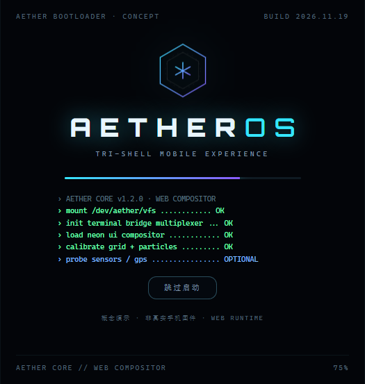</p>

- 顶部显示 `AETHER BOOTLOADER · CONCEPT` 与构建号。
- 中央为六边形 X 徽标与 `AETHER OS` 字标。
- 下方依次打印挂载、终端多路复用、合成器、网格与粒子校准日志。
- 进度条与百分比推进；底部 `AETHER CORE // WEB COMPOSITOR`。
- 右下角「跳过启动」可立即进入锁屏。

这段动画是纯前端演示，不会加载真实内核或修改设备。

### 4.2 锁屏

<p align="center"></p>

- 大号时钟、日期、`AETHER OS · CONCEPT SHELL`。
- 顶部左侧显示链路状态，右侧显示电量。
- 点击任意位置或上滑解锁；进入桌面。

### 4.3 桌面

<p align="center">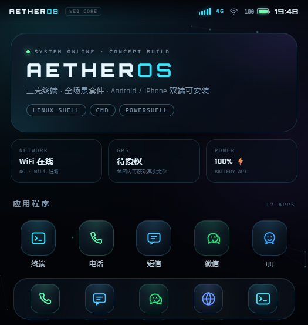</p>

- 顶部状态栏：品牌、`WEB CORE` 标签、信号、蜂窝代际、Wi-Fi、电量、时钟。
- Hero 卡片：`SYSTEM ONLINE · CONCEPT BUILD`、AETHEROS 字标、三种 Shell 标签。
- 系统卡片：NETWORK（在线状态 / 链路）、GPS（授权状态）、POWER（电量）。
- 应用网格：17 个应用，带分类点缀与 `order` 排序。
- 底部 Dock：电话、短信、微信、浏览器、终端。

### 4.4 深链接

| URL | 效果 |
|---|---|
| `/?skip=1` | 跳过启动与锁屏，直接桌面 |
| `/?skip=1&app=terminal` | 直接打开终端 |
| `/?skip=1&app=map` | 直接打开地图 |
| `/?skip=1&app=notes` | 直接打开备忘录 |
| `/?skip=1&app=...` | 任意已注册应用 ID |

PWA 快捷方式（长按图标）提供终端、地图、备忘录入口。

---

## 5. 系统界面与交互

### 5.1 应用窗口

- 点击图标打开应用；窗口从下方滑入并淡入。
- 左上角返回箭头关闭窗口；部分应用右上角有动作按钮（下载、外部打开等）。
- 底部中央胶囊按钮「回到桌面」关闭当前应用。
- 应用关闭时会清理定时器、音频上下文与对象 URL（由各应用 `onClose` 实现）。

### 5.2 状态栏

- **信号格**：5 格；网络概念开关关闭或离线时降为 1 格。
- **蜂窝代际**：由 `Network Information API` 的 `effectiveType` 映射为 2G / 3G / 4G / 5G；不支持该 API 时显示「蜂窝」。这不是手动假切换。
- **Wi-Fi 图标**：概念开关关闭或离线时变暗。
- **电量**：优先使用 Battery API 的真实百分比与充电状态；不支持时显示 `--`，不伪造数值。省电策略开启时显示「省电」标记。
- **时钟**：本地时间，每分钟更新。

### 5.3 主题与壁纸

设置 → 外观与主题：

- 主题色：青（cyan）、洋红（magenta）、青柠（lime）、琥珀（amber）。
- 壁纸：极光（aurora）、星云（nebula）、网格（grid）、深空（void）。

选择立即生效，并保存到 `aether.settings`。

### 5.4 网络概念开关

设置 → 网络与连接：

- Wi-Fi / 数据网络为**概念开关**，只影响状态栏与网络卡片的显示。
- 「真实连接状态」读取 `navigator.onLine` 与 `effectiveType`。
- 不能控制手机真实 Wi-Fi / 蜂窝数据 / 飞行模式。

### 5.5 电池与省电

- 使用 Battery API 时显示真实百分比与充电状态；不支持该 API 的浏览器显示 `--`。
- 设置 →「电池与省电」提供三档真实策略：
  - **自动**：电量 ≤ 20% 且未充电时自动进入省电，恢复后自动退出。
  - **开启**：立即进入省电。
  - **关闭**：保持完整动效。
- 省电模式会暂停粒子画布与背景动画、减少模糊和过渡、停止不必要的渲染循环；状态栏显示「省电」。
- 策略保存在 `aether.settings.powerPolicy`；开关和电量变化会触发 `aether:power` 事件，状态栏与设置卡片同步。
- 电量图标颜色随水平变化。网页不能修改系统省电设置，也不能控制充电。

### 5.6 手势与键盘

- 锁屏点击 / 上滑解锁。
- 应用内滚动区域独立滚动；地图支持拖拽、双指 / 滚轮缩放。
- 终端输入框支持回车执行、上下方向键浏览历史（模拟模式）。

---

## 6. 终端与真 Linux 桥接

### 6.1 终端界面

<p align="center"></p>

- 顶部：返回、标题「终端」、Shell 切换、动作按钮。
- 连接桥接后顶部切换组变为 `LINUX` 与 `TERMUX`（Android）/ `ISH`（iPhone、iPad），用于选择命令在哪一层执行。
- 终端主体：等宽字体、命令历史、输出着色。
- 底部：提示符 + 输入框 + 快捷操作（清屏、键盘、真 Linux）。

右上角「真 Linux」打开连接面板：

<p align="center">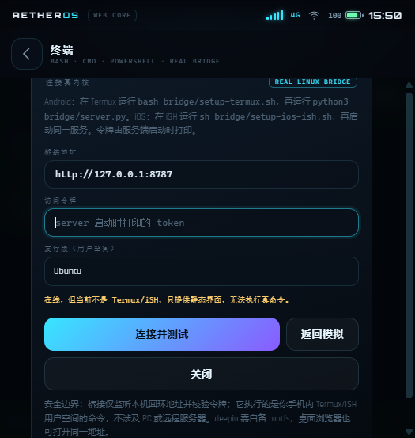</p>

面板字段：

| 字段 | 说明 |
|---|---|
| 桥接地址 | 默认当前页面 origin；真机通常为 `http://127.0.0.1:8787` |
| 访问令牌 | 桥接启动时打印，保存在 `bridge/.aether_token` |
| 发行版 | 自动探测已安装列表；iSH 固定为 alpine |
| 连接并测试 | 校验令牌、模式与发行版 |
| 返回模拟 | 断开真 Linux，回到模拟命令 |

连接成功后终端会打印类似：

```text
已连接：proot · ubuntu · Linux
已进入 ubuntu 用户空间，可执行 apt、uname、ls、编译器等发行版命令。
切换上方 LINUX / TERMUX 可改变命令执行位置；输入 help 查看示例。
```

Android 点 `TERMUX` 后命令不再进入 proot，而是直接在 Termux 主机执行；iPhone / iPad 点 `ISH` 后直接在 iSH 的 Alpine 中执行。两个通道分别维护 cwd，切换时不会混淆。

### 6.2 模拟 Linux 命令

<p align="center"></p>

在模拟模式中，命令由前端解析并返回预设结果。支持的命令包括：

- 文件：`ls`、`cd`、`pwd`、`cat`、`touch`、`mkdir`、`rm`、`grep`
- 计算：`echo`、`calc`
- 系统信息：`whoami`、`hostname`、`uname -a`、`date`、`uptime`、`df -h`、`free -h`、`ps`
- 展示：`neofetch`
- 网络演示：`ping`、`nmap`（**不会扫描真实目标**）
- 演示：`apt`、`sudo`、`chmod`
- 应用：`open terminal`、`open map` 等
- 其他：`history`、`clear`、`shell bash|cmd|pwsh`

虚拟文件系统与输出都保存在页面内存中；刷新后重置。

### 6.3 CMD 模式

<p align="center"></p>

命令：`dir`、`cd`、`cls`、`type`、`echo`、`ver`、`ipconfig`、`systeminfo`、`tasklist`、`whoami`、`hostname`、`date`、`time`、`ping`、`shell`。

提示符为 `C:\Users\aether>`。这些是交互模拟，不执行真实 Windows 二进制。

### 6.4 PowerShell 模式

<p align="center">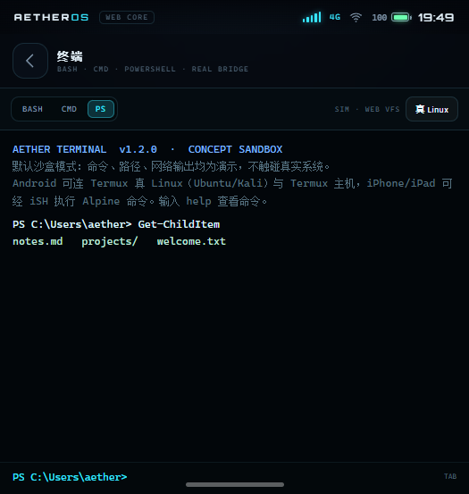</p>

支持：

| cmdlet / 别名 | 作用 |
|---|---|
| `Get-ChildItem`、`gci`、`ls` | 列目录 |
| `Get-Location`、`pwd` | 当前目录 |
| `Set-Location`、`cd` | 切换目录 |
| `Get-Content` | 查看文件 |
| `Get-Date` | 当前时间 |
| `Get-Process` | 进程列表（模拟） |
| `Get-Command` | 可用命令 |
| `Write-Output` | 输出 |
| `Clear-Host`、`cls` | 清屏 |
| `Get-Help`、`help` | 帮助 |
| `shell` | 切换 Shell |

### 6.5 真 Linux 模式

点击「连接并测试」后，终端进入真实执行模式：

- 输入的命令通过 `POST /api/exec` 发送到本地桥接；
- Android 上执行 `proot-distro login <distro> -- bash -lc <cmd>`；
- iSH 上执行 `/bin/sh -lc <cmd>`；
- 返回合并输出、退出码、执行后的工作目录与耗时；
- 支持 `cd` 持久化：桥接通过哨兵标记返回 `$PWD`，前端更新 `realCwd`。

执行示例：

```bash
uname -a
cat /etc/os-release
ls -la /root
apt update
```

在 proot 中安装工具：

```bash
proot-distro login ubuntu
apt update
apt install -y build-essential gdb nasm python3 nodejs
exit
```

之后即可编译 / 调试：

```bash
gcc -g hello.c -o hello
gdb ./hello
nasm -f elf64 hello.asm
```

Android 的 `TERMUX` 主机通道与 Linux 用户空间是两个执行位置：

```bash
pkg update
pkg install termux-api
termux-battery-status
termux-toast "hello from AETHER"
termux-open --content-type image /sdcard/DCIM/photo.jpg
```

`termux-*` 需要安装 Termux:API App 与 `termux-api` 包；共享存储需先运行 `termux-setup-storage`。主机命令受 Android 与 Termux 的权限约束，不是 root，也不能绕过系统沙盒。

iPhone / iPad 的 `ISH` 通道直接执行 Alpine 命令：

```bash
apk update
apk add curl git python3
uname -a
```

工具是否存在取决于你安装的软件包；AETHER OS 不内置编译器。

### 6.6 桥接部署细节

```bash
python3 bridge/server.py
```

环境变量：

| 变量 | 默认 | 说明 |
|---|---|---|
| `AETHER_HOST` | `127.0.0.1` | 监听地址；改为 `0.0.0.0` 时需自行承担风险 |
| `AETHER_PORT` | `8787` | 监听端口 |
| `AETHER_ALLOW_LAN` | `0` | 设为 `1` 允许非回环 Host，用于局域网访问 |
| `AETHER_TOKEN` | 自动生成 | 固定令牌；不建议公开 |
| `AETHER_SKIP_BOOT` | 未设置 | 启动时在打印的 UI 地址追加 `?skip=1` |

示例：

```bash
AETHER_PORT=9000 python3 bridge/server.py
AETHER_ALLOW_LAN=1 AETHER_HOST=0.0.0.0 python3 bridge/server.py
```

> 局域网模式下，HTTP 明文会传输令牌；仅限可信网络。不要把端口映射到公网。

### 6.7 令牌与故障

- 令牌文件：`bridge/.aether_token`，权限 600。
- 更换：停止服务 → 删除文件 → 重启；或在环境变量中指定新值。
- 令牌错误：连接面板显示「访问令牌无效」，执行接口返回 401。
- 令牌丢失：查看 Termux / iSH 中的启动输出，或 `cat bridge/.aether_token`。

### 6.8 桥接 API 参考

**GET /api/health**

- 公开；用于探测。
- 带正确令牌时 `auth: true`。
- 字段：`ok`、`bridge`、`version`、`mode`、`platform`、`proot`、`installed`、`home`、`python`、`studio`、`gallery`、`files`、`hostShell`、`auth`。`studio` / `gallery` / `files` 表示对应接口可用；`hostShell` 为 `termux` 或 `ish`，表示主机通道类型。

**POST /api/exec**

请求头：

```http
Content-Type: application/json
x-aether-token: <令牌>
```

请求体：

```json
{ "cmd": "uname -a", "cwd": "/root", "distro": "ubuntu", "scope": "distro" }
```

- `scope` 为 `distro`（默认）时进入 proot 发行版；为 `host` 时 Android 直接调用 Termux 的 `bash -lc`，iSH 直接调用 Alpine 的 `/bin/sh -lc`。主机通道不经过 proot。

响应（成功）：

```json
{
  "ok": true,
  "out": "Linux ...",
  "cwd": "/root",
  "code": 0,
  "ms": 120,
  "distro": "ubuntu",
  "scope": "distro",
  "truncated": false,
  "timed_out": false
}
```

错误：

| 状态码 | 含义 |
|---|---|
| 400 | 请求体为空 / 过大 / JSON 错误 / 命令为空 / 命令过长 / 发行版未安装 |
| 401 | 令牌无效或缺失 |
| 403 | Host 非本机且未开启 LAN |
| 429 | 并发超过 2 |
| 501 | 静态模式（非 Termux / iSH） |
| 504 | 命令超过 25 秒 |

输出超过 128 KB 时保留头尾并标记 `truncated`。

**POST /api/studio**

请求头同上。请求体：

```json
{
  "lang": "c",
  "code": "int main(void){return 0;}",
  "action": "run",
  "breakpoint": 3,
  "distro": "ubuntu",
  "timeout": 90
}
```

- `action`：`run`、`debug` 或 `probe`；`probe` 仅检测语言与工具链。
- 桥接只接受固定语言白名单：`js`、`py`、`c`、`cpp`、`java`、`kotlin`、`swift`、`rust`、`go`、`php`、`asm`。HTML / CSS 在浏览器沙盒中预览，不经过桥接。
- Kotlin 使用 `kotlinc Main.kt -include-runtime -d main.jar` 后由 JVM 运行；Swift 使用 `swiftc` 编译为原生命令行程序。两者只用于命令行程序，不包含 Android SDK / Gradle / Xcode，不能生成 APK 或 iOS App，也暂未接入自动交互断点。
- 请求体上限 192 KB，源码上限 32 KB；编译 / 调试在临时目录执行。
- 响应包含 `ok`、`output`、`diagnostics` 等；`diagnostics` 的每一项为 `{ line, column, severity, message, file }`，用于定位到准确行列。

**文件接口**

| 方法与路径 | 作用 |
|---|---|
| `GET /api/files/roots` | 列出桥接授权的根目录及其可写状态 |
| `GET /api/files/list?root=&path=&hidden=` | 列目录，单目录最多 2000 项 |
| `GET /api/files/read?root=&path=` | 读取文件，单文件上限 64 MB |
| `POST /api/files/write?root=&path=&overwrite=1` | 以原始字节写入文件，上限 64 MB |
| `POST /api/files/mkdir` | 请求体 `{ root, path }`，新建文件夹 |
| `POST /api/files/rename` | 请求体 `{ root, path, name }`，重命名 / 移动 |
| `POST /api/files/delete` | 请求体 `{ root, path, recursive }`，删除文件或文件夹 |

所有文件路径都限制在授权根目录内，拒绝 `..`、符号链接逃逸与 `.aether_token` / `.tsowner` 等受保护名称。

**GET /api/gallery/list?refresh=1**

扫描桥接可见的图片目录。Termux 优先 `~/storage/dcim`、`~/storage/pictures`；iSH 为 `Pictures`、`Documents`、`Downloads`；桌面为系统「图片」目录。单图上限 32 MB，最多 4000 项，服务端缓存 12 秒。

**GET /api/gallery/file?id=**

按列表返回的 ID 读取图片原始字节；ID 必须解析到授权根目录内。

---

## 7. 应用详细说明

### 7.1 终端

见第 6 节。补充：

- 真 Linux 连接配置保存在 `aether.bridge`，刷新后仍保留。
- 断线重连时若发行版被删除，连接面板会报错并列出可用发行版。
- 模拟模式的历史仅保存在内存。

### 7.2 电话

<p align="center">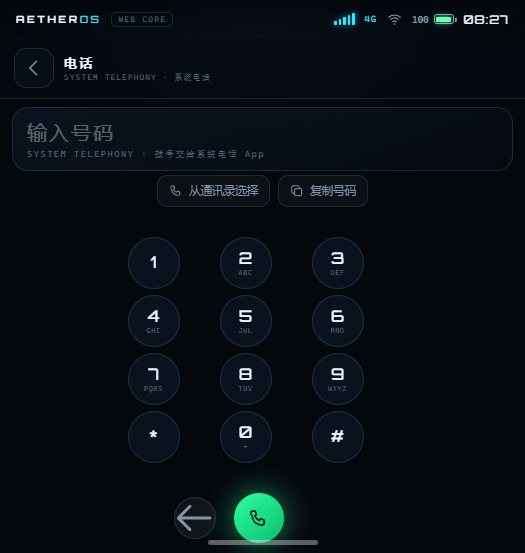</p>

**入口**：桌面图标 / Dock / 终端 `open phone`。

**界面**：

- 号码显示区、系统电话说明与退格键。
- 3×4 拨号盘（1–9、*、0、#）。
- 「从通讯录选择」「复制号码」与绿色拨号按钮。

**操作**：

1. 输入号码，或点击「从通讯录选择」调用 Contact Picker（Chrome Android 等支持；iOS Safari 与桌面浏览器通常不支持）。
2. 点击绿色按钮，AETHER 使用 `tel:` 链接请求系统电话 App 接管。
3. 实际拨号、通话、挂断、录音、双卡与运营商线路均在系统 App 中完成。
4. 没有 `tel:` 处理器时会给出提示，可复制号码手动拨打。

**限制**：不读取系统通话记录，不访问 SIM 或运营商信息，不承载通话界面。旧版中的模拟通话与测试记录已移除。

### 7.3 短信

<p align="center">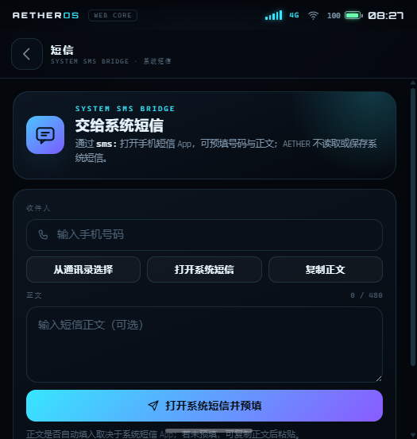</p>

**操作**：

- 输入号码，或从通讯录选择。
- 填写可选正文，点击「打开系统短信并预填」。
- AETHER 使用 `sms:` 链接请求系统短信 App 接管；iOS 与 Android 的正文参数不同，是否预填取决于短信 App。
- 「复制正文」可在未预填时手动粘贴。
- 「打开系统短信」直接进入系统短信 App。

**限制**：不读取收件箱、发送记录或送达回执，不保存会话，不真实发送。旧版中的示例会话与自动回复已移除。

### 7.4 微信

<p align="center"></p>

- 点击「打开官方微信」使用 `weixin://` 唤起已安装的官方 App。
- 未安装时提供微信官网入口。
- 可输入文字，调用系统分享面板交给微信，或复制草稿。
- 网页不能登录账号、读取聊天记录、选择具体聊天或代发消息；不连接腾讯服务器，不提供支付、语音 / 视频、朋友圈。

### 7.5 QQ

<p align="center"></p>

- 点击「打开官方 QQ」使用 `mqq://` 唤起已安装的官方 App。
- 未安装时提供 QQ 官网入口。
- 同样支持系统分享与复制草稿。
- 网页不能读取或代发 QQ 消息；不连接 QQ 服务。旧版中的演示会话已移除。

### 7.6 浏览器

<p align="center"></p>

- 地址栏：输入完整 URL 或关键词；关键词使用 Bing 搜索。
- 快捷书签：Bing、Wikipedia、GitHub、MDN、哔哩哔哩、百度。
- iframe 视图带 sandbox 与 no-referrer；部分站点拒绝嵌入。
- 右上角动作按钮在系统浏览器打开当前 URL。

**限制**：不是完整浏览器内核，不提供标签页、下载管理、广告拦截、密码管理、扩展。

### 7.7 支付宝

<p align="center">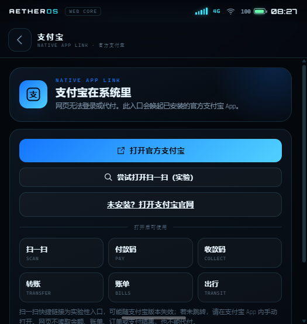</p>

- 「打开官方支付宝」使用 `alipays://` 唤起已安装的官方 App。
- 「尝试打开扫一扫（实验）」使用 `alipayqr://platformapi/startapp?saId=10000007`；该入口可能随支付宝版本变化失效，失败时请在 App 内手动打开。
- 未安装时提供支付宝官网入口；页面列出的扫一扫、付款码、收款码、转账、账单、出行均在官方 App 内完成。
- 网页不读取余额、账单、订单或支付结果，也不能代付、登录或连接支付宝 / 蚂蚁集团服务。AETHER 不是支付宝客户端。

### 7.8 办公

<p align="center"> 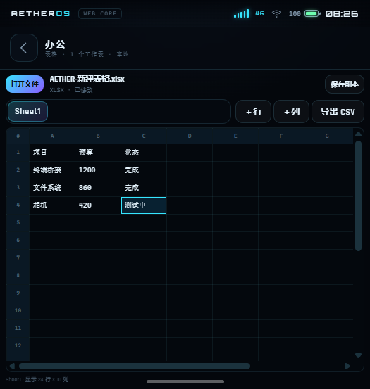</p>

**打开方式**：点「打开文件」调用系统选择器，桌面环境也可把文件拖入办公窗口。文件在本机浏览器内解析，不上传；关闭应用后当前文件不保留，修改需点「保存副本」下载。

**支持格式与真实编辑范围**：

| 格式 | 查看 | 可修改 | 另存 |
|---|---|---|---|
| PDF | 内置 PDF 查看器 | 旋转、删除页、后插空白页、加页码；叠加中文批注 / 水印文字层 | PDF 副本 |
| DOCX | 提取正文与基础结构预览 | 逐段文字编辑；保存时保留包内图片与结构，复杂版式可能被简化 | DOCX 副本 |
| XLSX / XLS / CSV / TSV / ODS | 多工作表网格 | 单元格编辑；公式以文本保留，不计算公式 | XLSX / CSV |
| PPTX | 文字视图 | 逐段文字编辑；保存时保留包内图片资源；不渲染图片、动画与母版 | PPTX 副本 |
| TXT / MD / JSON / XML / HTML / CSS / JS 等 | 文本视图 | 纯文本编辑 | 原扩展名副本 |
| 旧版 .doc / .ppt | 仅提示格式 | 不做无损解析 | — |

- 点击「＋ 空白文档 / 表格 / PDF / 文本」可新建空文件。
- 单文件上限 80 MB；解析库随项目本地提供（pdf-lib、SheetJS、mammoth、JSZip），首次打开对应格式时加载。
- PDF 正文的原生文字流排版编辑、DOCX 复杂样式编辑、XLSX 公式计算、PPTX 图形编辑不在本应用范围内，页面会明确说明，不伪造能力。

### 7.9 代码工作室

<p align="center">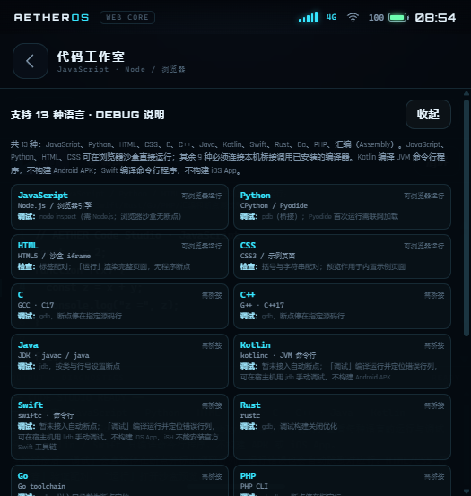</p>

**13 种语言**：JavaScript、Python、HTML、CSS、C、C++、Java、Kotlin、Swift、Rust、Go、PHP、汇编（Assembly）。点顶部「说明」可查看每种语言的运行环境与调试方式。

| 语言 | 运行方式 | 调试 / 检查 |
|---|---|---|
| JavaScript | 浏览器沙盒 | 桥接后 node inspect；错误跳到对应行列 |
| Python | 浏览器 Pyodide（首次联网） | 桥接后 pdb；错误跳到对应行列 |
| HTML | 隔离 sandbox iframe | 「检查」标签配对并定位行列；无程序断点 |
| CSS | 内置示例页预览 | 「检查」括号 / 字符串配对；无程序断点 |
| C / C++ | 桥接 GCC / G++ | gdb，断点停在指定源码行 |
| Java | 桥接 javac / java | jdb，按类与行号设置断点 |
| Kotlin | 桥接 kotlinc + JVM | 编译运行并解析错误行列；交互断点需手动 jdb；不构建 APK |
| Swift | 桥接 swiftc | 编译运行并解析错误行列；交互断点需手动 lldb；不构建 iOS App |
| Rust | 桥接 rustc | 编译器错误行列；调试依赖已安装工具链 |
| Go | 桥接 Go toolchain | 编译 / 运行错误行列；gdb 入口断点 |
| PHP | 桥接 PHP CLI | phpdbg，断点停在指定行 |
| 汇编 | 桥接 nasm / as | 汇编器错误行列；gdb 调试取决于平台工具链 |

- 顶部选择语言；代码按语言保存在 `aether.code.<lang>`，断点保存在 `aether.code.bp.<lang>`，当前语言在 `aether.code.lang`。
- 「运行」执行代码；「调试」会把断点行号发给桥接，由 pdb / node inspect / jdb / phpdbg / gdb 真实执行并停在断点，输出调用栈与局部变量。
- 编译或运行错误会解析为 `{ 行, 列, 严重级别, 消息 }`，编辑器直接把光标定位到出错行列并高亮，而不是只丢一段日志。
- 浏览器 JS / Python 没有真实断点；点「调试」会提示连接桥接。
- HTML / CSS 预览在 `sandbox` iframe 中，不读取主页面令牌。
- 桥接只接受固定语言白名单，源码在临时目录编译运行；工具链需要你在 Termux / iSH 中自行安装（见第 6.5 节）。
- Kotlin 需要 `kotlinc` 与 JDK，Swift 需要官方 `swiftc`；Kotlin 只构建 JVM 命令行程序，Swift 只构建命令行程序。这里没有 Android SDK / Gradle / Xcode，不能生成 APK 或 iOS App；iSH 上也无法安装官方 Swift 工具链。
- Kotlin / Swift 当前未接入自动交互断点：点「调试」会编译并直接运行，然后解析错误行列；需要断点暂停时请在宿主机用 jdb / lldb 手动调试，界面不会假装已经停在断点。

### 7.10 地图

<p align="center"> 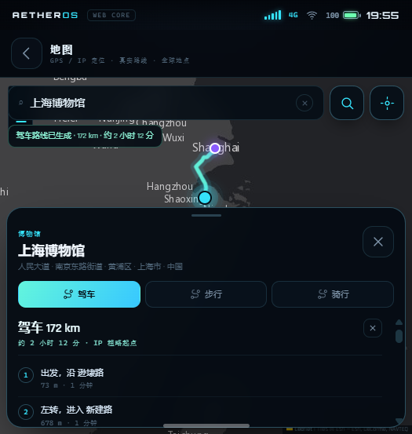</p>

**瓦片**：Esri Dark Gray Canvas Base + Reference；无需 API Key，遵循 Esri 条款。Leaflet 1.9.4 已放在本地 `vendor/leaflet/`，不依赖 CDN。

**搜索**：

1. 输入地点，点击放大镜或回车。
2. 使用 Photon 全球地理编码，8 秒超时；单次请求最多 40 条。
3. 客户端去重后按「名称匹配度 + 地点类型 + 与当前位置距离」排序：精确名称、景点 / 博物馆 / 塔等优先，住宅区、公交站、道路等降权，避免同名小区压过目标地标；列表最多展示 20 条。
4. 点击结果放置标记，并打开底部详情面板。

**定位**：

- 点击「定位」调用浏览器 Geolocation API；需要 HTTPS 或 localhost 与用户授权，成功后地图飞到当前位置。
- 授权被拒绝、超时或设备无 GPS 时，回退到 `ipinfo.io` 的 IP 粗略定位；精度只到城市级，界面会显示「IP APPROX · CITY LEVEL / IP 粗略定位」。
- GPS 授权状态会同步到桌面系统卡片。

**地点详情**：选中结果后读取 OpenStreetMap / Overpass 标签，展示地址、电话（`phone`、`contact:phone`、`contact:mobile`、`mobile`）、营业时间、官网、运营方 / 品牌，并根据国家显示紧急电话；OSM 未收录电话时会明确提示「OSM 未收录电话」。详情请求失败不影响地图标记与路线。

**路线**：

1. 在详情面板选择驾车 / 步行 / 骑行，再点「开始规划」。
2. 起点优先使用当前 GPS；没有定位时自动请求 GPS 或 IP 粗略定位。
3. 驾车使用 OSRM 公共路由，步行与骑行使用 FOSSGIS 公共路由；返回真实道路几何、总距离、预计时间与中文分步指引。
4. 路线以发光折线与主线绘制，点击任一步骤可定位到对应路口。

**限制**：

- 不提供实时路况、公交 / 地铁换乘、离线搜索与离线路径规划；瓦片、搜索、详情与路线均需网络，离线只显示已缓存瓦片。
- 地图视图保存在 `aether.map.view`。
- Photon、Overpass、OSRM、FOSSGIS 均为公共第三方服务，可能限流或不可用；失败时界面会显示具体原因，不影响其他功能。

### 7.11 黄页

<p align="center">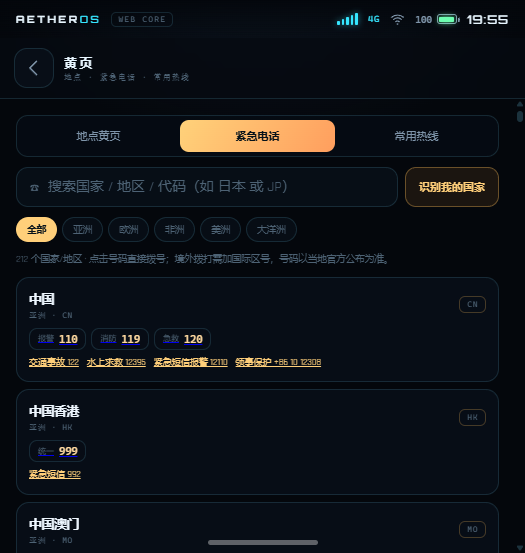</p>

**三个页签**：

1. **地点黄页**：与地图共用 Photon 全球搜索。搜索关键词后显示地址、电话、营业时间与官网；可以「查看地图」或在详情中选择驾车 / 步行 / 骑行，直接交给地图规划路线。
2. **紧急电话**：内置 **212 个国家与地区**的报警、消防、急救、统一紧急号码与补充号码；支持按大洲筛选、按国家名称或代码搜索，并根据 IP 粗略定位高亮当前国家或地区。点击号码通过 `tel:` 交给系统电话 App。
3. **常用热线**：7 类共 40 余条，包括领事与海外求助、支付与银行卡、通信与运营商、铁路 / 航空 / 出行、快递与物流、手机与电脑支持、消费与政务；支持点击号码直接呼出。

**数据边界**：

- 黄页数据保存在本地 `js/hotlines.js`，不依赖网络即可查看。
- 号码可能随当地政策调整，以官方最新公布为准；网页无法验证号码是否仍有效。
- 境外拨打需要加拨正确的国际区号；`tel:` 只负责把号码交给系统，网页不承载通话，也无法确认是否拨出。

### 7.12 备忘录

<p align="center"></p>

- 搜索框实时过滤标题与正文。
- 「＋ 新建」创建并进入编辑器。
- 标题 / 正文输入后 400 ms 自动保存；状态显示「已保存 · 时间」。
- 返回按钮关闭编辑器；删除按钮带确认。
- 数据保存 `aether.notes.items`；清除站点数据会删除全部笔记。

### 7.13 媒体

<p align="center"></p>

**音乐**：

- 三段 WebAudio 合成曲目：Neon Rain、Deep Orbit、Grid Runner。
- 专辑封面旋转、可视化条、播放 / 暂停、上一首 / 下一首、音量滑杆。
- 导入本地音频后使用原生 `<audio controls>` 播放；文件不上传。

**视频**：

- 导入本地视频到 `<video controls playsinline>`。
- 支持格式取决于浏览器；iOS Safari 对容器 / 编码有限制。

**限制**：合成音乐不是真实曲目；页面关闭后停止播放；导入文件不持久化。

### 7.14 相册

<p align="center"></p>

**三个来源**（顶部筛选）：

1. **本机选择**：点「选择图片」调用系统照片选择器；选中的图片会保存一份副本到 IndexedDB（`aether-photos-v1`），所以在 AETHER 内刷新后仍可查看。不会上传。
2. **桥接相册**：连接本地桥接后点「扫描相册」，读取桥接进程能看到的相册目录：
   - Android / Termux：`~/storage/dcim`、`~/storage/pictures`，或 `/sdcard/DCIM`、`/sdcard/Pictures`。首次必须运行 `termux-setup-storage` 并允许照片权限；应用会提供「复制授权命令」按钮。
   - iPhone / iSH：只能读取 iSH 自己的 `Pictures`、`Documents`、`Downloads`。iOS 不把「照片」图库交给 iSH，因此必须先把照片导入 iSH 目录，无法静默读取整个系统相册。
   - Windows / Linux 桌面：默认扫描用户「图片」目录，可用 `AETHER_GALLERY_DIRS` 增加目录。
3. **全部**：合并两类并按时间排序。

**能力**：

- 懒加载缩略图，滚动到可见区域才读取原图；每次加载 120 张，可继续加载。
- 全屏查看、上一张 / 下一张、下载原图、删除 AETHER 内的副本。
- 桥接扫描上限 4000 项、单图 32 MB、深度 4 层，服务端缓存 12 秒。

**限制**：浏览器 / PWA 不能绕过系统权限静默枚举整个系统相册；相册只读取，不会删除或修改你系统相册中的原始照片。相机拍摄的 AETHER 副本保存在本应用的 IndexedDB 中，不会自动写回系统「照片」App，可通过「下载原图」或系统分享导出。

### 7.15 文件

<p align="center"></p>

**三个来源**：

- **本机目录**：使用 File System Access API 选择一个真实目录并授权读写；授权句柄保存在 IndexedDB（`aether-file-access-v1`），下次打开可在浏览器允许时恢复。Chrome / Edge 支持；Safari / Firefox 不提供该 API。
- **手机存储**：通过本地桥接读写 Termux / iSH 能访问的目录。Termux 需先执行 `termux-setup-storage`；Android 共享存储、下载、文档、图片等会作为根目录列出。iSH 只能访问它自己的主目录与 Documents / Downloads / Pictures。
- **AETHER 空间**：浏览器私有 OPFS，可自由增删改查，不经过网络，也不会出现在系统相册或文件 App 中。

**操作**：

- 列出目录、进入 / 返回、显示或隐藏点文件；单目录最多显示 3000 项。
- 上传文件、新建文件夹、新建文本文件、重命名 / 移动、删除（文件夹需确认）。
- 打开文本、图片、音频、视频、PDF 与常见办公文件；办公文件可交给办公应用继续查看 / 编辑。
- 下载 / 导出文件到系统下载目录。
- 桥接单文件读写上限 64 MB；路径限制在授权根目录内，拒绝目录穿越、符号链接逃逸和 `.aether_token` / `.tsowner` 等受保护文件。
- 删除操作不可撤销；网页无法绕过系统授权访问任意路径。

### 7.16 相机

<p align="center">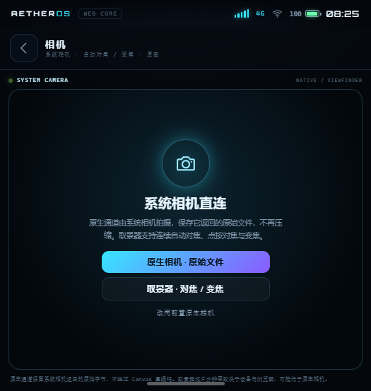</p>

**两条通道**：

1. **原生相机 · 原始文件**：通过带 `capture` 属性的系统文件输入调用手机相机 App（后置 / 前置）。系统返回的照片文件按**原始字节**保存，不做 Canvas 重编码，因此画质与系统相机输出一致。受浏览器与文件选择器限制，是否能直接调用相机由设备决定；不支持时会退化为系统文件选择器。
2. **取景器 · 对焦 / 变焦**：使用 `getUserMedia` 在页面内预览。支持：
   - 连续自动对焦；设备支持时点按画面设置对焦点（`pointsOfInterest` / `focusMode`）。
   - 读取 `MediaTrackCapabilities` 的变焦范围，用滑杆或双指捏合变焦；设备不报告变焦能力时不伪造数字变焦。
   - 前后摄像头切换。
   - 拍照优先使用 `ImageCapture.takePhoto()`；不支持时用 Canvas 取当前帧，分辨率取决于浏览器与设备，可能低于原生相机。

**保存与限制**：

- 拍照后自动把原始文件写入「相册」的本机 IndexedDB 副本；可下载原图、调用系统分享、删除相册副本。
- 相机副本不会自动写入系统「照片」App。需要进入系统相册时，请用「下载原图」或系统分享保存。
- 网页不能调节系统相机的专业参数（ISO、快门、RAW、镜头切换）、不能在后台录制，也不能绕过系统相机权限。

### 7.17 设置

<p align="center"></p>

分区：

1. **网络与连接**：Wi-Fi / 数据概念开关、真实连接状态（在线状态 + 有效网络类型）。
2. **外观与主题**：主题色、壁纸。
3. **电池与省电**：AUTO / ON / OFF 三档真实渲染策略，显示当前电量、是否充电与策略状态。
4. **真 Linux 接入**：桥接步骤说明与入口提示。
5. **安装应用**：Android / iOS 安装说明。
6. **系统更新**：自动/手动检查 GitHub 与 GitCode、选择更新来源、刷新生效、打开发布页。刷新不需要重新安装 PWA；远端文件不会越过浏览器权限写入本地磁盘。
7. **系统信息**：版本、构建、运行环境 UA、显示与设备信息。
8. **存储与数据**：localStorage 用量、清除按钮（不删除 IndexedDB 中的相册副本、目录授权与 OPFS 文件；可在浏览器站点设置中单独清除）。
9. **能力边界**：真实 / 模拟 / 不存在的清晰声明。

---

## 8. PWA、离线与更新

### 8.1 安装机制

- `manifest.webmanifest`：名称、短名称、主题色、背景色、`display: standalone`、图标、快捷方式。
- iOS 还使用 `apple-mobile-web-app-*` meta 与 `apple-touch-icon`。
- 安装后以独立窗口运行，状态栏颜色与主题一致。

### 8.2 离线缓存

`sw.js` 预缓存：

- `index.html`、manifest、`css/fonts.css`、`css/style.css`、`css/files.css`、`css/office.css`；
- 8 个业务 JS 文件：`core`、`terminal`、`apps-social`、`places`、`hotlines`、`apps-tools`、`files`、`office`；
- 本地 Leaflet 1.9.4 的脚本、样式与标记图片；
- SVG / 192 / 512 图标；
- Orbitron / Rajdhani 字体文件。

办公解析库位于 `vendor/`，首次使用时按需加载并写入缓存；未使用过对应格式时，离线打开该格式会失败。

策略：

- **导航请求**：网络优先，失败回退缓存的 `index.html`。
- **同源 GET**：缓存优先，同时后台更新（stale-while-revalidate）。
- **API 与跨域**：不拦截。更新检查直接请求 GitHub / GitCode，不经过 SW 缓存；`version.json` 不在预缓存列表中。

### 8.3 离线能力边界

离线可用：桌面、终端（模拟）、备忘录、黄页全部紧急电话与常用热线、AETHER 空间文件、已导入的相册副本、设置，以及已缓存的办公库、Leaflet 脚本与地图瓦片。

离线不可用：真实地图新瓦片 / 搜索 / 地点详情 / 路线规划、Pyodide 首次加载、未缓存过的办公解析库、真实 Linux 命令与桥接文件 / 相册。电话 / 短信 / 微信 / QQ / 支付宝的交接依赖系统 App 与 URL Scheme，离线时仍可发起跳转，但实际通信由系统 App 负责。

### 8.4 更新缓存与自动提示

应用在解锁后、回到前台、联网恢复时自动检查更新，并每 6 小时复查一次；30 分钟内不重复请求。检查并行读取两个公开清单：

- GitHub：`raw.githubusercontent.com/IAMMEZSH/aether-os/main/version.json`
- GitCode：`api.gitcode.com/api/v5/repos/gcw_So3EkhfR/aether-os/contents/version.json?ref=main`

单个来源失败不会阻塞另一个；请求 8 秒超时。远端 `version` 高于当前 `Aether.version` 时，顶部出现更新条；设置页也可手动检查。用户自行选择 GitHub 或 GitCode 来源，点刷新后应用清除旧缓存、更新 Service Worker 并重新加载当前安装地址，不需要重新安装 PWA。更新条每个版本自动提示一次，选择「稍后」后仍可在设置中手动更新。

维护者修改静态资源后：

1. 修改 `sw.js` 中 `VERSION`（当前为 `aether-v1.2.0-b1`）。
2. 同步提升 `version.json` 的 `version` / `build` / `notes`，并发布到 GitHub 与 GitCode。若只在其中一个平台提升，用户仍会从可达的那个来源收到提示。
3. 若未部署对应平台 Pages，用户需先把新文件更新到当前站点/本地目录；浏览器不能跨源替换已安装 PWA 的包，这是平台边界。
4. 传统方式：刷新页面两次，或在开发者工具 → Application → Service Workers 中 Unregister 并清除 Cache Storage。

---

## 9. 数据、隐私与安全

### 9.1 本地存储键

| 键 | 内容 |
|---|---|
| `aether.settings` | 主题、壁纸、网络概念开关、省电策略 |
| `aether.notes.items` | 备忘录 |
| `aether.code.<lang>` | 各语言代码（如 `aether.code.js`、`aether.code.c`、`aether.code.asm`） |
| `aether.code.bp.<lang>` | 各语言断点行号 |
| `aether.code.lang` | 当前语言 |
| `aether.map.view` | 地图中心与缩放 |
| `aether.bridge` | 桥接地址、令牌、发行版、模式 |
| `aether.photos.filter` | 相册来源筛选 |
| `aether.filesHidden` | 文件管理器是否显示点文件 |
| `aether.updates.lastCheck` | 上次更新检查时间戳 |
| `aether.updates.dismissed` | 已选择「稍后」的版本号 |
| `aether.updates.source` | 用户选择的更新来源（`github` / `gitcode`） |

IndexedDB：

| 数据库 | 内容 |
|---|---|
| `aether-photos-v1` | 相册副本元数据与原始图片 Blob（包含相机拍摄副本） |
| `aether-file-access-v1` | File System Access 目录授权句柄 |

OPFS 中的 AETHER 空间文件由浏览器管理，不在 localStorage 中。旧版的 `aether.phone.calls`、`aether.messages.threads`、`aether.wechat.threads`、`aether.qq.threads` 属于演示数据，脚本加载时会自动删除，并且不再写入。

### 9.2 外部请求

| 目标 | 目的 | 数据传输 |
|---|---|---|
| Overpass 镜像 | 读取 OSM 地点详情 | OSM 要素编号、IP、UA |
| OSRM / FOSSGIS | 驾车 / 步行 / 骑行路线 | 起点与终点坐标、IP、UA |
| ipinfo.io | 定位失败时的 IP 城市级粗略定位 | IP、UA |
| Esri 瓦片 | 地图底图 | 瓦片坐标、IP、UA |
| Photon | 全球地点搜索 | 搜索关键词、IP、UA |
| jsDelivr CDN | Pyodide 0.26.4 Python 运行时 | IP、UA |
| GitHub Raw | 读取 `version.json` 检查更新 | IP、UA；不发送本地数据 |
| GitCode API | 读取 `version.json` 检查更新 | IP、UA；不发送本地数据 |
| 本地桥接 | 命令、编译、文件、相册 | 命令 / 源码 / 文件内容（仅回环或你显式开启的局域网） |

办公解析库（pdf-lib、SheetJS、mammoth、JSZip）、Leaflet 1.9.4、黄页数据、字体与图标随项目本地提供，不请求第三方 CDN。无遥测、无账号、无广告、无第三方分析脚本。

### 9.3 桥接威胁模型

防御目标：

- 其他网页通过 DNS rebinding / 跨站请求调用本地桥接；
- 局域网内未授权设备访问；
- 静态文件路径穿越读取令牌；
- 超大请求 / 输出导致资源耗尽；
- 时序侧信道猜测令牌。

措施：

- Host 白名单（默认仅回环）；
- 随机令牌 + 常量时间比较；
- 普通 JSON 请求体 16 KB、代码工作室 192 KB、文件写入 64 MB 上限；命令 4000 字符上限；
- 25 秒命令超时、128 KB 输出截断、并发 2；
- 静态路径拒绝 `..` 与点文件；文件 API 限制在授权根目录并拒绝符号链接逃逸；
- 文件根目录不暴露 `.aether_token` / `.tsowner`，静态服务也不提供点文件；
- 响应带 `Access-Control-Allow-Origin: *`，因此**不能**把 CORS 当作安全边界；真正的边界是 Host 校验 + 令牌 + 回环绑定。若在浏览器其他页面填入令牌，该页面可以调用桥接，所以不要向不可信页面泄露令牌。

不在防御范围：

- 能直接操作你手机的用户；
- 已获得 Termux / iSH 权限的恶意软件；
- 你主动执行的危险命令；
- 开启 `AETHER_ALLOW_LAN=1` 后在不可信网络中的明文传输。

### 9.4 令牌处理建议

- 不要把令牌截图发布到公开网络；
- 不要在共享设备上保存桥接配置；
- 定期更换令牌；
- 公共电脑预览时不要连接真机桥接。

---

## 10. 故障排查

| 现象 | 可能原因 | 处理 |
|---|---|---|
| 桌面 0 APPS / 空白 | 旧缓存或 JS 加载失败 | 刷新两次，清除 SW 与缓存；检查控制台错误 |
| 终端点击无反应 / 应用缺失 | 旧缓存了有语法错误的脚本 | 注销 SW、清除 Cache Storage、刷新 |
| 启动后一直停在锁屏 | 点击 / 上滑未触发 | 点击屏幕中央；检查是否被其他覆盖层拦截 |
| 地图空白 / 灰块 | 无网络或瓦片服务不可达 | 检查网络；等待瓦片加载；重试搜索 |
| 地图搜索「没有结果」 | 关键词无匹配或第三方限流 | 换更完整的名称 / 地标名；稍后重试 |
| 地图一直「搜索中…」 | 网络阻塞（8 秒超时） | 等待超时后重试；检查网络 |
| 定位失败 | 非安全上下文 / 拒绝授权 / 无 GPS | 使用 localhost 或 HTTPS；允许定位；失败时会回退到 IP 城市级定位 |
| 定位只到城市 | 浏览器定位被拒绝或超时，使用了 IP 回退 | 允许精确位置权限；IP 定位精度只到城市级 |
| 地点详情没有电话 | OSM 未收录该地点的电话标签 | 属正常现象；可查看官网或改用其他渠道 |
| 路线规划失败 | OSRM / FOSSGIS 公共路由不可达或起终点不可达 | 稍后重试；更换起终点；驾车 / 步行 / 骑行可分别尝试 |
| Python 一直加载 / 失败 | CDN 不可达、首次体积大 | 稍后重试；检查网络；或使用真 Linux 的 Python |
| 桥接面板「未检测到桥接」 | 服务未启动 / 地址错误 | 确认 `python3 bridge/server.py` 正在运行；地址为 `http://127.0.0.1:8787` |
| 连接提示「访问令牌无效」 | 令牌复制不完整 / 已更换 | 从启动输出或 `.aether_token` 重新复制 |
| 连接提示「尚未安装发行版」 | proot-distro 无 rootfs | 运行 `bash bridge/setup-termux.sh` |
| 连接提示「该服务运行在非 Termux/iSH」 | 在桌面启动，模式为 static | 正常现象；真命令需在手机 Termux / iSH 中运行 |
| 真命令超时 | 命令超过 25 秒 | 拆分命令；使用后台任务；调整脚本 |
| 真命令无输出 | 命令写文件 / 无 stdout / 被截断 | 检查返回码；查看 `out` 与 `truncated` |
| Termux 后台被冻结 | 系统省电策略 | 启用 wake lock、关闭电池优化、厂商白名单 |
| iOS 连接很快断开 | iSH 被挂起 | 保持 iSH 前台；iPad 分屏；重新启动服务 |
| 浏览器无法打开某些站点 | 站点禁止 iframe 嵌入 | 使用右上角「在系统浏览器中打开」 |
| 视频无声 / 无法播放 | 编码不受支持 | 转为 H.264 + AAC 的 mp4；在系统播放器验证 |
| 微信 / QQ 点击后无反应 | 未安装官方 App、浏览器阻止自定义 Scheme，或桌面无处理器 | 安装官方 App；从官网入口打开；改用系统分享或复制草稿 |
| 系统短信没有预填正文 | 短信 App 不支持 `sms:` body 参数 | 复制正文后在系统短信 App 中粘贴 |
| 通讯录按钮提示不支持 | 当前浏览器没有 Contact Picker（如 iOS Safari、桌面） | 手动输入号码 |
| 清除站点数据后笔记消失 | localStorage 被清除 | 无法恢复；重要内容请导出 / 备份 |
| PWA 图标未更新 | 系统缓存旧图标 | 卸载 PWA 后重新安装；清除站点数据 |
| 文件管理器「本机目录」不可用 | Safari / Firefox 没有 File System Access API | 改用「AETHER 空间」，或连接 Termux / iSH 桥接 |
| 文件管理器看不到手机存储 | 桥接未连接或 Termux 未授权存储 | 先运行 `termux-setup-storage`，再启动 `python3 bridge/server.py` 并连接 |
| 文件写入失败 / 超过上限 | 单文件超过 64 MB、目录只读或磁盘已满 | 缩小文件；检查根目录可写状态与剩余空间 |
| 删除文件后无法恢复 | 文件和桥接删除都是真实删除，无回收站 | 操作前先下载 / 备份；删除前会要求确认 |
| 相册扫描不到照片 | Termux 未授权、照片在 iSH 不可见目录、或超过扫描限制 | Termux 执行 `termux-setup-storage`；iSH 先把照片导入 `Pictures` / `Documents`；点「扫描相册」 |
| 相册能看列表但缩略图失败 | 单图超过 32 MB、HEIC 浏览器不支持解码或文件被移动 | 下载后用系统查看器打开；转换为 JPEG / PNG 再导入 |
| 相机按钮没有打开系统相机 | 浏览器不支持 `capture`，退化为文件选择器 | 改用「取景器」通道，或从系统文件选择器选择用相机拍摄 |
| 取景器黑屏 / 无法变焦 | 未授权、非安全上下文或设备不报告变焦能力 | 使用 HTTPS / localhost 并允许相机；变焦取决于硬件与浏览器 |
| 相机照片没有出现在系统相册 | AETHER 只保存应用内副本 | 用「下载原图」或系统分享保存到系统相册 |
| 打开 DOCX / PPTX 后版式简化 | 浏览器内只编辑文字层并保留包内资源，不渲染复杂版式 | 重要排版请在 Word / PowerPoint / WPS / LibreOffice 中完成 |
| 无法编辑 PDF 正文文字流 | PDF 只支持页面操作与叠加文字层 | 需要原生排版编辑时使用源文档或桌面 PDF 编辑器 |
| XLSX 公式不计算 | 公式以文本保留，不内置计算引擎 | 用 Excel / WPS / LibreOffice 打开计算 |
| 旧版 .doc / .ppt 打不开 | 旧二进制格式不在解析范围 | 先转存为 .docx / .pptx |

---

## 11. 常见问题 FAQ

**Q：这能在真机上取代 Android / iOS 吗？**  
不能。它是 PWA 界面与 Linux 用户空间工具，不接管系统。

**Q：安装后我的手机变慢 / 发热吗？**  
PWA 本身很轻。Termux 中安装 Ubuntu + Kali、运行 proot 与编译任务会占用 CPU / 存储，模拟器（iSH）更明显。不用时停止桥接。

**Q：能玩 Android 游戏吗？**  
不能。PWA 没有 Android 运行时。

**Q：能运行真正的微信吗？**  
不能。AETHER 不内置微信客户端；「微信」页面只负责唤起已安装的官方 App，或把文字交给系统分享。

**Q：地图能导航吗？**  
能。地图支持全球地点搜索、GPS / IP 定位、地点电话与营业信息，以及驾车 / 步行 / 骑行真实路线与中文分步指引；不提供实时路况、公交 / 地铁换乘或离线路径规划。

**Q：黄页里的号码能直接拨打吗？**  
点击号码会通过 `tel:` 交给系统电话 App，网页本身不拨号。号码为本地静态数据，可能随政策调整，境外拨打需加拨正确的国际区号，以当地官方最新公布为准。

**Q：终端能执行所有 Linux 命令吗？**  
在真 Linux 模式下，能执行 rootfs 中已安装程序支持的任意命令；不存在的程序会报 command not found。模拟模式只支持内置命令。

**Q：能用汇编和调试器吗？**  
代码工作室把汇编列为 13 种语言之一；在 Termux 的 Ubuntu / Kali 中安装 `binutils`、`nasm`、`gdb` 后，可通过桥接汇编并调试。浏览器端不内置汇编器，需要桥接与真实工具链。Kotlin / Swift 只支持命令行程序，不构建 Android APK 或 iOS App。

**Q：能自动接收系统短信、微信、QQ 或支付宝推送，并接听电话吗？**  
不能。浏览器 / PWA 没有读取系统短信、通知、微信 / QQ / 支付宝消息或接听电话的 API；即使「授权」也不存在可调用的接口。Android 原生 App 可以申请短信与通知权限，默认拨号器才能接听电话；iOS 不允许第三方读取这些数据。本项目不会加入伪造的接收或接听界面。支付宝页面只能唤起官方 App。

**Q：为什么 iPhone 不能装 Kali / Ubuntu？**  
iSH 是 Alpine 用户态模拟，不是完整虚拟化；且 iOS 不允许加载第三方内核或完整系统镜像。

**Q：为什么 Android 上不能直接运行 APK？**  
PWA 不是 Android 应用运行时，无法加载 APK 的 DEX / 原生库，也无法获得系统签名权限。Android 原生游戏同样不能在页面内运行；最多只能由系统 Intent 打开已安装的 App / 游戏，界面会离开 AETHER，iOS 则不允许这种跳转。

**Q：能把 AETHER OS 部署到公网吗？**  
静态界面可以部署到任意静态托管；但**不要**把桥接暴露到公网。桥接设计为本地工具，公网暴露会带来命令执行风险。

**Q：项目会收集我的命令或笔记吗？**  
不会。桥接只在本机回环，前端无遥测。

**Q：相机拍出来和系统相机一样吗？**  
「原生相机 · 原始文件」通道保存系统相机 App 返回的原始字节，不二次压缩，画质与系统输出一致。「取景器」通道用于自动对焦 / 变焦，分辨率与编码取决于浏览器和设备，可能低于原生相机。应用内副本不会自动写入系统相册。

**Q：文件管理器能管理整个手机吗？**  
不能。浏览器不能绕过系统权限：Android 通过 Termux 桥接访问共享存储，iPhone 通过 iSH 只能访问 iSH 可见目录，桌面 Chrome 可通过系统目录授权访问你选择的文件夹。删除是真实删除，没有回收站。

**Q：如何贡献 / 二次开发？**  
见第 12 节。代码为原生 JS + Python 标准库，无构建步骤，便于修改。

---

## 12. 开发与二次开发

### 12.1 本地开发

```bash
python3 bridge/server.py
# 打开 http://127.0.0.1:8787/?skip=1
```

修改文件后刷新；若被 SW 缓存，提升 `sw.js` 的 `VERSION`。

语法检查：

```bash
node --check js/core.js
node --check js/terminal.js
node --check js/apps-social.js
node --check js/apps-tools.js
node --check js/files.js
node --check js/office.js
python3 -m py_compile bridge/server.py bridge/studio.py bridge/files.py bridge/gallery.py
```

### 12.2 应用注册 API

```js
Aether.registerApp({
  id: 'example',            // 唯一 ID，用于深链接
  name: '示例',
  sub: 'EXAMPLE',
  icon: 'spark',            // ICONS 中的键
  accent: '#36e6ff',
  order: 300,
  flush: false,             // true 时应用主体无默认内边距
  render(root, api) {
    root.innerHTML = '<div class="card">内容</div>';
    api.setSub('副标题');
    api.toast('提示', 'ok');
    api.addAction('download', '导出', () => {});
    api.onClose(() => {});
  }
});
```

可用 API：

| 方法 | 作用 |
|---|---|
| `api.setSub(text)` | 设置标题栏副标题 |
| `api.toast(text, type)` | 轻提示（`ok` / `err` / 默认） |
| `api.addAction(id, label, fn)` | 注册右上角动作按钮 |
| `api.onClose(fn)` | 应用关闭时清理资源 |

系统 API：

| 方法 | 作用 |
|---|---|
| `Aether.openApp(id)` | 打开应用 |
| `Aether.closeApp()` | 关闭当前应用 |
| `Aether.store.get/set/del` | localStorage 封装（自动加 `aether.` 前缀） |
| `Aether.download(filename, content, mime)` | 触发浏览器下载 |
| `Aether.fmtBytes(n)` | 格式化字节 |
| `Aether.fmtTime(ts)` | 格式化时间 |
| `Aether.icon(name)` | 返回 SVG 字符串 |

### 12.3 添加图标

在 `js/core.js` 的 `ICONS` 中添加 SVG path：

```js
ICONS.spark = '<path d="..."/>';
```

图标统一 24×24 viewBox、`stroke="currentColor"`、`fill="none"`。

### 12.4 修改桥接

- 命令执行：`run_command()`；
- 健康检查：`do_GET` 中的 `/api/health`；
- 执行接口：`do_POST` 中的 `/api/exec`；
- 代码工作室：`do_POST` 中的 `/api/studio` 与 `bridge/studio.py`；
- 文件接口：`bridge/files.py`，路由在 `do_GET` / `do_POST` 的 `/api/files/*`；
- 相册接口：`bridge/gallery.py`，路由在 `/api/gallery/*`；
- 安全：`_host_is_local()`、`_token_ok()`、`_safe_static_path()`；
- 静态 MIME：`MIME` 字典。

修改后重启桥接，浏览器无需刷新（前端调用新接口时）。

### 12.5 文档图片

```bash
python tools/make_intro_images.py
```

依赖 Pillow 与 Windows 字体（微软雅黑）。如需在 macOS / Linux 生成，请修改字体路径。截图建议 525×553 或 390×844 视口。

### 12.6 发布检查清单

- [ ] `node --check` 全部通过
- [ ] `python3 -m py_compile bridge/server.py bridge/studio.py bridge/files.py bridge/gallery.py`
- [ ] PWA 注销旧 SW 后，manifest / SW 正常
- [ ] `version.json`、`Aether.version`、SW `VERSION` 三者一致
- [ ] GitHub / GitCode 更新检查与来源选择可用
- [ ] 终端模拟三壳命令
- [ ] 桥接令牌正确 / 错误两种路径
- [ ] 代码工作室 13 种语言与 DEBUG 定位
- [ ] 文件管理器三种来源增删改查
- [ ] 办公 PDF / DOCX / XLSX / PPTX 打开与另存
- [ ] 地图搜索、定位回退、地点详情与三种路线
- [ ] 黄页国家筛选、紧急电话与常用热线
- [ ] 相机原生 / 取景器两条通道
- [ ] 相册系统选择与桥接扫描
- [ ] 省电策略三档
- [ ] 17 个应用可打开、可关闭
- [ ] 截图与文档同步更新
- [ ] 更新 `README`、`MANUAL`、`RELEASE_NOTES`
- [ ] 生成 zip 与 SHA256SUMS
- [ ] 双平台 Release 附件与介绍核验

---

## 13. 测试与验收记录

测试环境：Chromium 移动视口 525×553，Windows 本地桥接（`mode: static`）；真机相关能力通过代码路径、接口与设备条件验证，无法在桌面环境覆盖的部分单独注明。

| # | 项目 | 结果 | 备注 |
|---|---|---|---|
| 1 | 启动动画 | 通过 | 进度、日志、跳过按钮 |
| 2 | 锁屏点击解锁 | 通过 | 进入桌面 |
| 3 | 桌面 17 应用 | 通过 | 网格与 Dock |
| 4 | 终端 help / neofetch | 通过 | 模拟模式 |
| 5 | CMD dir | 通过 | 模拟模式 |
| 6 | PowerShell Get-ChildItem | 通过 | 模拟模式 |
| 7 | 桥接探测 | 通过 | 静态模式提示正确；`studio/gallery/files: true` |
| 8 | 错误令牌拦截 | 通过 | `data.auth !== true` 拒绝 |
| 9 | 电话交接 | 通过 | `tel:` URI、无号码提示、复制号码 |
| 10 | 短信交接 | 通过 | `sms:` 号码 + 正文编码、复制正文、空正文 |
| 11 | 微信 / QQ 原生入口 | 通过 | `weixin://` / `mqq://`、官网、分享与复制回退 |
| 12 | 支付宝原生入口 | 通过 | `alipays://`、实验性扫一扫、官网回退 |
| 13 | 旧演示数据清理 | 通过 | 加载后删除四个旧版 localStorage 键 |
| 14 | 文件管理器 AETHER 空间 | 通过 | OPFS 新建、写入、重命名、删除、查看器刷新 |
| 15 | 桥接文件 API | 通过 | 根目录、列目录、读写、新建、重命名、删除、越界与符号链接拒绝共 15 项 |
| 16 | 文件上限与只读保护 | 通过 | 64 MB 写入上限、受保护文件名拒绝 |
| 17 | 办公 PDF | 通过 | 旋转、页码、中文批注后另存为有效 PDF |
| 18 | 办公 DOCX | 通过 | 应用修改后另存为有效 OOXML |
| 19 | 办公 XLSX / CSV | 通过 | 多工作表编辑与另存 |
| 20 | 办公 PPTX | 通过 | 逐段修改后保留 7 个包内条目 |
| 21 | 办公文本 | 通过 | TXT 保存 UTF-8 内容一致 |
| 22 | 代码工作室 JS | 通过 | 浏览器沙盒输出 / 错误 |
| 23 | 代码工作室 Python | 通过 | Pyodide 输出 |
| 24 | 代码工作室 13 语言 | 通过 | 下拉与说明面板完整 |
| 25 | HTML / CSS 检查 | 通过 | CSS 未闭合括号报告「第 1 行 第 6 列」并阻止预览 |
| 26 | 桥接 /api/studio | 通过 | 语言探测、编译、运行与 DEBUG 路由 |
| 27 | 地图瓦片 | 通过 | Esri；Leaflet 从本地 `vendor/leaflet/` 加载 |
| 28 | 地图搜索 | 通过 | Photon；「东方明珠电视塔」相关度排序后位列第一 |
| 29 | 地图标记 / 缩放 | 通过 | flyTo 15；选中后打开详情面板 |
| 30 | 备忘录 CRUD | 通过 | localStorage 回显 |
| 31 | 媒体播放 / 视频切换 | 通过 | 合成音频与标签 |
| 32 | 相册系统选择 | 通过 | 导入 3 张本地图片并写入 IndexedDB |
| 33 | 相册桥接 API | 通过 | 目录枚举、ID 校验、图片读取 |
| 34 | 相机 UI / 约束路径 | 通过（代码路径） | 原生捕获、取景器、连续 / 点按对焦与变焦能力探测；真实镜头画质需真机复测 |
| 35 | 省电策略 | 通过 | 手动开启立即生效；模拟 15% 未充电自动开启，充电退出；无 API 显示不可用 |
| 36 | 流畅度 | 通过 | 打开应用后 0.6 秒内背景粒子绘制帧数为 0，返回桌面恢复 |
| 37 | 设置主题 / 网络 | 通过 | 状态栏跟随 effectiveType |
| 38 | PWA SW / 缓存 | 通过 | activated，包含 8 个业务 JS、Leaflet、CSS 与字体 |
| 39 | 离线壳 | 通过（静态资源） | 地图脚本 / 瓦片、Pyodide、未缓存办公库需网络 |
| 40 | 双平台更新检查 | 通过 | 模拟 GitHub / GitCode 返回 1.2.1，两来源均可用并显示更新条 |
| 41 | 更新来源选择 | 通过 | 选择 GitCode 后设置页选中，刷新目标为 GitCode |
| 42 | 更新失败路径 | 通过 | 两来源不可达时明确报错，不伪造新版本 |
| 43 | 更新提示 / 手动检查 | 通过 | 自动检查去重；设置页可强制检查与打开对应发布页 |
| 44 | Termux 主机通道 | 通过（分支 + 模拟界面） | 服务端 `scope=host` 在本机以 Termux 模式执行成功；界面在 Termux mock 下切换 LINUX / TERMUX，`pkg update` 返回 host；真实 Termux 需真机复测 |
| 45 | iSH 主机通道 | 通过（模拟界面） | iSH mock 显示 ISH 按钮、`ish@alpine` 提示符，`apk update` 返回 host；iPhone / iPad 真机需复测 |
| 46 | Kotlin / Swift 编译与诊断 | 部分验证 | 13 语言注册、样例、说明与缺工具提示通过；本机未安装 kotlinc / swiftc，未做真实编译；Kotlin 异常栈与 Swift fatal error 解析用样例输出验证 |
| 47 | 地图定位回退 | 通过 | GPS 被拒绝后自动使用 IP 城市级定位，HUD 与状态文案标注「IP APPROX · CITY LEVEL」 |
| 48 | 地点详情 | 通过 | 东方明珠电视塔返回地址、营业时间与官网；OSM 未收录电话时显示明确提示 |
| 49 | 真实路线 | 通过 | 余姚 → 东方明珠电视塔驾车 176 km、约 2 小时 16 分、38 个中文步骤与真实道路折线 |
| 50 | 黄页 | 通过 | 212 个国家与地区条目、大洲筛选、国家搜索、IP 国家高亮、7 类常用热线；「驾车去」交接地图并自动规划路线 |

桌面环境无法覆盖：真实手机相机画质与对焦速度、iOS Safari 安装 / 相册授权、Termux 真实短信与通知权限（本项目不读取这些数据）。

---

## 14. 法律、合规与第三方条款

- 本项目为**概念演示与个人工具**，不提供电信服务、应用分发、系统刷机或商店兼容。
- 不得将本项目用于绕过设备安全机制、侵犯他人系统、未授权访问或发送垃圾信息。
- 电话 / 短信页面通过系统 URL Scheme 交接给系统 App；微信 / QQ 页面仅唤起官方 App 或系统分享。AETHER 不读取相关系统数据，也不代表任何平台；相关商标归各自权利人所有。
- 地图瓦片、搜索、地点详情与路线的使用需遵守 Esri、Photon、OpenStreetMap / Overpass、OSRM 与 FOSSGIS 的条款与署名要求。
- Orbitron、Rajdhani 字体遵循 SIL OFL 1.1，许可证见 `fonts/OFL-*.txt`。
- Leaflet 遵循 BSD-2-Clause（本地 `vendor/leaflet/`）；Pyodide 遵循 MPL-2.0。
- pdf-lib 遵循 MIT；SheetJS 遵循 Apache-2.0；mammoth 遵循 BSD-2-Clause；JSZip 遵循 MIT 或 GPLv3 双许可。许可证原文见 `vendor/LICENSE-*`。
- 本项目代码采用 MIT License；第三方组件保留各自许可证。

---

## 15. 附录

### 15.1 模拟命令速查（Linux）

```text
help  ls  cd  pwd  cat  touch  mkdir  rm  grep
echo  calc  whoami  hostname  uname -a  date  uptime
df -h  free -h  ps  neofetch  ping  nmap
apt  sudo  chmod  open <app>  history  clear
shell bash|cmd|pwsh
```

### 15.2 模拟命令速查（CMD）

```text
help  dir  cd  cls  type  echo  ver  ipconfig
systeminfo  tasklist  whoami  hostname  date  time
ping  shell
```

### 15.3 模拟命令速查（PowerShell）

```text
help  Get-Help  Get-ChildItem  gci  Get-Location  pwd
Set-Location  cd  Get-Content  Get-Date  Get-Process
Get-Command  Write-Output  Clear-Host  cls  shell
```

### 15.4 路径与端口

| 项 | 值 |
|---|---|
| 默认 UI / API | `http://127.0.0.1:8787` |
| 健康检查 | `GET /api/health` |
| 命令执行 | `POST /api/exec` |
| 代码编译 / 调试 | `POST /api/studio` |
| 文件接口 | `/api/files/roots|list|read|write|mkdir|rename|delete` |
| 相册接口 | `/api/gallery/list|file` |
| 令牌文件 | `bridge/.aether_token` |
| Service Worker 缓存 | `aether-v1.2.0-b1` |
| PWA 主题色 | `#04070c` |

### 15.5 URL 参数

| 参数 | 值 | 说明 |
|---|---|---|
| `skip` | `1` | 跳过启动与锁屏 |
| `app` | 应用 ID | 打开指定应用 |

应用 ID：`terminal`、`phone`、`messages`、`wechat`、`qq`、`alipay`、`browser`、`files`、`office`、`code`、`map`、`yellow`、`notes`、`media`、`photos`、`camera`、`settings`。

### 15.6 localStorage 键

见 9.1。所有键以 `aether.` 为前缀；设置页「清除」会删除全部前缀键。

### 15.7 环境变量

见 6.6。

### 15.8 发布校验

```text
SHA256SUMS.txt
  <sha256>  aether-os-1.2.0.zip
```

每次发布都应重新生成并核对；README、MANUAL、RELEASE_NOTES 与 zip 内容保持一致。

---

<p align="center"><sub>AETHER OS 1.2.0 · 概念系统 · 真 Linux 可选桥接 · 不修改固件</sub></p>
